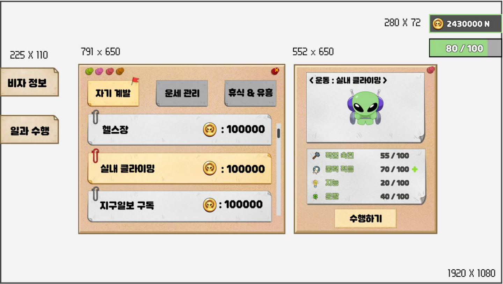
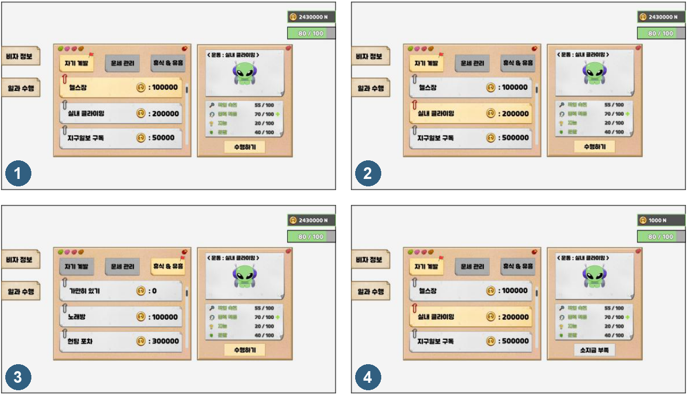
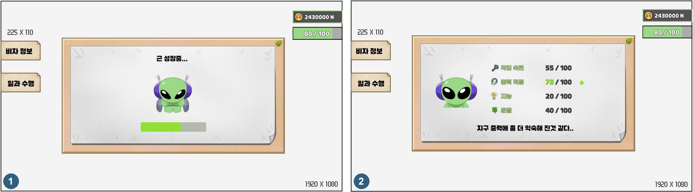

# 성장 시스템_일과 시스템

- 일과는 미니게임으로 번 골드를 쓰는 곳이자, 다음 미니게임에 영향을 주는 스탯을 키우는 성장 콘텐츠입니다.
- 플레이어가 하루 일과를 골라 골드를 쓰면 스탯이 오르거나 피로도가 회복됩니다.
- 골드의 소모처를 만들면서, 그 결과가 다시 미니게임 플레이로 이어지도록 설계했습니다.

## 진입과 화면 흐름

| 단계 | 화면 | 동작 |
|---|---|---|
| 1 | 메인 화면 | 왼쪽 메뉴의 `비자 정보` 버튼은 캐릭터 스테이터스 창을, `일과 수행` 버튼은 일과 선택창을 연다. 두 버튼은 같은 형태에 글자만 다르다. |
| 2 | 일과 선택창 | 탭과 일과 목록에서 일과를 고르고, 오른쪽 정보 패널에서 현재 스탯을 확인한 뒤 `수행하기`를 누른다. |
| 3 | 일과 진행창 | 일과별 진행 문구와 애니메이션을 보여 주고, 남은 재생 시간을 게이지로 표시한다. |
| 4 | 일과 결과창 | 완료 문구와 함께 스탯 변화를 보여 준다. |

골드와 피로도 표시는 화면 오른쪽 위에 항상 떠 있으며, 일과를 진행하는 동안에도 사라지지 않습니다.

## 일과 선택창 구성

| 요소 | 규칙 |
|---|---|
| 카테고리 탭 | `자기 계발`, `운세 관리`, `휴식 & 유흥` 3개. 선택한 탭은 밝은 색과 깃발로, 나머지는 회색으로 표시한다. |
| 일과 목록 | 탭에 속한 일과를 정렬 순서대로 나열한다. 한 줄에 일과 이름과 소모 골드를 표시하고, 선택한 줄은 노란색과 빨간 클립으로 구분한다. |
| 스크롤바 | 목록이 창보다 길면 오른쪽 스크롤바로 내린다. 트랙과 막대는 따로 만든다. |
| 썸네일 영역 | 선택한 일과의 썸네일 문구(예: `<운동 : 실내 클라이밍>`)와 애니메이션 썸네일을 표시한다. |
| 스탯 요약 | 작업 숙련, 중력 적응, 지능, 운빨의 현재 값을 `현재 / 100`으로 표시한다. 이 일과로 바뀌는 스탯 옆에는 `+`, `-`로 증감 방향만 표시한다. |
| 수행하기 버튼 | 누르면 일과 진행창으로 넘어간다. 소지금이 부족하면 비활성화되고 글자가 `소지금 부족`으로 바뀐다. |
| 골드, 피로도 | 오른쪽 위에 항상 표시한다. |

---

# 성장 시스템_일과 선택, 진행, 결과

## 선택 상태 규칙

| IDX | 상황 | 규칙 |
|---|---|---|
| 1 | 창을 처음 열 때 | `자기 계발` 탭의 첫 일과(헬스)가 기본으로 선택된다. |
| 2 | 다른 일과를 누를 때 | 선택 표시가 그 일과로 옮겨 가고, 오른쪽 썸네일과 스탯 요약이 함께 바뀐다. |
| 3 | 다른 탭으로 옮길 때 | 목록만 바뀐다. 새 일과를 누르기 전까지 오른쪽 패널은 직전에 고른 일과의 정보를 유지한다. |
| 4 | 소지금이 부족할 때 | 수행하기 버튼을 비활성화하고 글자를 `소지금 부족`으로 바꾼다. |

## 진행과 결과

| IDX | 화면 | 규칙 |
|---|---|---|
| 1 | 일과 진행창 | 수행하기를 누르면 일과별 진행 문구(예: `근 성장중...`)와 애니메이션을 5초 동안 재생하고, 남은 시간을 게이지로 보여 준다. 애니메이션이 중간에 끊기지 않도록 재생 시간은 몇 초 늘릴 수 있다. |
| 2 | 일과 결과창 | 재생이 끝나면 완료 문구와 함께 네 가지 스탯을 보여 준다. 오른 스탯은 녹색(`#11C49D`), 내린 스탯은 적색(`#E2606C`)으로 표시한다. |
| - | 공통 틀 | 진행창과 결과창은 같은 창 틀을 쓰고, 안쪽 이미지와 글자만 바뀐다. |

---

# 성장 시스템_일과 데이터와 피로도 회복

## 일과 목록

- 같은 탭 안에서는 정렬 순서대로 나열합니다.
- 효과 열은 실제 변화량이고, 선택창 표시 열은 수행 전에 보여 주는 증감 방향입니다.

| 카테고리 | 일과 | 정렬 | 소모 골드 | 효과 | 선택창 표시 |
|---|---|---|---|---|---|
| 자기 계발 | 헬스 | 1 | 100000 | 중력 적응 +1 | 중력 적응 + |
| 자기 계발 | 실내 클라이밍 | 2 | 200000 | 중력 적응 +2 | 중력 적응 ++ |
| 자기 계발 | 지구 일보 구독 | 3 | 50000 | 지능 +2 | 지능 + |
| 자기 계발 | 지구사 연구 | 4 | 100000 | 지능 +3 | 지능 ++ |
| 운세 관리 | 기도 | 1 | 0 | 운빨 -10 ~ +10 중 하나, 모두 같은 확률 | 운빨 ?? |
| 운세 관리 | 쓰레기 줍기 | 2 | 0 | 운빨 0 ~ +5 중 하나, 모두 같은 확률 | 운빨 + |
| 휴식 & 유흥 | 가만히 있기 | 1 | 0 | 지능 -2, 피로도 1 회복 | 지능 - |
| 휴식 & 유흥 | 노래방 | 2 | 150000 | 효과 없음 | 없음 |
| 휴식 & 유흥 | 헌팅포차 | 3 | 300000 | 효과 없음 | 없음 |
| 휴식 & 유흥 | 병원 입원 | 4 | 500000 | 피로도 1 회복 | 없음 |

## 일과별 문구

| 일과 | 썸네일 | 진행 중 | 완료 후 |
|---|---|---|---|
| 헬스 | <운동: 헬스> | 근성장중... | 근육이 조금 붙은 거 같다 |
| 실내 클라이밍 | <운동: 실내 클라이밍> | 팔다리가 짧아서 슬프다... | 지구 중력에 조금은 익숙해진 것 같다 |
| 지구 일보 구독 | <공부: 지구 일보 구독> | 역시 신문은 만화가 제일 재밌다... | 시사 상식이 늘은 것 같다. |
| 지구사 연구 | <공부: 지구사 연구> | 어디까지 했더라... | 조금은 똑똑해진 거 같다. |
| 기도 | <운세관리: 기도> | 네이오스 신에게 열심히 비는 중... | 네이오스 신이 기도를 들어 주었습니다. |
| 쓰레기 줍기 | <운세관리: 쓰레기 줍기> | 나는야 건실한 청년... | 선행은 행운을 가져다줍니다. |
| 가만히 있기 | <휴식: 가만히 있기> | 멍청해지는 것 같다... | 내일은 뭐라도 하자.. |
| 노래방 | <유흥: 노래방> | 비내리는 호남선~ 남행 열차에 | 노래 실력이 늘은 것 같은데.? |
| 헌팅포차 | <유흥: 헌팅포차> | 오늘은 성공...? | 역시나 오늘도 실패했다. |
| 병원 입원 | <휴식: 입원> | ... | 항상 건강이 최우선입니다. |

## 피로도 회복

- 피로도는 미니게임을 하기 위한 비용입니다.
- 최대 3개까지 보유하고 미니게임을 1회 하면 1개 줄며, 0이면 미니게임 진행 버튼이 비활성화됩니다.
- 일과로는 아래 두 가지 방법으로 회복합니다.

| 일과 | 규칙 |
|---|---|
| 가만히 있기 | 수행하면 피로도 1개를 회복한다. 인게임 시간 30분마다 한 번 수행할 수 있다. 처음 수행하기 전에는 타이머가 `00:00`이고, 수행한 뒤부터 타이머가 줄어든다. 타이머가 0초가 될 때까지 수행하기 버튼은 비활성화된다. |
| 병원 입원 | 골드를 써서 피로도 1개를 회복한다. 횟수 제한은 없다. |
