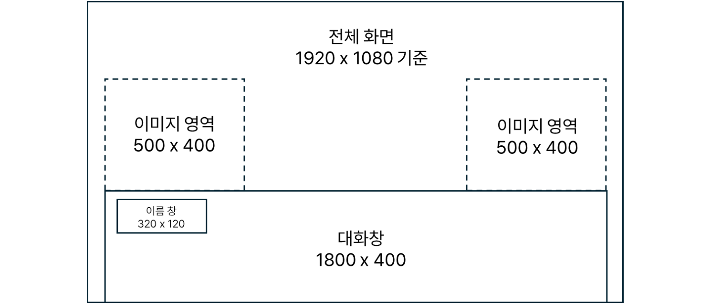
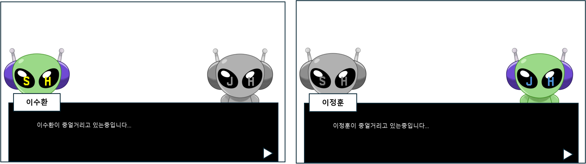

# 대화 시스템_화면 및 진행규칙

## 화면 구성

- 1920 × 1080 화면을 기준으로 좌우 이미지 영역(각 500 × 400), 대화창(1800 × 400), 이름 창(320 × 120)을 둔다.
- 모든 영역의 크기와 위치는 고정이다. 이미지 영역에 표시되는 캐릭터 이미지만 장면에 따라 바뀐다.
- 대화가 진행되는 동안 뒤의 화면은 흐리게 처리한다.
- 초기안에서는 이름 창이 대화창 위로 튀어나와 왼쪽 이미지를 가릴 수 있었다. 이를 막기 위해 이름 창을 대화창 안쪽 왼쪽 위로 옮겼다.

## 텍스트 출력과 다음 대사

| 단계 | 표시 | 입력과 전환 |
| --- | --- | --- |
| 출력 중 | 대사를 한 번에 띄우지 않고 초당 10글자씩 순서대로 출력한다. | 출력이 끝나야 다음 대사로 넘어갈 수 있다. |
| 출력 완료 | 대화창 오른쪽 아래에 화살표를 표시한다. | 화면을 터치하면 다음 대사 출력을 시작한다. |
| 마지막 대사 완료 | 화살표를 표시한다. | 화면을 터치하면 대화를 끝내고 대화창 UI를 닫는다. |

- 텍스트는 왼쪽 정렬이며, 줄 수와 관계없이 시작 위치가 같다.
- 한 줄이 30자를 넘으면 자동으로 줄을 바꾼다. 바이트가 아닌 글자 수로 세며, 공백, 특수기호, 영어, 숫자, 한글을 모두 1자로 센다.
- 한 대사는 최대 4줄(120자)까지 출력한다. 대사를 쓸 때부터 4줄을 넘지 않게 작성한다.

## 화자 이미지

- 말하지 않는 캐릭터의 이미지는 채도를 0으로 낮춰 현재 화자를 구분한다.
- 독백일 때는 이미지 한 장만 표시한다.

---

# 대화 시스템_대사 데이터 및 이벤트 연결

## 이벤트 데이터: 진행 순서

- 챕터마다 이벤트 시트(Event_C1~Event_C5)가 있으며, 이벤트를 차례로 실행해 대화와 미니게임을 불러온다.
- 대화와 미니게임이 같은 이벤트 목록에 있어, 챕터의 진행 순서를 시트 한 장에서 확인할 수 있다.

| 필드 | 자료형 | 내용 |
| --- | --- | --- |
| EventID | STRING | 이벤트 고유 ID. 시트마다 Start 행에서 시작한다. |
| EventType | STRING | Dialog, MiniGame, End. 진입용 Start 행은 Unknown을 쓴다. |
| Parameter | STRING | Dialog이면 대사 시트 키(S1_01 등), MiniGame이면 미니게임 종류(Unload) |
| NextEventID | List&lt;STRING&gt; | 다음에 실행할 이벤트 ID. End이면 해당 시트의 진행을 마친다. |
| DialogScene | STRING | 대화가 진행되는 장소. Office, UnloadWorkplace, DeliveryGarage, House, ManagerRoom 등 |

Event_C1은 다음 순서로 연결된다.

| EventID | EventType | Parameter | DialogScene | NextEventID |
| --- | --- | --- | --- | --- |
| C1_E1 | Dialog | S1_01 | Office | C1_E2 |
| C1_E2 | Dialog | S1_02 | UnloadWorkplace | C1_E3 |
| C1_E3 | Dialog | S1_03 | UnloadWorkplace | C1_E4 |
| C1_E4 | MiniGame | Unload | Unknown | C1_E5 |
| C1_E5 | Dialog | S1_04 | DeliveryGarage | C1_E6 |
| C1_E6 | Dialog | S1_05 | House | C1_E7 |
| C1_E7 | End | | Unknown | End |

## 대사 데이터: 한 행이 한 대사

- 대사 데이터는 Parameter와 같은 이름의 시트(S1_01 등)로 나뉜다.
- 각 행이 다음 행의 ID를 가리키며, Type이 End인 행에서 대화가 끝난다.

| 필드 | 내용 |
| --- | --- |
| DialogID, NextDialogID | 대사 ID와 다음 대사 ID. 마지막 대사의 다음 ID는 End다. |
| CharacterName, Script | 이름 창에 표시할 화자 이름과 대사. 대사 안의 줄바꿈을 그대로 쓴다. |
| Type | Dialog(대화), Monolog(독백), End(종료) |
| SpeakerType, SpeakerPosType | 표시할 화자 이미지(예: KIM_DEFAULT, HWANG_DEFAULT)와 위치(Left, Right, Center, Unknown) |

S1_01 시트의 일부 행이다.

| DialogID | CharacterName | Script | NextDialogID | Type | SpeakerType | SpeakerPosType |
| --- | --- | --- | --- | --- | --- | --- |
| S1_01_001 | 김이민 | 여기가 코스모 물류.... 내가 배정 받은 곳이다. | S1_01_002 | Monolog | KIM_DEFAULT | Left |
| S1_01_003 | 황반장 | 여~~~~ | S1_01_004 | Dialog | HWANG_DEFAULT | Right |
| S1_01_015 | 황반장 | 아이 참. 우리는 그냥 일한만큼 받아간다고 생각하면 돼. 쓸데없는 소리 하지말고 빨리 이동혀. 김씨 | End | Dialog | HWANG_DEFAULT | Right |
| End | End | End | End | End | UNKNOWN | Unknown |

---

# 대화 시스템_선택지 및 분기

## 선택지 대화의 진행 규칙

- 일반 대화는 화면 터치로 넘어가지만, 선택지가 있는 대화는 플레이어가 버튼을 골라야 다음으로 넘어간다.
- 대사 표시는 `DIALOG_TB`가, 선택 결과에 따른 이벤트 전환은 `DAILY_DATA`가 맡도록 나누었다.

| 구분 | 표시 | 진행 조건 |
|---|---|---|
| 일반 대화 | 대사와 화자 정보 | 대사 출력이 끝난 뒤 화면 터치 |
| 선택지 대화 | `Type`이 `choice`이면 선택지 버튼 표시 | 선택지 버튼을 누를 때까지 현재 대화를 유지 |
| 선택지 문구 | `ChoiceA`, `ChoiceB`, `ChoiceC`의 문자열 | 고른 버튼의 순서를 이벤트 전환에 전달 |

- 선택지 대화에서는 화면 터치로 선택을 건너뛸 수 없다.
- `choice`가 아닌 대사에는 선택지 버튼을 표시하지 않는다.

## 선택 결과와 다음 이벤트 연결

- 11일차 대화 `D11_03_02`의 마지막 대사 `(신중하게 생각하자…)`가 선택지 대화이다.
- 이 대화를 부르는 이벤트 `D11_E8`의 `EventType`은 `Choice`이며, `NextEvent` 목록 가운데 고른 버튼에 해당하는 이벤트로 이동한다.

| 선택 | 연결 데이터 | 전환 결과 |
|---|---|---|
| 선택 A | `NextEvent`의 첫 번째 항목 | `D11_E9A` → `D11_03_03A` 대화 |
| 선택 B | `NextEvent`의 두 번째 항목 | `D11_E9B` → `D11_03_03B` 대화 |
| 선택 C | `NextEvent`의 세 번째 항목 | `D11_E9C` → `D11_03_03C` 대화 |
| 분기 종료 | 각 분기 이벤트의 다음 값 `END` | 해당 진행을 마친다. |

## 데이터 구조의 구분

- 이 선택지 구조는 `DIALOG_TB`의 `ChoiceA/B/C`와 `DAILY_DATA`의 `NextEvent` 목록을 함께 쓰는 확장안이다.
- 스테이지 단위로 관리하는 데이터는 `EventData.NextEventID`로 이벤트를 연결하며, 이 대사 시트에는 선택지 열이 없다.
- 두 구조의 필드를 섞지 않고 용도에 따라 구분한다.
