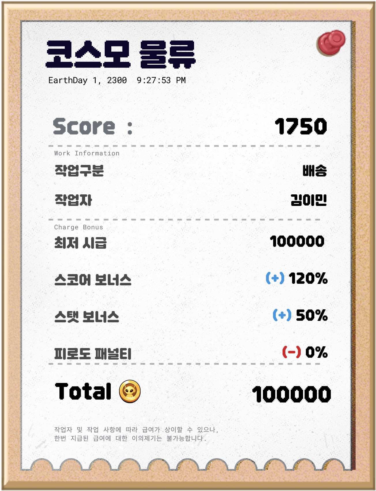

# 재화_골드 시스템

- 골드는 미니게임으로 벌고 일과와 스킬 성장에 쓰는 기본 재화이다.
- 미니게임의 점수와 스탯이 보상 크기를 정하고, 그 보상으로 키운 스탯과 스킬이 다시 다음 플레이를 돕도록 획득과 소모를 연결했다.

## 표시

| 항목 | 규칙 |
|---|---|
| 위치 | 피로도 표시와 함께 화면 오른쪽 위에 항상 띄운다. |
| 형식 | `xxxxxxxxx N` 형식으로 보유량을 표시한다. 최댓값은 999,999,999 N이다. |

## 획득처와 소모처

| 구분 | 내용 |
|---|---|
| 획득 | 미니게임 완료 보상, 특별 이벤트의 GoodEvent |
| 소모 | 일과 수행 비용(병원 입원 포함), 워크 모듈의 스킬 업그레이드 비용, 특별 이벤트의 BadEvent |

## 미니게임 완료 보상

| 항목 | 규칙 |
|---|---|
| 최저시급 | 기본 지급액. 초기 기획값은 100,000골드이며, 테스트 결과에 따라 조정한다. |
| 스코어 보너스 | 점수 100점당 10%. 100점 미만은 버린다. 예: 3750점 → 370%, 3710점 → 370% |
| 스탯 보너스 | 작업 숙련 스탯 10 단위 구간마다 10%(0~9는 없음, 100이면 100%). 화면에는 % 단위로 표시한다. |

결과 화면은 급여 명세서 형태로 점수, 최저시급, 보너스 내역을 한 줄씩 보여 주고, 지급액은 숫자가 올라가는 애니메이션으로 표시한다.

## 미니게임 완료 보상 UI 예시

- 점수는 해당 판의 최종 스코어이며, 작업 구분과 작업자는 수행한 미니게임과 캐릭터를 식별하는 정보이다.
- 최저 시급은 기본 지급액이다. 스코어 보너스와 스탯 보너스는 위 완료 보상 규칙에 따른 가산 내역을 표시한다.
- 피로도 페널티는 보상에서 차감되는 비율을 %로 표시한다.
- 최종 지급액은 미니게임에서 받는 골드를 명세서 하단에 크게 표시한다.

