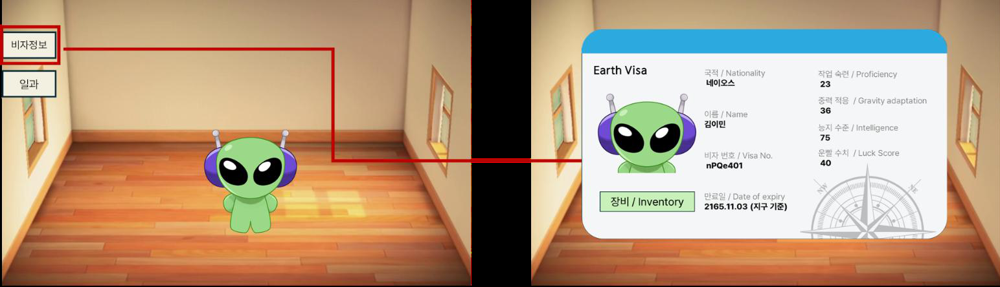

# 성장 시스템_캐릭터 스테이터스창

- 외계인 노동자의 지구 체류 서류를 모티프로, 캐릭터 정보를 비자 카드 형태로 구성했습니다.
- 세계관에 맞는 외형 안에서 현재 스탯과 스킬 관리 기능을 함께 확인하도록 설계했습니다.

## 진입과 닫기

메인 화면의 `비자정보` 버튼으로 열고, 카드 오른쪽 위의 닫기 버튼으로 닫습니다.

## 화면 구성

<svg xmlns="http://www.w3.org/2000/svg" viewBox="237 46 674 395" style="display:block;width:720px;max-width:100%;margin:16px auto 24px" role="img" aria-label="비자 화면의 캐릭터, 정보, 스탯, 워크 모듈, 장식 영역">
<image href="../../images/alien-specs/status-layout.png" width="926" height="455"/><g><circle cx="280" cy="136" r="15" fill="#315f80" stroke="white" stroke-width="2"/><text x="280" y="141" text-anchor="middle" fill="white" font-family="Arial" font-size="17" font-weight="bold">1</text></g><g><circle cx="498" cy="104" r="15" fill="#315f80" stroke="white" stroke-width="2"/><text x="498" y="109" text-anchor="middle" fill="white" font-family="Arial" font-size="17" font-weight="bold">2</text></g><g><circle cx="695" cy="124" r="15" fill="#315f80" stroke="white" stroke-width="2"/><text x="695" y="129" text-anchor="middle" fill="white" font-family="Arial" font-size="17" font-weight="bold">3</text></g><g><circle cx="281" cy="358" r="15" fill="#315f80" stroke="white" stroke-width="2"/><text x="281" y="363" text-anchor="middle" fill="white" font-family="Arial" font-size="17" font-weight="bold">4</text></g><g><circle cx="886" cy="355" r="15" fill="#315f80" stroke="white" stroke-width="2"/><text x="886" y="360" text-anchor="middle" fill="white" font-family="Arial" font-size="17" font-weight="bold">5</text></g><text x="386" y="379" text-anchor="middle" font-size="18" font-family="P" font-weight="700" fill="#383126">워크 모듈</text></svg>

| IDX | 요소 | 표시 및 동작 |
|---|---|---|
| 1 | 캐릭터 이미지 | 김이민의 얼굴을 표시한다. |
| 2 | 비자 정보 | 국적, 이름, 비자 번호, 만료일을 표시한다. 세계관을 전달하는 정보이며 성장 수치와 구분한다. |
| 3 | 성장 스탯 | 작업 숙련, 중력 적응, 지능, 운빨을 아이콘·이름·현재 값 / 100으로 표시한다. |
| 4 | 워크 모듈 | 버튼을 누르면 스킬의 현재 성능을 확인하고 업그레이드하는 창을 연다. |
| 5 | 비자 장식 | 바코드, 기계 판독 줄, 도장 등 꾸밈 요소는 글자 가독성을 위해 가장자리 쪽에 둔다. |

- 스탯 아이콘은 일과 선택·결과 화면에서도 같은 모양을 사용합니다.
- 화면이 바뀌어도 같은 능력치를 바로 알아볼 수 있도록 합니다.

---

# 성장 시스템_피로도와 미니게임 진입

- 피로도는 미니게임을 시작할 때 소모하는 플레이 자원입니다.
- 최대 3개를 보유하며, 소모 후에는 챕터 성과나 휴식 일과로 회복합니다.
- 화면 오른쪽 위에 남은 수량을 표시해 다음 플레이 가능 여부를 알 수 있도록 합니다.

## 소모와 회복

| 구분 | 조건 | 변화 |
|---|---|---|
| 소모 | 미니게임 1회 수행 | 1개 감소 |
| 회복 | 챕터에서 처음 별 1개 획득 | 최대치까지 전량 회복 |
| 회복 | 이미 클리어한 챕터에서 별 추가 획득 | 추가 별 1개당 1개 회복 |
| 회복 | 병원 입원 | 골드를 소모해 1개 회복. 횟수 제한 없음 |
| 회복 | 가만히 있기 | 1개 회복. 수행 후 인게임 시간 30분 대기 |

## 피로도 부족 시 스테이지 진입 제한

<svg xmlns="http://www.w3.org/2000/svg" viewBox="0 0 1203 605" style="display:block;width:100%;margin:12px 0" role="img" aria-label="피로도 0개일 때 회색 상자와 비활성 진행하기 버튼">
<image href="../../images/alien-specs/status-fatigue-zero.png" width="1203" height="605"/><rect x="1020" y="90" width="180" height="65" rx="8" fill="none" stroke="#315f80" stroke-width="4"/><rect x="544" y="540" width="126" height="48" rx="4" fill="none" stroke="#315f80" stroke-width="4"/><g><circle cx="1001" cy="120" r="15" fill="#315f80" stroke="white" stroke-width="2"/><text x="1001" y="125" text-anchor="middle" fill="white" font-family="Arial" font-size="17" font-weight="bold">1</text></g><g><circle cx="523" cy="563" r="15" fill="#315f80" stroke="white" stroke-width="2"/><text x="523" y="568" text-anchor="middle" fill="white" font-family="Arial" font-size="17" font-weight="bold">2</text></g></svg>

| IDX | 화면에서 확인할 항목 | 표시 및 동작 |
|---|---|---|
| 1 | 남은 피로도 | 보유한 칸은 갈색, 소모한 칸은 회색이다. 0개일 때는 세 칸 모두 회색으로 표시한다. |
| 2 | 진행하기 버튼 | 피로도가 0개이면 비활성화한다. 피로도를 회복하기 전에는 미니게임을 시작할 수 없다. |

---

# 성장 시스템_휴식과 피로도 회복

- 휴식 일과를 고를 때 회복될 피로도를 먼저 보여 줍니다.
- 플레이어가 휴식을 수행하기 전에 회복 효과를 확인하고, 무료 회복을 다시 이용할 수 있는 시점도 알 수 있도록 합니다.

## 회복 일과 미리보기와 재사용 대기 시간

<svg xmlns="http://www.w3.org/2000/svg" viewBox="0 0 1274 647" style="display:block;width:100%;margin:12px 0 24px" role="img" aria-label="회복 후 피로도 미리보기와 가만히 있기 재사용 대기 시간">
<image href="../../images/alien-specs/status-rest-timer.png" width="1274" height="647"/><rect x="896" y="168" width="127" height="46" rx="8" fill="none" stroke="#315f80" stroke-width="4"/><rect x="419" y="529" width="133" height="45" rx="4" fill="none" stroke="#315f80" stroke-width="4"/><rect x="762" y="564" width="190" height="61" rx="4" fill="none" stroke="#315f80" stroke-width="4"/><g><circle cx="1045" cy="191" r="15" fill="#315f80" stroke="white" stroke-width="2"/><text x="1045" y="196" text-anchor="middle" fill="white" font-family="Arial" font-size="17" font-weight="bold">1</text></g><g><circle cx="574" cy="551" r="15" fill="#315f80" stroke="white" stroke-width="2"/><text x="574" y="556" text-anchor="middle" fill="white" font-family="Arial" font-size="17" font-weight="bold">2</text></g><g><circle cx="972" cy="596" r="15" fill="#315f80" stroke="white" stroke-width="2"/><text x="972" y="601" text-anchor="middle" fill="white" font-family="Arial" font-size="17" font-weight="bold">3</text></g></svg>

| IDX | 화면에서 확인할 항목 | 표시 및 동작 |
|---|---|---|
| 1 | 회복 미리보기 | 선택한 일과 정보 안에 회복 후의 피로도를 표시한다. 예시는 0개에서 1개로 회복되는 상태다. 오른쪽 위의 현재 피로도와 구분한다. |
| 2 | 재사용 대기 시간 | 가만히 있기를 처음 수행하기 전에는 00:00이며 즉시 이용할 수 있다. 수행한 뒤 인게임 시간 30분을 MM:SS로 표시하고 줄여 나간다. |
| 3 | 수행하기 버튼 | 남은 시간이 0보다 크면 비활성화하고, 0이 되면 다시 수행할 수 있다. |

## 회복 수단 선택

| 일과 | 비용 및 조건 | 효과 |
|---|---|---|
| 가만히 있기 | 골드 소모 없음. 재사용 대기 시간 적용 | 피로도 1개 회복, 지능 2 감소 |
| 병원 입원 | 골드 소모. 수행 횟수 제한 없음 | 피로도 1개 회복 |

무료 회복의 대기 시간과 골드 소비를 비교해 다음 미니게임을 준비하도록 구성했습니다.

---

# 성장 시스템_성장 스탯

- 네 가지 스탯의 범위는 0~100입니다.
- 작업 숙련은 미니게임 성과로, 중력 적응은 챕터 클리어와 자기계발 일과로 올립니다.
- 지능과 운빨은 일과를 통해 변화합니다.

## 작업 숙련

- 미니게임 종료 시 받는 골드 보너스를 정합니다.
- 별과 챕터 클리어로만 오르며 줄지 않습니다.

- 누적 획득 별 1개당 5 증가한다. 5개 챕터 × 별 3개를 모두 모으면 75다.
- 클리어한 챕터(처음 별 1개 획득) 1개당 5 증가한다. 5개 챕터를 모두 클리어하면 25다.
- 두 조건을 모두 채우면 최댓값 100에 도달한다.

| 작업 숙련 | 0~9 | 10~19 | 20~29 | 30~39 | … | 80~89 | 90~99 | 100 |
|---|---|---|---|---|---|---|---|---|
| 골드 보너스 | 없음 | 10% | 20% | 30% | … | 80% | 90% | 100% |

## 중력 적응

지구 중력에 적응한 정도로, 미니게임에서 캐릭터 이동속도를 높입니다.

- 클리어한 챕터 1개당 5 증가하며, `자기계발` 일과를 수행하면 일과에 정해진 수치만큼 증가한다.
- 이동속도는 `중력 적응 × 0.25`%만큼 증가한다. 예를 들어 중력 적응이 50이면 12.5% 빨라진다.
- 이동속도 증가 스킬 `빤스런`과는 곱으로 적용한다. 중력 적응 50에서 빤스런 Lv.1(이동속도 +10%)을 쓰면 1.125 × 1.1 = 1.2375로 23.75% 빨라진다.

## 지능

- 일과로만 바뀌며, 일과에 따라 오르거나 내린다.
- 스토리 분기의 해금 조건과 스킬 레벨업 조건으로 쓴다.
- 지능이 0~49이면 11일차 분기에서 밀수책 선택지를 고를 수 없다. `저는 비즈니스 이야기를 하고 싶을 뿐입니다.`를 고르면 `너 같은 멍청한 놈이랑은 할 얘기가 없다.` 대사가 나온 뒤 선택지 화면으로 돌아간다.

## 운빨

- 미니게임이 끝난 뒤 등장하는 특별 이벤트에서 좋은 이벤트가 나올 확률을 높입니다.
- 특별 이벤트는 GoodEvent 2종과 BadEvent 2종이며, 기본 확률은 각 25%입니다.

| 운빨 | 0~24 | 25~49 | 50~74 | 75~100 |
|---|---|---|---|---|
| GoodEvent 1종당 확률 | 25% | 27% | 30% | 40% |

- 운빨 30: GoodEvent 1, 2 각 27%, BadEvent 1, 2 각 23%
- 운빨 68: GoodEvent 1, 2 각 30%, BadEvent 1, 2 각 20%
