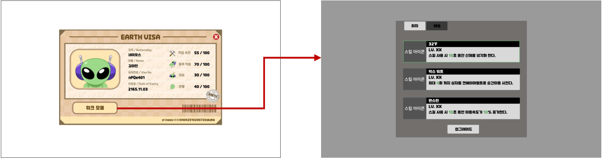
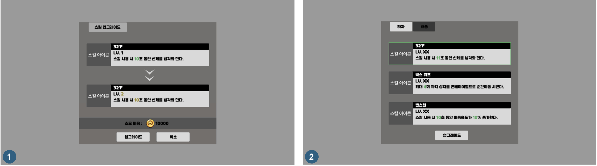
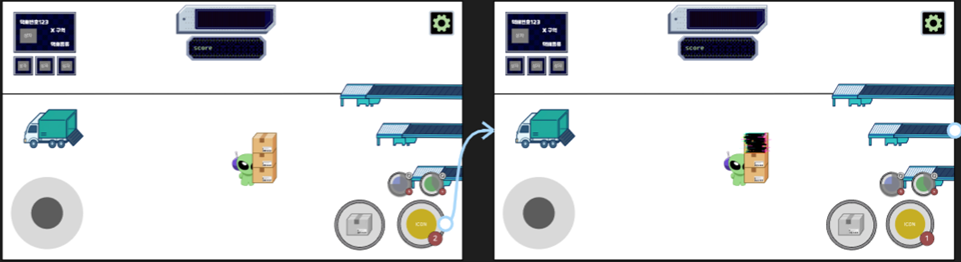
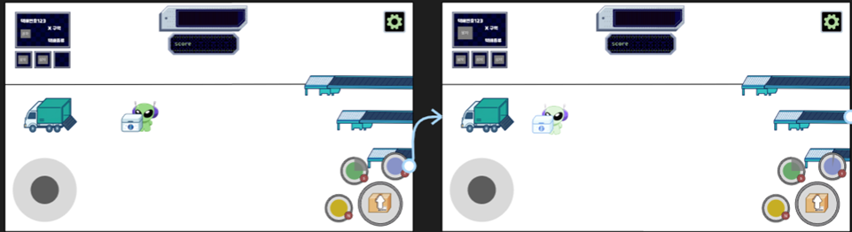

# 성장 시스템_워크 모듈

- 워크 모듈은 미니게임에서 쓰는 스킬의 현재 성능을 확인하고, 골드를 써서 스킬 레벨을 올리는 스킬 관리창입니다.
- 업그레이드 전에 달라지는 수치와 비용을 먼저 보여 주어, 플레이어가 결과를 확인한 뒤 결정하도록 했습니다.
- 레벨에 따라 바뀌는 수치는 글자 색을 다르게 적용해 바로 찾을 수 있게 했습니다.

## 진입

- 캐릭터 스테이터스 창(`EARTH VISA`)의 `워크 모듈` 버튼을 누르면 워크 모듈 창이 열립니다.
- 이 버튼은 이전 장비(Inventory) 버튼 자리에 들어갑니다.

## 화면 구성

| 요소 | 규칙 |
|---|---|
| 탭 | `하차`, `배송` 2개. 선택한 탭은 밝은 색, 나머지는 어두운 색으로 표시한다. |
| 스킬 칸 | 스킬마다 아이콘, 이름, 현재 레벨(`LV.`), 효과 설명을 한 칸에 표시한다. |
| 변하는 수치 | 효과 설명 중 레벨에 따라 바뀌는 수치(시간, 횟수, 비율)만 다른 글자 색으로 표시한다. |
| 선택 표시 | 현재 고른 스킬은 다른 색 윤곽선으로 구분한다. |
| 업그레이드 버튼 | 고른 스킬의 업그레이드 확인 화면을 연다. |

`하차` 탭에는 32℉, 박스 워프, 빤스런 3종을 배치합니다.

## 스킬별 역할

| 스킬 | 플레이에서의 역할 |
|---|---|
| 박스 워프 | 들고 있는 상자를 해당 구역의 컨베이어 벨트로 순간이동시켜 운반 동선을 줄인다. |
| 32℉ | 냉장 보관 상자의 냉각 과정을 생략한다. |
| 빤스런 | 일정 시간 이동속도를 높여 상자를 옮기는 시간을 줄인다. |

---

# 성장 시스템_스킬 업그레이드

## 업그레이드 흐름

| IDX | 화면 | 규칙 |
|---|---|---|
| 1 | 업그레이드 확인 | 고른 스킬의 현재 레벨 칸과 다음 레벨 칸을 위아래로 놓고, 바뀌는 레벨과 수치를 강조한다. 아래에 소모 비용과 `업그레이드`, `취소` 버튼을 둔다. |
| - | 골드 부족 | 소지금이 소모 비용보다 적으면 비용의 골드 글자를 붉은색으로 표시하고 `업그레이드` 버튼을 비활성화한다. |
| 2 | 업그레이드 완료 | 골드를 소모하고 고른 스킬의 레벨을 1 올린 뒤 워크 모듈 창으로 돌아간다. 돌아간 창에는 바뀐 수치가 바로 반영된다. |

## 레벨 구간별 수치

스킬 레벨에 따른 지속 시간, 사용 횟수와 이동속도 증가량입니다.

| 스킬 | Lv.1 | Lv.2 | Lv.3 | Lv.4 | Lv.5 |
|---|---|---|---|---|---|
| 32℉ (지속 시간) | 10초 | 11초 | 12초 | 13초 | 15초 |
| 박스 워프 (사용 횟수) | 1회 | 2회 | 3회 | 4회 | 5회 |
| 빤스런 (지속 시간 / 이동속도 증가) | 10초 / 10% | 12초 / 10% | 12초 / 15% | 13초 / 15% | 15초 / 20% |

## 레벨 구간별 업그레이드 비용

- 현재 레벨에서 다음 레벨로 올릴 때의 비용입니다.
- Lv.5가 최대 레벨이며, 비용은 초기값으로 이후 조정할 수 있습니다.
- 스킬마다 업그레이드 비용을 다르게 설정했습니다.

| 스킬 | Lv.1 → 2 | Lv.2 → 3 | Lv.3 → 4 | Lv.4 → 5 | Lv.5 |
|---|---|---|---|---|---|
| 32℉ | 10000 | 30000 | 40000 | 110000 | - |
| 박스 워프 | 10000 | 15000 | 25000 | 60000 | - |
| 빤스런 | 5000 | 10000 | 15000 | 30000 | - |

---

# 스킬 시스템_스킬 동작 규칙

아래 규칙은 상자 구역과 냉장 보관 상자가 추가된 하차 미니게임 프로토타입을 기준으로 합니다.

## 박스 워프

| 항목 | 규칙 |
|---|---|
| 방식 | 횟수 기준 스킬. 사용할 때마다 남은 횟수가 1 줄고, 모두 쓰면 비활성화된다. 최대 횟수는 레벨 구간별 수치를 따른다. |
| 효과 | 들고 있는 상자 더미의 맨 위 상자를 해당 구역의 컨베이어 벨트로 순간이동시킨다. |
| 연출 | 사용하면 맨 위 상자에 글리치 이펙트를 표시하고, 500ms 뒤 컨베이어 벨트 위로 위치를 옮기며 글리치 이펙트를 한 번 더 표시한다. |
| 예외 | 들고 있는 상자가 없을 때 사용하면 아무 일도 일어나지 않고 횟수도 줄지 않는다. |
| 소진 | 횟수를 모두 쓰면 아이콘의 횟수 표시가 0이 되고, 아이콘을 회색으로 어둡게 처리해 비활성 상태임을 보여 준다. |

## 32℉

- 냉장 보관 상자는 트럭에서 나온 뒤 10초 안에 급냉 구역에 넣어 냉각해야 합니다.
- 늦으면 손상되어 올바른 구역에 옮겨도 감점됩니다.
- 급냉 구역에는 상자를 1개만 놓을 수 있습니다. 32℉는 이 냉각 과정을 건너뛰게 하는 스킬입니다.

| 항목 | 규칙 |
|---|---|
| 방식 | 시간 기준 스킬. 사용하면 활성화되고, 활성 중에는 지속 시간이 줄어든다. 한 번 쓰면 취소할 수 없고, 지속 시간을 모두 쓰면 비활성화된다. 최대 지속 시간은 레벨 구간별 수치를 따른다. |
| 효과 | 활성 중에 집는 모든 냉장 보관 상자가 바로 냉각 완료 상태가 된다. 일반 상자와 파손주의 상자에는 영향이 없다. |
| 연출 | 활성 중에는 캐릭터 외형이 바뀐다. 냉장 보관 상자를 집으면 300ms 뒤 상자 외형이 냉각 완료 상태로 바뀐다. |
| 리게인 | 비활성 상태에서 냉각 완료된 냉장 보관 상자를 올바른 구역에 놓으면 지속 시간을 2초 얻는다. 10초가 모이면 다시 활성화할 수 있다. 레벨이 올라 최대 지속 시간이 늘어도 리게인으로 모을 수 있는 시간은 10초까지다. |
