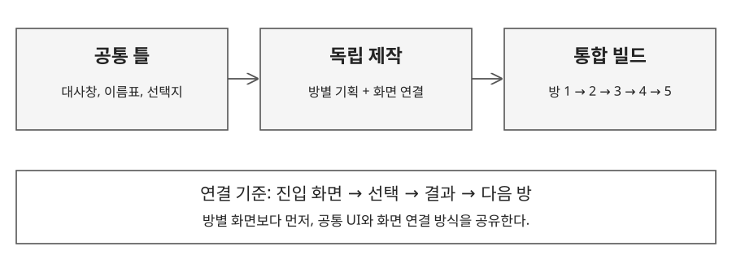

# 2.1 제작 구조와 공통 화면

## 제작 조건

| 항목 | 기준 |
|---|---|
| 제작 인원과 기간 | 기획자 5인, 2026.04.20~04.24 제작, 04.25 제출 |
| 구현 환경 | Figma 프로토타입, PC 화면, 마우스 조작 |
| 화면 규격 | 1920 × 1080 |
| 제작 범위 | 방 5개, 엔딩 3종 |
| 담당 범위 | 개발 및 빌드, 프롤로그와 에필로그, 2번째 방, 연출과 플러그인 적용 |

## 공통 조작

| 요소 | 입력 | 화면 반응 |
|---|---|---|
| 대사창과 이름표 | 화면 클릭 | 다음 대사 또는 장면으로 진행 |
| 선택지 | 해당 선택지 클릭 | 선택 결과에 해당하는 프레임으로 이동 |
| 조사 오브젝트 | 클릭 영역 선택 | 설명, 규칙 문서 또는 힌트 카드 표시 |
| 입력 장치 | 버튼 또는 키패드 선택 | 연결된 입력 상태와 결과 화면 표시 |

## 분업 원칙

- 각 담당자가 방 하나의 기획과 구현을 함께 맡는다.
- 공통 UI와 프로토타입 연결 방식을 먼저 공유한다.
- 방별 진입 화면과 종료 화면을 지정한 뒤 전체 흐름에 연결한다.
- 방마다 다른 테마를 허용하고, 공통 UI와 조작 방식은 같은 틀을 사용한다.

---

# 2.2 제작 범위 조정과 빌드 연결

## 변경 결정

| 상황 | 팀 결정 | 유지할 경험 |
|---|---|---|
| 팀원 6인에서 5인으로 변경 | 방 6개에서 5개로 조정 | 1인 1방 분업 구조 |
| 도입부 역할 정리 | 방 1을 스토리와 조작 학습 중심으로 구성 | 규칙을 익힌 뒤 방 2의 선택에 진입 |
| 시나리오 작성 지연 | 완성된 맵에 맞춰 대사와 지문 작성 | 제작된 공간을 활용한 플레이 흐름 |
| 마감 일정 부족 | 작업 일지 기준 엔딩 4종에서 3종으로 축소 | 앞선 선택에 따라 달라지는 결말 |
| 사운드 연출 제약 | 효과음 유지, BGM 별도 재생 | 장면 연결을 우선해 플레이 가능한 빌드 확보 |

## 통합 순서

1. 공통 UI와 화면 전환 방식을 적용한다.
2. 방 2~5의 진입과 종료를 연결한다.
3. 프롤로그를 연결하고 조작 설명과 세계관 규칙을 전달한다.
4. 선택 결과에 맞춰 엔딩 3종을 연결한다.
5. PC 화면을 기준으로 전체 경로와 연출을 점검한다.

## 다음 제작에서 적용할 기준

| 문제 | 보완 기준 |
|---|---|
| 방마다 분위기와 완성도 차이 | 제작 전 대사 톤, 힌트 강도, 화면 전환 기준 공유 |
| 다른 방의 진행 상황 파악 지연 | 담당자, 작업 상태, 검토 요청을 같은 목록에서 관리 |
| 사운드와 분기 제약을 제작 중 확인 | 착수 전에 핵심 기능을 작은 프로토타입으로 확인 |
| 수정 요청 전달이 분산됨 | 프레임 코멘트와 담당자 지정으로 변경 이력 유지 |

다음 제작에서는 공통 화면과 핵심 기능을 먼저 확인한 뒤 방별 병렬 제작에 들어간다.
