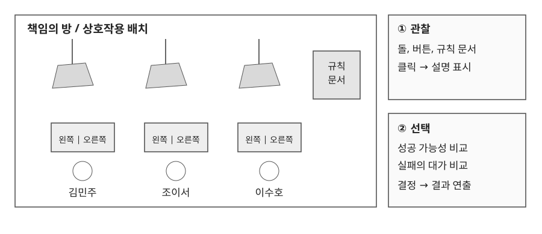
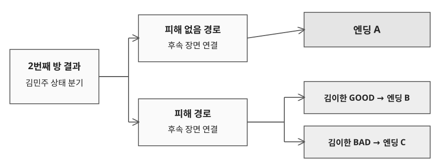

# 1.1 책임의 방, 선택 규칙

## 기획 의도

- 성공 가능성이 높은 선택과 타인에게 피해를 주지 않는 선택을 충돌시킨다.
- 버튼을 누르기 전에 성공 조건과 실패의 대가를 모두 전달한다.
- 선택 직후 돌이 떨어지는 결과를 보여 주어, 규칙이 실제로 적용되는 공간임을 체감하게 한다.

## 선택지 구성

| 구분 | 오른쪽 버튼 | 왼쪽 버튼 |
|---|---|---|
| 초기 열쇠 구성 | 3개 중 2개 | 3개 중 1개 |
| 실패 시 피해 대상 | 오른쪽 사람 | 선택한 본인 |
| 플레이어가 비교할 정보 | 높은 성공 가능성, 타인의 피해 | 낮은 성공 가능성, 자신의 피해 |

## 규칙 전달 순서

| 단계 | 화면과 대사 | 전달할 정보 |
|---|---|---|
| 탐색 | 돌, 버튼, 벽의 규칙 문서 확인 | 상호작용 대상과 위험 요소 |
| 해석 | 세 인물이 문서를 읽고 대화 | 열쇠 구성, 실패 시 피해 대상 |
| 선행 선택 | 김민주가 오른쪽 버튼 선택 | 확률을 우선하는 인물의 판단 |
| 선행 결과 | 돌 낙하, 성공과 실패에 따른 대화 | 규칙이 실제로 적용됨을 확인 |
| 플레이어 선택 | 오른쪽과 왼쪽 중 선택 | 책임을 감수할 대상 결정 |
| 결과 | 낙하 연출, 반응 대사, 문 개방 | 선택의 결과와 다음 방 진입 |

후속 확률은 남은 선택지에 따라 달라질 수 있으므로 초기 구성과 구분해 표시한다.

---

# 1.2 책임의 방, 상태 전달과 결과 연출

## 장면 연결

| 전달 정보 | 후속 장면의 처리 |
|---|---|
| 김민주의 피해 여부 | 5번째 방과 엔딩으로 상태를 전달한다. |
| 김이한 GOOD / BAD | 피해 경로에서 엔딩 B와 C를 구분한다. |
| 선택 직후의 결과 | 낙하 연출과 인물 반응을 먼저 보여 준 뒤 대화를 진행한다. |

## Figma 연결 방식

- 변수 대신 상태별 후속 장면을 따로 만들어 연결한다.
- 같은 배경이라도 대사와 인물 상태가 다르면 별도의 프레임을 사용한다.
- 분기 후 공통 장면에 합류할 때에는 이후에 필요한 상태가 누락되지 않도록 연결을 유지한다.
- 방 2의 선택 결과, 방 5의 인물 반응, 엔딩 도착 지점을 하나의 경로로 점검한다.

## 연결 검토 기준

| 확인할 상황 | 기대 동작 |
|---|---|
| 피해 없음 경로 진입 | 후속 대사와 엔딩 A가 2번째 방 결과와 일치한다. |
| 피해 경로, 김이한 GOOD | 엔딩 B에 도착한다. |
| 피해 경로, 김이한 BAD | 엔딩 C에 도착한다. |
| 빠른 연속 클릭 | 결과 장면을 건너뛰거나 다른 분기로 이동하지 않는다. |
| 규칙 문서 닫기 | 탐색 중이던 방 화면으로 돌아간다. |

위 항목은 검토 기준이다. 실제 빌드는 씬 전환에 지연이 있어 연속 클릭을 피하도록 안내했다.
