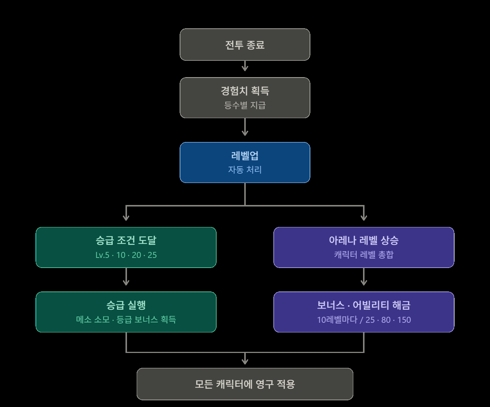
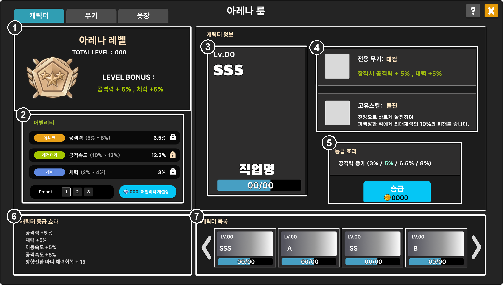

# 3.1 캐릭터 성장 구조

## ● 한 캐릭터의 성장이 모든 캐릭터에 적용

- 플레이어는 8종 캐릭터를 모두 보유한 상태로 시작하며, 캐릭터 뽑기는 두지 않는다.
- 전투 모드에서 캐릭터가 무작위 후보로 제시되므로, 특정 캐릭터를 키운 보상이 다른 캐릭터를 쓸 때도 같게 작동해야 한다.
- 경험치는 사용한 캐릭터에 쌓이고, 승급 보너스와 아레나 레벨 보너스는 모든 캐릭터에 영구 적용한다.

| 구분 | 획득 방식 | 보상 | 적용 범위 |
| --- | --- | --- | --- |
| 캐릭터 레벨 | 해당 캐릭터로 플레이해 경험치 획득 | 등급 승급 자격 | 해당 캐릭터 |
| 캐릭터 등급 | 승급 레벨 도달 후 메소를 소모해 승급 | 보너스 능력치 | 모든 캐릭터 |
| 아레나 레벨 | 캐릭터 레벨 총합으로 자동 산출 | 능력치 보너스, 어빌리티 슬롯 해금 | 모든 캐릭터 |

*원본 기획서 수록 성장 흐름도*

## ● 레벨과 경험치

- 레벨은 1~25다. 매치 종료 시 등수에 따라 1등 100, 2등 70, 3등 50, 4등 0의 경험치를 받는다.
- 요구 경험치를 채우면 연출이나 조작 없이 자동으로 레벨업하고, 초과분은 다음 레벨로 넘긴다. 만렙에서는 획득을 멈추고 MAX로 표시한다.
- 승급하지 않아도 경험치와 레벨은 계속 오른다. 만렙까지 총 5,000이며 한 캐릭터 기준 약 100판으로 설계했다(한 판 평균 50.4).

| 레벨 | 요구 | 누적 | 레벨 | 요구 | 누적 | 레벨 | 요구 | 누적 |
| --- | --- | --- | --- | --- | --- | --- | --- | --- |
| 1 → 2 | 50 | 50 | 9 → 10 | 130 | **800, S** | 17 → 18 | 255 | 2,420 |
| 2 → 3 | 60 | 110 | 10 → 11 | 150 | 950 | 18 → 19 | 270 | 2,690 |
| 3 → 4 | 70 | 180 | 11 → 12 | 165 | 1,115 | 19 → 20 | 310 | **3,000, SS** |
| 4 → 5 | 70 | **250, A** | 12 → 13 | 180 | 1,295 | 20 → 21 | 340 | 3,340 |
| 5 → 6 | 90 | 340 | 13 → 14 | 195 | 1,490 | 21 → 22 | 370 | 3,710 |
| 6 → 7 | 100 | 440 | 14 → 15 | 210 | 1,700 | 22 → 23 | 400 | 4,110 |
| 7 → 8 | 110 | 550 | 15 → 16 | 225 | 1,925 | 23 → 24 | 430 | 4,540 |
| 8 → 9 | 120 | 670 | 16 → 17 | 240 | 2,165 | 24 → 25 | 460 | **5,000, SSS** |

*굵은 값은 해당 등급의 승급이 가능해지는 지점이다.*

## ● 등급과 승급

| 등급 | B | A | S | SS | SSS |
| --- | --- | --- | --- | --- | --- |
| 도달 레벨 | 1 | 5 | 10 | 20 | 25 |

등급은 5종, 승급은 4회다. B는 기본 등급이다. 레벨 도달만으로는 오르지 않고, 승급 버튼을 눌러 메소를 소모해야 반영되며 되돌릴 수 없다.

---

# 3.2 아레나룸 캐릭터 화면

*원본 기획서 수록 UI 시안에 번호를 표시. 00, 0000은 시안의 자리표시 값이다.*

| IDX | 구분 | 표시 내용과 동작 |
| --- | --- | --- |
| 1 | 아레나 레벨 | 캐릭터 레벨 총합과 현재 레벨 보너스(공격력, 체력) |
| 2 | 어빌리티 | 슬롯 3줄의 등급, 능력치, 수치 범위와 잠금. 프리셋 1~3과 어빌리티 재설정 버튼 |
| 3 | 캐릭터 정보 | 선택한 캐릭터의 레벨, 등급, 직업명, 경험치 게이지 |
| 4 | 전용 무기, 고유 스킬 | 전용 무기 장착 시 공격력 +5%, 체력 +5%와 고유 스킬 설명 |
| 5 | 등급 효과, 승급 | 등급별 보너스 수치와 승급 버튼, 소모 메소 |
| 6 | 캐릭터 등급 효과 | 모든 캐릭터에 적용 중인 등급 보너스 합계 |
| 7 | 캐릭터 목록 | 8종의 레벨, 등급, 경험치와 좌우 화살표 |

## ● 승급 버튼 상태

| 상태 | 조건, UI |
| --- | --- |
| 대기 | 승급 레벨 미달, 비활성 |
| 승급 가능 | 레벨 도달, 메소 충족. 활성 |
| 재화 부족 | 레벨 도달, 메소 부족. 활성, 소모 메소 #FF3636 |
| 최고 등급 | SSS 달성. 비활성, 문구를 Max로 교체 |

## ● 아레나 레벨과 어빌리티

- 모든 캐릭터 레벨의 합, 최대 200. 레벨업 시 즉시 갱신한다.
- 10레벨마다 공격력, 체력 +1%(나머지 버림), 200에서 20%.
- 어빌리티는 계정 단위 능력치다. 슬롯 3개, 프리셋 3개이며 슬롯은 아레나 레벨 25, 80, 150에서 열린다. 능력치는 재설정(무작위 추첨)으로 얻는다.

## ● 캐릭터별 등급 보너스

| 캐릭터 | 능력치 | A | S | SS | SSS |
| --- | --- | --- | --- | --- | --- |
| 히어로 | 공격력, 체력 증가 | 1.5% | 2.5% | 4.5% | 6% |
| 팔라딘 | 체력 증가 | 3% | 5% | 9% | 12% |
| 나이트로드 | 공격력 증가 | 3% | 5% | 9% | 12% |
| 섀도어 | 공격속도 증가 | 3% | 5% | 9% | 12% |
| 캡틴 | 치명타 확률 증가 | 3% | 5% | 9% | 12% |
| 바이퍼 | 이동속도, 공격속도 증가 | 1.5% | 2.5% | 4.5% | 6% |
| 비숍 | 방향전환 시 체력 회복 | 6 | 10 | 18 | 24 |
| 보우마스터 | 공격속도 증가 | 3% | 5% | 9% | 12% |

*히어로와 바이퍼는 두 능력치를 절반씩 받는다. 비숍은 고정 회복량이며, 스킬과 벽 충돌로 방향이 바뀌는 경우를 모두 포함한다. 원문의 SSS 누적 표는 보우마스터 12%를 이동속도에 합산해 위 표와 다르므로 확인이 필요하다.*
