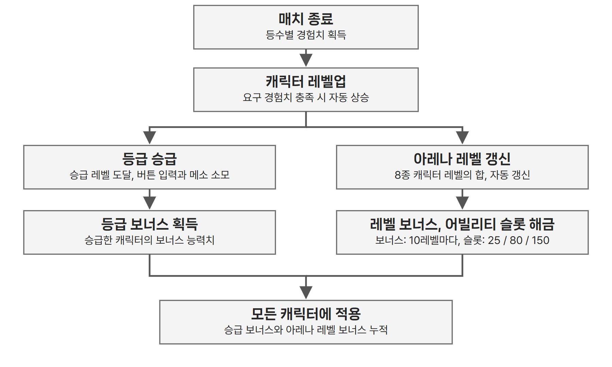
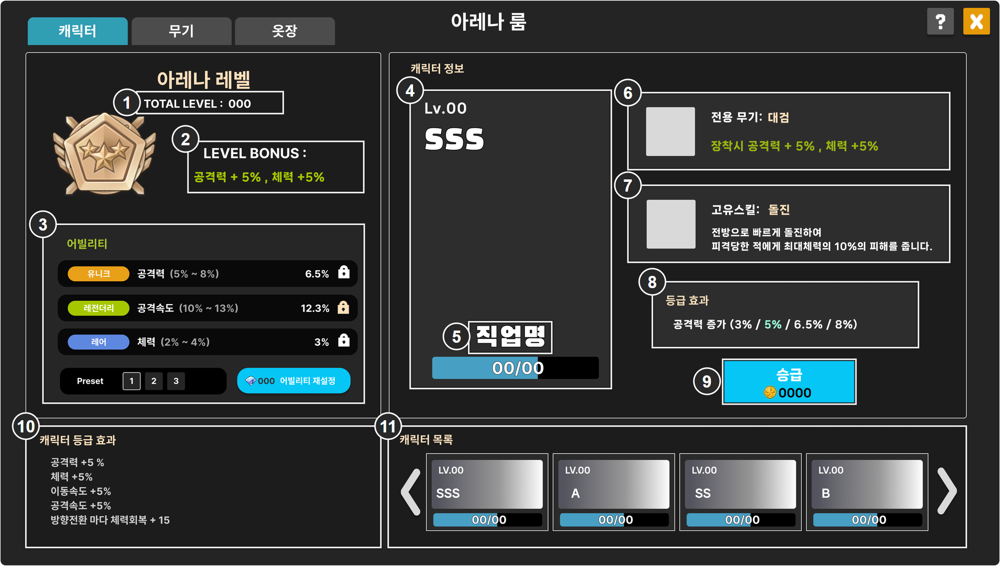

# 캐릭터 성장 구조

## ● 한 캐릭터의 성장이 모든 캐릭터에 적용

- 플레이어는 8종 캐릭터를 모두 보유한 상태로 시작한다.
- 전투 모드에서 캐릭터가 무작위 후보로 제시되므로, 특정 캐릭터를 키운 보상이 다른 캐릭터를 선택한 매치에서도 적용되도록 설계했다.
- 경험치는 사용한 캐릭터에 쌓이고, 승급 보너스와 아레나 레벨 보너스는 모든 캐릭터에 영구 적용한다.

| 구분 | 획득 방식 | 보상 | 적용 범위 |
| --- | --- | --- | --- |
| 캐릭터 레벨 | 해당 캐릭터로 플레이해 경험치 획득 | 등급 승급 자격 | 해당 캐릭터 |
| 캐릭터 등급 | 승급 레벨 도달 후 메소를 소모해 승급 | 보너스 능력치 | 모든 캐릭터 |
| 아레나 레벨 | 캐릭터 레벨 총합으로 자동 산출 | 능력치 보너스, 어빌리티 슬롯 해금 | 모든 캐릭터 |

## ● 레벨과 경험치

- 레벨은 1~25다. 매치 종료 시 등수에 따라 1등 100, 2등 70, 3등 50, 4등 0의 경험치를 받는다.
- 요구 경험치를 채우면 연출이나 조작 없이 자동으로 레벨업하고, 초과분은 다음 레벨로 넘긴다. 만렙에서는 획득을 멈추고 MAX로 표시한다.
- 승급하지 않아도 경험치와 레벨은 계속 오른다. 만렙까지 총 5,000이며 한 캐릭터 기준 약 100판으로 설계했다(한 판 평균 50.4).

<table><colgroup><col style="width:32%"><col style="width:25%"><col style="width:43%"></colgroup><thead><tr><th>레벨</th><th>요구</th><th>누적</th></tr></thead><tbody><tr><td>1 → 2</td><td>50</td><td>50</td></tr><tr><td>2 → 3</td><td>60</td><td>110</td></tr><tr><td>3 → 4</td><td>70</td><td>180</td></tr><tr><td>4 → 5</td><td>70</td><td><strong>250, A</strong></td></tr><tr><td>5 → 6</td><td>90</td><td>340</td></tr><tr><td>6 → 7</td><td>100</td><td>440</td></tr><tr><td>7 → 8</td><td>110</td><td>550</td></tr><tr><td>8 → 9</td><td>120</td><td>670</td></tr></tbody></table><table><colgroup><col style="width:32%"><col style="width:25%"><col style="width:43%"></colgroup><thead><tr><th>레벨</th><th>요구</th><th>누적</th></tr></thead><tbody><tr><td>9 → 10</td><td>130</td><td><strong>800, S</strong></td></tr><tr><td>10 → 11</td><td>150</td><td>950</td></tr><tr><td>11 → 12</td><td>165</td><td>1,115</td></tr><tr><td>12 → 13</td><td>180</td><td>1,295</td></tr><tr><td>13 → 14</td><td>195</td><td>1,490</td></tr><tr><td>14 → 15</td><td>210</td><td>1,700</td></tr><tr><td>15 → 16</td><td>225</td><td>1,925</td></tr><tr><td>16 → 17</td><td>240</td><td>2,165</td></tr></tbody></table><table><colgroup><col style="width:32%"><col style="width:25%"><col style="width:43%"></colgroup><thead><tr><th>레벨</th><th>요구</th><th>누적</th></tr></thead><tbody><tr><td>17 → 18</td><td>255</td><td>2,420</td></tr><tr><td>18 → 19</td><td>270</td><td>2,690</td></tr><tr><td>19 → 20</td><td>310</td><td><strong>3,000, SS</strong></td></tr><tr><td>20 → 21</td><td>340</td><td>3,340</td></tr><tr><td>21 → 22</td><td>370</td><td>3,710</td></tr><tr><td>22 → 23</td><td>400</td><td>4,110</td></tr><tr><td>23 → 24</td><td>430</td><td>4,540</td></tr><tr><td>24 → 25</td><td>460</td><td><strong>5,000, SSS</strong></td></tr></tbody></table>

*굵은 값은 해당 등급의 승급이 가능해지는 지점이다.*

## ● 등급과 승급

| 등급 | B | A | S | SS | SSS |
| --- | --- | --- | --- | --- | --- |
| 도달 레벨 | 1 | 5 | 10 | 20 | 25 |

B는 시작 시의 기본 등급이다. 레벨 도달만으로는 오르지 않고, 승급 버튼을 눌러 메소를 소모해야 반영되며 되돌릴 수 없다.

---

# 아레나룸 캐릭터 화면

| IDX | 표시 내용 | 데이터 연결 |
| --- | --- | --- |
| 1 | TOTAL LEVEL | 아레나 레벨 = 8종 캐릭터 레벨의 합 |
| 2 | LEVEL BONUS(공격력, 체력) | 아레나 레벨 10레벨마다 공격력과 체력 +1% |
| 3 | 어빌리티의 등급, 옵션명(범위), 실제 수치, 잠금, 프리셋 1~3, 재설정 | 어빌리티 옵션 테이블의 `grade`, `descUi`, `valueMin`~`valueMax`. 실제 수치는 추첨값 |
| 4 | 선택 캐릭터의 Lv, 등급, 경험치 게이지 | 플레이어 저장 데이터에서 해당 캐릭터의 레벨, 등급, 현재 경험치를 조회 |
| 5 | 직업명 | 선택한 캐릭터의 직업 정의에 지정된 이름 |
| 6 | 전용 무기명과 장착 보너스 | 무기명은 `WeaponUpgrade.weaponName` 참조. 장착 보너스는 공격력 +5%, 체력 +5%로 고정한다. |
| 7 | 고유 스킬 아이콘, 이름, 설명 | `SkillData`의 `jobId` 일치 행: `iconOnRuid`, `name`, `ArenaroomDescui` |
| 8 | 등급 효과(A / S / SS / SSS) | 선택 캐릭터의 등급별 보너스와 현재 등급에 해당하는 효과 |
| 9 | 승급 버튼과 소모 메소 | 현재 등급의 승급 가능 조건, 다음 등급의 승급 비용 |
| 10 | 캐릭터 등급 효과 합계 | 8종이 달성한 등급 보너스를 능력치별로 합산 |
| 11 | 캐릭터 카드: Lv, 등급, 경험치 게이지, 좌우 화살표 | 8종 각각의 저장된 레벨, 등급, 경험치와 목록 위치 |

- `descUi`에는 수치가 없다. 범위와 실제 수치는 따로 조립해 붙인다.
- 아레나 레벨과 어빌리티의 산출 규칙은 캐릭터 성장 구조와 어빌리티 데이터를 따른다.

---

# 캐릭터 화면 상태와 동작

## ● 경험치 게이지

| 상태 | 표시 |
| --- | --- |
| 일반 | 현재 레벨 구간의 보유 경험치 / 다음 레벨 요구 경험치 |
| 레벨업 | 초과분을 다음 구간으로 넘겨 게이지를 다시 채운다 |
| 25레벨 | 획득 중단, MAX 표시 |

예: 14레벨에서 170/210 상태로 경험치 50을 얻으면, 15레벨의 10/225로 갱신한다.

## ● 승급 버튼

| 상태 | 조건 | 버튼 | 소모 메소 |
| --- | --- | --- | --- |
| 대기 | 승급 레벨 미달 | 비활성 | 표시 |
| 승급 가능 | 승급 레벨 도달, 메소 충족 | 활성 | 기본 색 |
| 재화 부족 | 승급 레벨 도달, 메소 부족 | 활성 | #FF3636 |
| 최고 등급 | SSS 달성 | 비활성, 문구 `Max` | 비용 숨김 |

- 승급 레벨은 5, 10, 20, 25다. 레벨만으로는 등급이 오르지 않는다.
- 승급 가능 상태에서 누르면 조건과 보유 메소를 다시 확인한 뒤, 요구 메소를 차감하고 등급을 즉시 반영한다. 되돌릴 수 없다.
- 재화 부족 상태에서 누르면 메소 부족을 안내하고 종료한다. 메소 차감이나 등급 변경은 하지 않는다.
- 승급 비용은 무기 강화 비용, 매치당 메소 획득량과 함께 확정한다.

## ● 클릭과 갱신

| 입력, 시점 | 처리 |
| --- | --- |
| 11번 카드 클릭 | 선택 캐릭터를 바꾸고 4~9번을 해당 캐릭터의 정보로 갱신 |
| 11번 좌우 화살표 | 8종 중 화면 밖 카드로 목록을 넘김 |
| 승급 완료 | 4번 등급, 8번 강조 효과, 9번 버튼과 비용, 10번 합계, 11번 카드 등급 갱신 |
| 매치 종료 | 사용 캐릭터에 경험치 반영. 레벨업 시 1번 아레나 레벨, 2번 보너스, 3번 어빌리티 슬롯 해금, 4번과 11번 레벨과 경험치 갱신 |
| 프리셋 전환 | 3번 어빌리티를 해당 프리셋으로 교체. 로비에서만 가능하며 비용 없음 |
| 재설정 | 3번에서 해금되고 잠기지 않은 줄만 다시 추첨. 3줄 모두 잠기면 비활성 |
