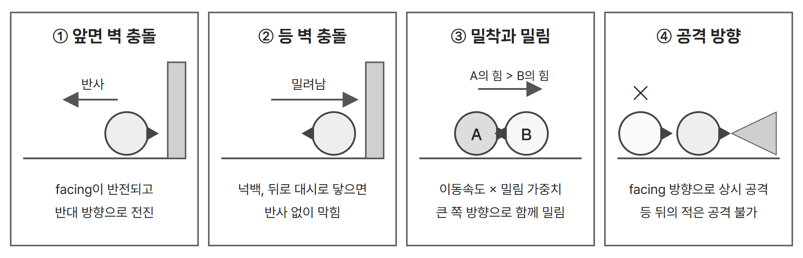
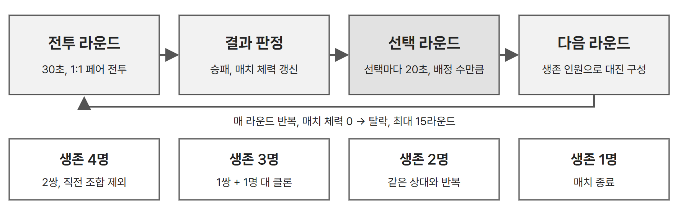

# 1.1 기본 전투 규칙과 무기

## ● 자동 전진, 자동 공격

- 캐릭터는 바라보는 방향(facing)으로 일정한 속도로 자동 전진하고, 공격도 facing 방향으로 상시 발동한다.
- 플레이어는 이동과 공격 대신 방향전환, 대시, 스킬의 사용 시점을 고른다. 기본 사용 횟수는 라운드당 1회이며 라운드마다 다시 채워진다.
- 4인 매치에서 매 라운드 1:1로 대전한다. 위치 싸움은 아래 네 가지 규칙에서 만들어진다.

*원문 규칙을 바탕으로 다시 그린 도식*

| 규칙 | 처리 |
| --- | --- |
| 벽 충돌 | 앞면이 벽에 닿을 때만 반사한다. 넉백이나 뒤로 대시해 등이 닿으면 반사 없이 막힌다. |
| 공격 판정 | 사거리 스탯 없이 계열로 판정한다. 근접은 상시 재생되는 공격 모션의 히트박스, 원거리는 맵 끝까지 날아가 벽이나 플레이어에 닿으면 소멸하는 투사체다. |
| 등 뒤의 적 | 공격할 수 없다. 예외는 표창의 벽 반사와 스태프의 위치 타겟팅이다. |
| 밀림 | 두 캐릭터는 튕기지 않고 밀착한다. 밀림 힘 = 이동속도 × 무기 밀림 가중치이며, 밀리는 동안에도 공격은 계속된다. |
| 넉백 | 피격 순간 시전자의 정면 방향으로 점프하듯 밀려나는 일회성 이동이다. 착지 전까지 이동, 기본 공격, 스킬이 모두 불가하다. 강도는 하(캐릭터 폭 1개, 0.2초), 중(2.5개, 0.5초), 상(4개, 0.8초)이다. |
| 대시, 방향전환 | 대시는 고정 거리 순간 이동이며 적을 관통하고 facing을 유지한다. 방향전환은 facing을 즉시 반대로 바꾼다. |

## ● 무기 8종의 기본값

무기는 스탯, 공격 메커니즘, 밀림 가중치, 무기 스킬을 정하고, 직업은 고유 스킬과 전용 무기 보너스(공격력 +5%, 체력 +5%)를 정한다. 직업과 무기는 자유롭게 조합한다.

| 무기 | 계열, 모션 | 넉백 | 체력 | 공격력 | 공격속도 | 이동속도 | 가중치 | 특수 메커니즘 |
| --- | --- | --- | --- | --- | --- | --- | --- | --- |
| 대검 | 근접, swingT2 | 중 | 1300 | 115 | 0.8 | 90 | 1.2 | 없음 |
| 망치 | 근접, swingT3 | 상 | 1200 | 40 ¹ | 0.7 | 80 | 1.60 | 넉백된 적이 착지 전 벽에 닿으면 공격력 2배 추가 피해 |
| 표창 | 원거리, swingO3 | 없음 | 850 | 90 | 1.0 | 110 | 0.7 | 투사체가 벽에서 1회 반사 |
| 단검 | 근접, swingO2 | 없음 | 900 | 45 ² | 1.3 | 110 | 0.9 | 적중 3회마다 공격력 +5 |
| 권총 | 원거리, shoot2 | 하 | 950 | 110 | 0.75 | 100 | 0.85 | 없음 |
| 스태프 | 원거리, 모션 없음 | 없음 | 800 | 100 | 0.8 | 95 | 0.7 | 적 위치를 타겟팅해 예고 후 낙하 |
| 활 | 원거리, shoot1 | 없음 | 1000 | 105 | 1.1 | 105 | 0.75 | 없음 |
| 건틀릿 | 근접, stabO2 | 하 | 850 | 125 | 1.25 | 95 | 1.3 | 없음 |

¹ 망치의 주력 피해는 벽 충돌 추가 피해다. 맵이 좁을수록 강하고 넓을수록 약하다. ² 단검의 시작값이다. 빗나간 공격은 세지 않고, 3회를 채우지 못한 카운트는 라운드 종료 시 초기화되며, 오른 공격력은 매치 내내 상한 없이 유지된다.

*무기별 공격 메커니즘 기획서의 스탯 초안. 기초 컨셉 문서의 가중치 순서와 기본 전투 1차 구현 범위의 가중치 1.0 고정값은 이 표와 구분한다.*

---

# 1.2 라운드 대진과 매치 체력

## ● 라운드 흐름과 대진

*원문 규칙을 바탕으로 다시 그린 도식*

| 생존 인원 | 대진 규칙 |
| --- | --- |
| 4명 | 가능한 조합 3가지 중 직전 라운드 조합을 뺀 2가지에서 무작위로 고른다. 1라운드는 3가지 중 무작위다. |
| 3명 | 클론 원본을 무작위로 정하고, 원본을 뺀 2명 중 클론 상대를 무작위로 정한다. 남은 1명이 원본과 대전한다. |
| 2명 | 매치가 끝날 때까지 같은 상대와 대전한다. |
| 1명 | 매치를 종료한다. |

- 클론은 라운드 시작 직전의 원본을 능력치, 스킬, 어빌리티, 인게임 유물의 매치 누적치까지 복제한다. 라운드가 끝나면 사라지고 원본에는 영향을 주지 않는다.
- 클론에게 이기면 매치 체력이 줄지 않는다. 지면 기본 피해와 추가 피해를, 무승부는 기본 피해만 받는다.

## ● 매치 체력 감소

매치 체력은 100에서 시작하고 0이 되면 탈락한다. 탈락 순서의 역순이 등수다. 감소는 패배한 쪽에만 적용한다.

> **패배한 쪽 감소량 = 기본 피해 + 승리한 쪽 남은 라운드 체력 비율 ÷ 10** 
> 남은 체력 비율은 10% 단위 구간으로 올림 처리하며, 추가 피해는 최대 +10이다.

| 라운드 구간 | 1~5 | 6~10 | 11~15 |
| --- | --- | --- | --- |
| 기본 피해 | 5 | 10 | 15 |

| 상황 | 승리한 쪽 남은 체력 | 구간 올림 | 계산 | 패배한 쪽 감소 |
| --- | --- | --- | --- | --- |
| 3라운드 패배 | 55% | 60% | 5 + 6 | 11 |
| 3라운드 패배 | 10% | 10% | 5 + 1 | 6 |
| 8라운드 패배 | 100%, 무피해 | 100% | 10 + 10 | 20 |
| 8라운드 패배 | 45% | 50% | 10 + 5 | 15 |
| 12라운드 패배 | 95% | 100% | 15 + 10 | 25 |
| 8라운드 무승부 | 없음 | 없음 | 10, 기본만 | 양쪽 10 |

- 30초 시간 초과 무승부는 양쪽 모두 패배로 처리한다. 승리한 쪽이 없으므로 기본 피해만 양쪽에 적용한다.
- 15라운드 안에 승부가 나지 않으면 남은 매치 체력 비율, 승리 수, 승자승 순서로 등수를 정해 강제 종료한다.
