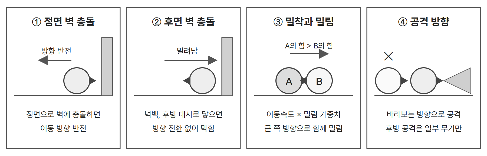
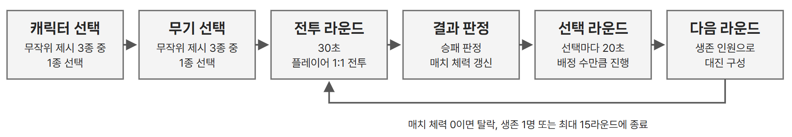

# 기본 전투 규칙과 무기

## ● 자동 전진, 자동 공격

- 캐릭터는 바라보는 방향(facing)으로 일정한 속도로 자동 이동하며 기본 공격을 반복한다.
- 플레이어는 이동과 공격 대신 방향전환, 대시, 스킬의 사용 시점을 고른다. 기본 사용 횟수는 라운드당 1회이며 라운드마다 다시 채워진다.
- 4인 매치에서 매 라운드 1:1로 대전한다. 위치 싸움은 아래 네 가지 규칙에서 만들어진다.

| 규칙 | 처리 |
| --- | --- |
| 벽 충돌 | 캐릭터가 정면 방향으로 벽에 충돌하면 이동 방향이 반전된다. 넉백이나 후방 대시로 캐릭터 후면이 벽에 닿으면 방향 전환 없이 벽에 막힌다. |
| 공격 판정 | - 별도의 사거리 스탯 대신 실제 무기 리소스와 공격 모션에 설정된 히트박스를 기준으로 명중 여부를 판정한다.  - 원거리 무기는 투사체의 충돌 또는 무기별 고유 공격 방식에 따라 판정한다.  - 일반 투사체는 맵 끝까지 날아가며 벽이나 적에게 닿으면 소멸한다. 표창의 벽 반사는 예외다. |
| 후방 공격 | - 기본 공격은 바라보는 방향으로 발생하므로 등 뒤의 적을 직접 공격할 수 없다.  - 다만 표창의 벽 반사, 스태프의 위치 지정 공격처럼 고유 공격 방식이 있는 무기는 후방의 적도 공격할 수 있다. |
| 밀림 | - 두 캐릭터가 정면으로 맞닿으면 서로를 통과하지 않고 밀어낸다.  - 각 캐릭터의 이동속도 × 무기별 밀림 가중치를 비교해, 값이 큰 캐릭터의 진행 방향으로 두 캐릭터가 함께 이동한다. - 밀리는 동안에도 공격은 계속된다. |
| 넉백 | - 피격 순간 시전자의 정면 방향으로 점프하듯 밀려나는 일회성 이동이다.  - 착지 전까지 이동, 기본 공격, 스킬이 모두 불가하다. 강도는 하(캐릭터 폭 1개, 0.2초), 중(2.5개, 0.5초), 상(4개, 0.8초)이다. |
| 대시, 방향전환 | - 대시는 고정 거리 순간 이동이며 적을 관통하고 facing을 유지한다.  - 방향전환은 facing을 즉시 반대로 바꾼다. |

## ● 무기별 공격 방식과 기본 능력치

\- 무기는 기본 능력치와 공격 방식, 넉백 강도, 밀림 가중치, 사용 가능한 무기 스킬을 결정한다.  - 근접 타격, 투사체 발사, 지정 위치 공격 등 무기마다 서로 다른 공격 메커니즘을 갖는다.

\- 기본 공격 애니메이션은 MSW에서 제공하는 기본 아바타 모션 구조를 사용한다. 무기별 사용 모션은 아래 표에 지정하며, 스태프는 별도의 기본 공격 모션을 사용하지 않는다.

| 무기 | 공격 계열 | 사용 모션 | 넉백 | 체력 | 공격력 | 공격속도 | 이동속도 | 밀림 가중치 | 특수 메커니즘 |
| --- | --- | --- | --- | --- | --- | --- | --- | --- | --- |
| 대검 | 근접 | swingT2 | 중 | 1300 | 115 | 0.8 | 90 | 1.2 | 없음 |
| 망치 | 근접 | swingT3 | 상 | 1200 | 40 ¹ | 0.7 | 80 | 1.6 | 넉백된 적이 착지 전 벽에 닿으면 공격력 2배 추가 피해 |
| 표창 | 원거리 | swingO3 | 없음 | 850 | 90 | 1.0 | 110 | 0.7 | 투사체가 벽에서 1회 반사 |
| 단검 | 근접 | swingO2 | 없음 | 900 | 45 ² | 1.3 | 110 | 0.9 | 적중 3회마다 공격력 +5 |
| 권총 | 원거리 | shoot2 | 하 | 950 | 110 | 0.75 | 100 | 0.85 | 없음 |
| 스태프 | 원거리 | 모션 없음 | 없음 | 800 | 100 | 0.8 | 95 | 0.7 | 적 위치를 타겟팅해 예고 후 낙하 |
| 활 | 원거리 | shoot1 | 없음 | 1000 | 105 | 1.1 | 105 | 0.75 | 없음 |
| 건틀릿 | 근접 | stabO2 | 하 | 850 | 125 | 1.25 | 95 | 1.3 | 없음 |

¹ 망치의 주력 피해는 벽 충돌 추가 피해다. 맵이 좁을수록 강하고 넓을수록 약하도록 설계한다.  ² 단검의 시작값이다. 빗나간 공격은 세지 않고, 3회를 채우지 못한 카운트는 라운드 종료 시 초기화되며, 오른 공격력은 매치 내내 상한 없이 유지된다.

---

# 라운드 대진과 매치 체력

## ● 라운드 흐름과 대진

| 생존 인원 | 대진 규칙 |
| --- | --- |
| 4명 | 플레이어 A, B, C, D를 두 명씩 묶는 대진은 **A–B / C–D**, **A–C / B–D**, **A–D / B–C**의 3가지다. 직전 대진이 A–B / C–D였다면, 나머지 2가지 중 하나를 무작위로 선택한다. 첫 라운드는 3가지 중 무작위로 선택한다. 같은 상대와 연속 대전하지 않도록 구성한다. |
| 3명 | 생존 플레이어 1명의 전투 정보를 무작위로 골라 클론을 만든다. 원본을 제외한 2명 중 1명은 클론과 대전하고, 나머지 1명은 원본 플레이어와 대전한다. |
| 2명 | 매치가 끝날 때까지 같은 상대와 대전한다. |
| 1명 | 매치를 종료한다. |

## ● 클론의 도입 목적과 기본 구조

- **도입 목적:** 생존자가 3명이 되면 1:1 대전의 짝이 맞지 않는다. 상대가 없는 플레이어도 대기하거나 부전승으로 넘어가지 않고 전투를 이어가도록 클론을 투입한다.
- **클론의 정의:** 다른 생존 플레이어의 전투 정보를 복제한 AI 조작 전투 전용 개체다. 라운드 시작 직전의 능력치, 스킬, 어빌리티, 인게임 유물과 매치 누적치를 복제하며, 라운드가 끝나면 소멸한다. 클론의 대전 결과는 원본 플레이어에게 영향을 주지 않는다.

- 클론에게 이기면 매치 체력이 줄지 않으며, 지면 기본 피해와 추가 피해를, 무승부는 기본 피해만 받는다.

## ● 매치 체력 감소

매치 체력은 100에서 시작하며, 패배한 쪽만 감소한다. 0이면 탈락하고, 등수는 탈락 순서의 역순이다. 매치가 길어지며 긴장감이 떨어지는 것을 막기 위해 라운드 구간이 진행될수록 기본 피해량을 높인다. 접전 끝의 패배와 완패에 차이를 주기 위해 승자의 남은 라운드 체력에 비례한 추가 피해를 적용한다.

> **패배한 쪽 감소량 = 기본 피해 + 승리한 쪽 남은 라운드 체력 비율 ÷ 10** 
> 남은 체력 비율은 10% 단위 구간으로 올림 처리하며, 추가 피해는 최대 +10이다.

| 라운드 구간 | 1~5 | 6~10 | 11~15 |
| --- | --- | --- | --- |
| 기본 피해 | 5 | 10 | 15 |

| 상황 | 승리한 쪽 남은 체력 | 구간 올림 | 계산 | 패배한 쪽 감소 |
| --- | --- | --- | --- | --- |
| 3라운드 패배 | 55% | 60% | 5 + 6 | 11 |
| 8라운드 패배 | 45% | 50% | 10 + 5 | 15 |
| 12라운드 패배 | 95% | 100% | 15 + 10 | 25 |
| 8라운드 무승부 | 없음 | 없음 | 10, 기본만 | 양쪽 10 |

- 30초 시간 초과 무승부는 양쪽 모두 패배로 처리한다. 승리한 쪽이 없으므로 기본 피해만 양쪽에 적용한다.
- 15라운드 안에 승부가 나지 않으면 남은 매치 체력 비율, 승리 수, 승자승 순서로 등수를 정해 강제 종료한다.
