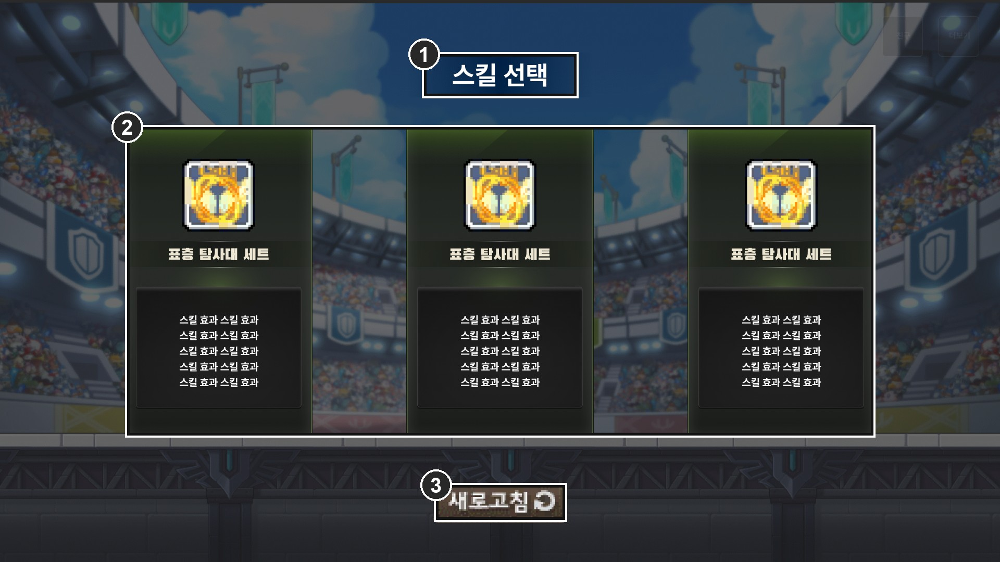
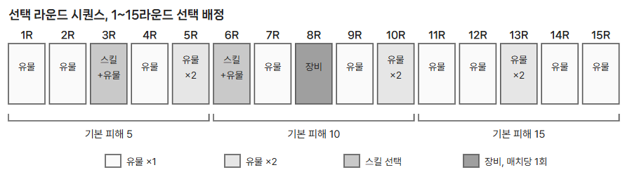

# 선택 라운드와 시퀀스

| IDX | 구분 | 표시 내용과 동작 |
| --- | --- | --- |
| 1 | 선택 창 헤더 | 종류별 헤더 색: 유물  `#315C85`, 스킬  `#765B40`, 장비  `#71528A` |
| 2 | 후보 카드 3장 | 하나를 고른다. 스킬은 1차에 4번, 2차에 5번 슬롯에 장착 |
| 3 | 새로고침 | 선택 라운드마다 1회, 3장을 모두 교체. 쓰지 않으면 사라지며 이월 없음 |

선택 라운드는 1회 20초이며, 시간이 지나거나 모든 유저가 고르면 즉시 끝난다. 배정이 여러 개면 그만큼 반복하고 각각 20초와 새로고침 1회를 따로 적용한다.

## ● 선택 라운드 시퀀스

선택 라운드 시퀀스는 각 전투 라운드 이후 제공할 선택의 종류, 순서, 횟수를 정한 구성이다. 유물, 스킬, 장비를 얻는 시점을 배치해 한 매치의 성장 흐름을 만든다. 아래는 여러 시퀀스 중 한 가지 예시다.

매치 시작 시 미리 만든 시퀀스(Arena01, Arena02 …) 중 하나를 추첨해, 같은 조합이라도 판마다 성장 흐름이 달라진다. 장비는 어느 시드에서도 매치당 1회이며, 시퀀스는 데이터로 분리해 계속 추가할 수 있다.

## ● 후보 등장 규칙

| 종류 | 후보 풀 |
| --- | --- |
| 유물 | 공용 유물과 현재 무기의 고유 유물 중 해금된 것. 이미 얻은 1회 한정 유물은 제외 |
| 스킬 | 공용 4종, 무기 10레벨 이상이면 무기 스킬 A, 20레벨이면 B까지 최대 6종. 2차 선택에서는 이미 장착한 스킬 제외 |
| 장비 | 장비 8종. 망토에 장착되어 상대에게 보이며 대부분 자동 발동 |

| 무기 | 무기 스킬 A, 10레벨 | 무기 스킬 B, 20레벨 |
| --- | --- | --- |
| 망치, 대검 | 디바인 스윙, 인사이징 | 디바인 차지, 광폭화 |
| 단검, 권총 | 레디 투 다이, 시즈 봄버 | 페이크, 럭키 다이스 |
| 활, 표창 | 폭풍의 시, 쉐도우 파트너 | 리트리트 샷, 스타 더스트 |
| 건틀릿, 스태프 | 폭류권, 에메랄드 플라워 | 섬멸, 매직 가드 |

*무기 고유 스킬 기획서 기준. 무기 성장 문서의 스킬명은 망치, 권총 외 6종에서 다르다. 시즈 봄버는 facing 방향 벽 앞에 5초간 포탑을 세워 1초마다 적 최대 체력 3% 피해를 준다.*
