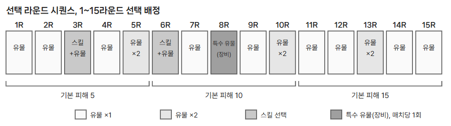

# 선택 라운드와 시퀀스

선택 라운드는 전투 뒤에 유물과 스킬을 고르는 성장 단계다. 
유물의 효과는 해당 매치 동안 유지되며, 매치가 끝나면 초기화된다. 
장비는 망토에 장착하는 특수 유물이다.

| IDX | 구분 | 표시 내용과 동작 |
| --- | --- | --- |
| 1 | 선택 창 헤더 | 종류별 헤더 색: 일반 유물  `#315C85`, 스킬  `#765B40`, 특수 유물(장비)  `#71528A` |
| 2 | 선택 후보 3개 | 하나를 고른다. 스킬은 1차에 4번, 2차에 5번 슬롯에 장착 |
| 3 | 새로고침 | 선택 라운드마다 1회, 3장을 모두 교체. 쓰지 않으면 사라지며 이월 없음 |

선택 1회당 최대 20초이며, 시간이 지나거나 전원이 선택하면 종료된다. 여러 번 배정되면 순서대로 진행하며, 매번 최대 20초와 새로고침 1회를 따로 적용한다.

## ● 선택 라운드 시퀀스

시퀀스는 각 전투 뒤에 제공할 유물과 스킬 선택의 순서, 횟수를 정한 구성이다. 아래는 여러 시퀀스 중 한 가지 예시다.

매치 시작 시 미리 만든 시퀀스(Arena01, Arena02 …) 중 하나를 추첨한다. 특수 유물(장비)은 어느 시퀀스에서도 매치당 1회 배정한다. 시퀀스는 데이터로 분리해 추가할 수 있다.

## ● 후보 등장 규칙

| 종류 | 후보 풀 |
| --- | --- |
| 일반 유물 | 공용 유물과 현재 무기의 해금된 고유 유물. 한 매치에서 한 번만 획득할 수 있는 유물을 이미 얻었다면 후보에서 제외 |
| 스킬 | 공용 4종, 무기 10레벨 이상이면 무기 스킬 A, 20레벨이면 B까지 최대 6종. 2차 선택에서는 이미 장착한 스킬 제외 |
| 특수 유물(장비) | 특수 유물 8종. 망토에 장착되어 상대에게 보이며 대부분 자동 발동 |

| 무기 | 무기 스킬 A, 10레벨 | 무기 스킬 B, 20레벨 |
| --- | --- | --- |
| 망치 | 디바인 스윙 | 디바인 차지 |
| 대검 | 인사이징 | 광폭화 |
| 단검 | 레디 투 다이 | 페이크 |
| 권총 | 시즈 봄버 | 럭키 다이스 |

| 무기 | 무기 스킬 A, 10레벨 | 무기 스킬 B, 20레벨 |
| --- | --- | --- |
| 활 | 폭풍의 시 | 리트리트 샷 |
| 표창 | 쉐도우 파트너 | 스타 더스트 |
| 건틀릿 | 폭류권 | 섬멸 |
| 스태프 | 에메랄드 플라워 | 매직 가드 |

