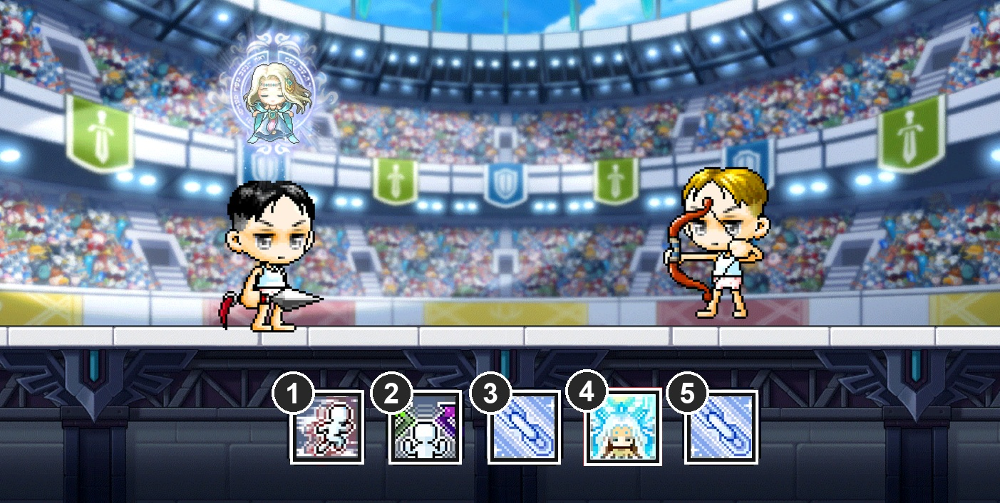
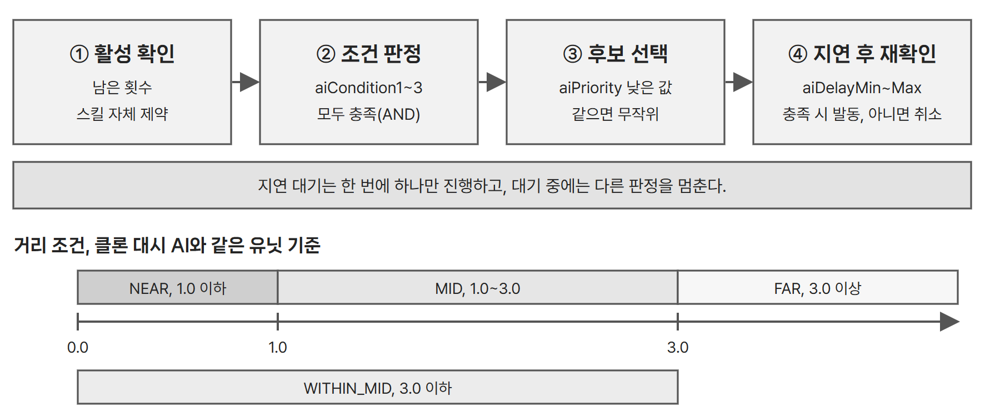

# 스킬 슬롯과 공통 규칙

## ● 스킬 구분과 해금

| 구분 | 구성과 사용 방식 |
| --- | --- |
| 기본 스킬 | 모든 캐릭터가 사용하는 대시와 방향 전환. 1, 2번 슬롯에 고정한다. |
| 캐릭터 스킬(직업 고유 스킬) | 선택한 직업의 고유 스킬. 캐릭터 선택 시 3번 슬롯에 고정한다. |
| 공용 선택 스킬 | 무기 레벨과 관계없이 선택 라운드의 후보에 포함되는 공용 스킬 4종. |
| 무기 스킬 | 현재 무기의 레벨에 따라 해금한다. 10레벨에 스킬 A, 20레벨에 스킬 B를 선택 후보에 추가한다. |

- 해금은 선택 라운드의 추첨 풀에 해당 스킬이 포함되는 조건이다. 해금만으로 자동 장착되지는 않는다.
- 선택 라운드에서 공용 스킬과 해금된 무기 스킬 중 하나를 골라 4, 5번 슬롯에 장착한다.

## ● 스킬 슬롯

- 전투 화면 하단에 스킬 슬롯 5개를 배치한다.
- 각 슬롯에는 스킬 아이콘과 사용 단축키를 표시한다. 해당 단축키를 입력하면 배치된 스킬이 발동한다.

| IDX | 단축키 | 스킬과 배치 방식 |
| --- | --- | --- |
| 1 | Shift | 대시. 공통 기본 스킬 |
| 2 | C | 방향 전환. 공통 기본 스킬 |
| 3 | A | 직업 고유 스킬. 직업 선택 시 고정 |
| 4 | S | 첫 번째 선택 스킬. 선택 라운드에서 후보 3개 중 선택 |
| 5 | D | 두 번째 선택 스킬. 선택 라운드에서 후보 3개 중 선택 |

- 스킬 선택은 매치당 2회이며, 선택 시점은 시퀀스에 따른다.
- 두 번째 선택에서는 이미 장착한 스킬을 후보에서 제외한다.
- 스킬은 라운드마다 1회씩 사용할 수 있으며, 다음 라운드에 사용 횟수가 충전된다.
- 선택한 스킬은 해당 슬롯에 고정되며 교체할 수 없다.

## ● 스킬 데이터

스킬별 효과, 지속 시간, 상태 이상, 모션과 이펙트 RUID는 SkillData 시트에서 관리한다.

---

# 클론, 봇 플레이어의 스킬 사용 AI 조건

클론과 봇 플레이어가 보유 스킬을 자동으로 사용할 시점을 판단하는 조건이다. 상대와의 거리, 방향, 체력 등의 조건을 확인해 사용할 스킬을 선택한다.

## ● AI의 스킬 사용 조건 조합 방식

- 스킬마다 AI 로직을 따로 만들지 않고 조건 유형을 조합해 사용 조건을 정한다. 스킬을 추가하거나 바꿔도 데이터만 지정하면 동작한다.
- 같은 AI를 3인 라운드의 클론과 랭킹 매칭의 봇이 함께 사용한다.

| 조건 유형 | 기준 |
| --- | --- |
| NEAR, MID, FAR | 적과의 거리 1.0 이하, 1.0~3.0, 3.0 이상 |
| WITHIN_MID | 적과의 거리 3.0 이하 |
| FACING_ENEMY | 적을 바라보는 상태 |
| HP_BELOW | 자신의 라운드 체력이 기준값 이하 |
| SKILL_EMPTY | 지정 스킬의 사용 횟수가 모두 소진된 상태 |
| ALWAYS | 조건 없음 |
| AUTO, PROJECTILE_PASSED_ENEMY | 2단 스킬의 2타 연계 조건 |

## ● 지연과 우선순위

| 스킬 성격 | 무작위 지연 |
| --- | --- |
| 생존기, 방향전환, 2단 스킬의 2타 | 없음 |
| 공격 스킬 | 0~2초 |
| 버프, 설치 | 1~3초 |

- 지연은 행동 패턴이 고정되지 않게 하기 위해 둔다.
- 설정 대상은 공용 4종, 무기 스킬 16종(8무기 × 2), 직업 스킬 8종이다. 2단 스킬은 폭류권, 스타 더스트, 퀴버 플로우다.
- 기본 스킬의 우선순위는 대시 12, 방향전환 0이다. 예를 들어 사용 조건을 함께 만족하면 매직 가드(1)가 석화(2)보다 먼저 선택되고, 우선순위가 3으로 같은 페이크와 여제의 축복은 무작위로 고른다.

## ● 클론의 이동 판단

| 행동 | 사용 조건 |
| --- | --- |
| 방향전환 | 남은 횟수가 있고 facing 방향에 적이 없을 때 |
| 대시, 근접 무기 | 거리 3.0 이상에서 상대를 바라보는 상태가 2초 지속될 때 |
| 대시, 원거리 무기 | 거리 1.0 이하에서 서로 마주 보는 상태가 2초 지속될 때 |

대시 거리는 2.0 유닛 기준이며, 조건이 중간에 깨지면 2초 타이머를 초기화한다.
