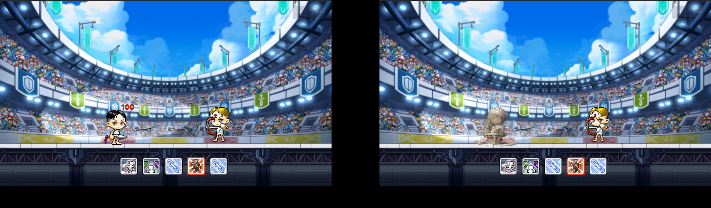
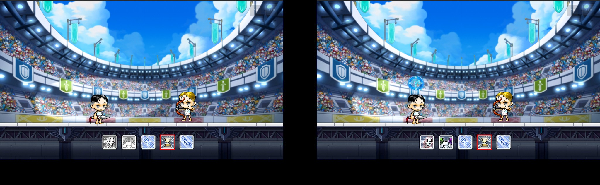

# 2.1 스킬 슬롯과 상세 스킬 조건

*원본 기획서 수록 전투 캡처에 번호 표시. 아이콘은 캡처 당시 장착 상태다. 6 여제의 축복 이펙트, 7 플레이어.*

| IDX | 키, 스킬과 결정 방식 |
| --- | --- |
| 1, 2 | Shift 대시, C 방향전환. 공통 기본, 피해 없는 위치 조정 |
| 3 | A 직업 고유 스킬. 직업 선택 시 고정, 시전 딜레이 없음 |
| 4, 5 | S, D 무기 스킬. 선택 라운드에서 3장 중 택1, 1차는 4번, 2차는 5번, 교체 불가 |

## ● 공용 무기 스킬 4종, 강화 없이 선택 가능, 무기 모션 미사용

| 스킬 | 효과 조건 | 예외 처리 | 연출 |
| --- | --- | --- | --- |
| 석화 | 2초간 이동, 공격 정지. 무적이며 피해와 대상 지정을 받지 않고 밀림에 면역 | 투사체는 석상에 막히지만 피해는 없다. 부딪힌 상대와 석상 모두 밀리지 않는다. | 시전 위치에 먼지구름 1회, 석상이 깨지는 클립을 2초로 재생 |
| 타임 리프 | 대시와 방향전환을 다시 사용 가능 상태로 변경 | 두 스킬이 이미 활성이어도 사용되며 이펙트만 재생 | 머리 위에 시계 이펙트 1회 |
| 여제의 축복 | 최대 체력 15% 즉시 회복, 이동 정지와 스턴 등 상태이상 해제 | 스킬 사용 자체를 막는 침묵은 해제 불가 | 머리 위에 버프 이펙트 1회 |
| 저주의 사슬 | 5초간 상대 최대 체력 10% 피해(초당 2%), 회복 수치 50% 감소 | 유물 효과, 흡혈 등 모든 회복 수단에 적용 | 상대 발밑 시전 1회, 머리 위 디버프 5초 반복 |

<figure><figcaption>원본 기획서 수록, 석화 사용 전후</figcaption></figure><figure><figcaption>원본 기획서 수록, 타임 리프 시전 전후</figcaption></figure>

## ● 직업 고유 스킬 8종

| 직업 | 고유 스킬 | 효과 | 이동, 기본 공격 |
| --- | --- | --- | --- |
| 히어로 | 돌진 | 전방 돌진, 부딪힌 적 최대 체력 10% 피해 | 돌진, 정지 |
| 팔라딘 | 소울실드 | 3초간 받는 피해 50%, 주는 피해 15% 감소 | 유지, 유지 |
| 나이트로드 | 윈드 탈리스만 | 피격 적 방향전환과 넉백(중), 피해 없음 | 유지, 유지 |
| 섀도어 | 인투 다크니스 | 적 뒤로 순간이동, 2초간 공격속도 10% 증가 | 순간이동, 유지 |
| 캡틴 | 헤드샷 | 최대 체력 10% 피해와 1초 스턴, 사거리 무제한 | 정지, 정지 |
| 바이퍼 | 윈드 점프 | 제자리 점프 중 무적, 피격 적 3초 침묵 | 제자리, 정지 |
| 비숍 | 홀리 심볼 | 적 2초 이동 정지, 확정 적중, 피해 없음 | 유지, 유지 |
| 보우마스터 | 퀴버 플로우 | 잔상 설치, 재사용 시 순간이동 | 순간이동, 유지 |

*% 수치는 원문의 초기값이다. 침묵은 스킬만, 이동 정지는 이동만, 스턴은 모든 조작을 막는다.*

<figure><figcaption>원본 기획서 수록, 히어로 돌진</figcaption></figure><figure><figcaption>원본 기획서 수록, 캡틴 헤드샷</figcaption></figure>

---

# 2.2 스킬별 AI 조건

## ● 조건 조합 방식

- 스킬마다 AI 로직을 따로 만들지 않고 조건 유형을 조합해 사용 조건을 정한다. 스킬을 추가하거나 바꿔도 데이터만 지정하면 동작한다.
- 같은 AI를 3인 라운드의 클론과 랭킹 매칭의 봇이 함께 사용한다.

*원문 규칙을 바탕으로 다시 그린 도식*

| 조건 유형 | 기준 |
| --- | --- |
| NEAR, MID, FAR | 적과의 거리 1.0 이하, 1.0~3.0, 3.0 이상 |
| WITHIN_MID | 적과의 거리 3.0 이하 |
| FACING_ENEMY | 적을 바라보는 상태 |
| HP_BELOW | 체력이 지정한 % 이하 |
| SKILL_EMPTY | 지정한 스킬이 비어 있는 상태 |
| ALWAYS | 조건 없음 |
| AUTO, PROJECTILE_PASSED_ENEMY | 2단 스킬의 2타 연계 조건 |

## ● 지연과 우선순위

| 스킬 성격 | 무작위 지연 |
| --- | --- |
| 생존기, 방향전환, 2단 스킬의 2타 | 없음 |
| 딜링 | 0~2초 |
| 버프, 설치 | 1~3초 |

- 지연은 행동 패턴이 고정되지 않게 하기 위해 둔다. 데이터 컬럼은 `aiPriority`, `aiCondition1~3`, `aiValue1~3`, `aiDelayMin/Max`, `aiChainCondition1`이다.
- 설정 대상은 공용 4종, 무기 스킬 16종(8무기 × 2), 직업 스킬 8종이다. 2단 스킬은 폭류권, 스타 더스트, 퀴버 플로우다.
- 기본 스킬의 우선순위는 대시 12, 방향전환 0이다. 충돌 검토 예시로 매직 가드(1)가 석화(2)보다 먼저 선택되고, 같은 3인 페이크와 여제의 축복은 무작위로 고른다.

## ● 클론의 이동 판단

| 행동 | 사용 조건 |
| --- | --- |
| 방향전환 | 남은 횟수가 있고 facing 방향에 적이 없을 때 |
| 대시, 근접 무기 | 거리 3.0 이상에서 상대를 바라보는 상태가 2초 지속될 때 |
| 대시, 원거리 무기 | 거리 1.0 이하에서 서로 마주 보는 상태가 2초 지속될 때 |

대시 거리는 2.0 유닛 기준이며, 조건이 중간에 깨지면 2초 타이머를 초기화한다.
