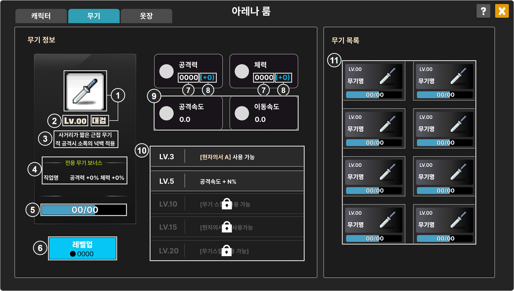
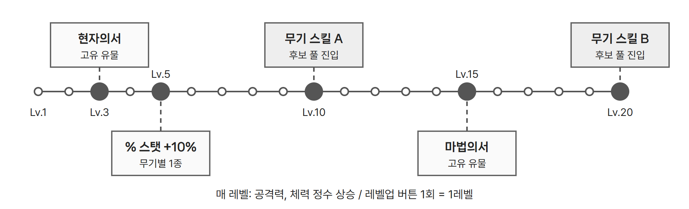
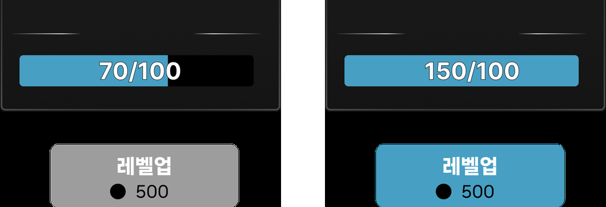

# 무기 강화와 아레나룸 무기 화면

*아레나룸 — 무기 UI 구성 기획*

| IDX | 표시 내용 | 데이터 연결 |
| --- | --- | --- |
| 1 | 무기 아이콘과 무기명 | 무기 기본 정보. 무기명은 `WeaponBaseInfo.weapon`(`WeaponUpgrade.weaponName`) |
| 2 | 현재 무기 Lv | 플레이어가 보유한 해당 무기의 레벨 |
| 3 | 무기 설명 | `WeaponBaseInfo.WeaponDesc`. 줄바꿈을 구분해 표시 |
| 4 | 전용 무기 직업명과 장착 보너스 | 이 무기를 전용 무기로 지정한 직업. 장착 보너스는 공격력 +5%, 체력 +5%로 고정한다. |
| 5 | 카드 게이지 | 해당 무기 카드 보유량 / 다음 레벨 행의 `RequireCard` |
| 6 | 레벨업 버튼과 소모 메소 | 다음 레벨 행의 `RequireMeso`와 카드와 메소 충족 여부 |
| 7 | 공격력, 체력 현재값 | 현재 레벨 행의 `Damage`, `Hp` |
| 8 | 공격력, 체력 증가량 (+N) | 다음 레벨 행의 `DamageGain`, `HpGain` |
| 9 | 공격속도, 이동속도 | `WeaponBaseInfo.attackInterval`, `moveSpeed`. 매 레벨 증가 대상 아님 |
| 10 | Lv.3, 5, 10, 15, 20 해금 문구 | `WeaponUpgrade.descUi`. 유형과 대상은 `milestoneType`, `milestoneKey`, `milestoneValue` |
| 11 | 8종 카드: Lv, 무기명, 카드 게이지 | 무기별 보유 레벨과 카드 보유량 |

- 다음 레벨 행은 `id`(무기명_레벨)로 찾는다. 증가량과 요구량은 모두 이전 레벨에서 해당 레벨로 오를 때의 값이다.
- 캐릭터는 경험치로 자동 레벨업하고 승급 보너스를 계정 전체에 준다. 무기는 카드와 메소로 수동 레벨업하고(최대 20), 정수 스탯을 해당 무기 장착 시에만 준다.
- 매 레벨 공격력과 체력이 오르며, 만렙에서 기본값 대비 +17% 내외가 되도록 설정하였다. 이는 고정 스탯 유물의 1.5배로 설정한 값이다.

## ● 마일스톤

현자의서와 마법의서는 무기당 2종, 총 16종의 고유 유물이다. 해금은 유물 선택 라운드 시 추첨 풀에 해당 유물이 진입하는 것을 의미하며, 제시된 후보 중 직접 선택해야 획득한다. 강화하지 않은 플레이어는 공용 유물과 공용 스킬만 선택 후보로 받는다.

- Lv.10, 20의 스킬명은 `SkillData`에서 `owner`가 해당 무기이고 `reqWeaponLevel`이 10, 20인 행의 `name`이다.
- 현재 레벨이 마일스톤 레벨보다 낮으면 문구를 흐리게 하고 잠금 아이콘을 얹는다.

---

# 무기 화면 상태와 동작

## ● 레벨업 처리

<figure></figure>

1. 무기 카드를 얻으면 해당 무기에 쌓인다.
2. 카드와 메소를 모두 충족하면 버튼이 활성화된다.
3. 버튼을 눌러야 반영하고, 요구량만 차감한다.
4. 여러 레벨분이 쌓여도 한 번에 1레벨씩 오른다.
5. 3, 5, 10, 15, 20레벨에 도달하면 해금을 처리한다.

## ● 레벨업 버튼

| 상태 | 조건 | 버튼 |
| --- | --- | --- |
| 카드 부족 | 보유 카드 < `RequireCard` | 비활성 |
| 메소 부족 | 보유 메소 < `RequireMeso` | 비활성 |
| 레벨업 가능 | 카드, 메소 모두 충족 | 활성 |
| 최고 레벨 | 20레벨 도달 | 비활성, `MAX` 표시. 요구 카드와 메소, 다음 레벨 증가량은 숨김 |

*캐릭터 승급은 메소가 부족해도 버튼을 켜고 글자색만 바꾸지만, 무기 레벨업은 하나라도 부족하면 버튼을 끈다.*

## ● 클릭과 갱신

| 입력, 시점 | 처리 |
| --- | --- |
| 11번 카드 클릭 | 선택 무기를 바꾸고 1~10번을 해당 무기의 정보로 갱신 |
| 레벨업 클릭 | 레벨, 카드, 메소 재확인 → 요구량 차감 → 레벨 +1 → 2번 Lv, 5번 게이지, 6번 비용, 7~8번 수치, 10번 해금, 11번 카드 갱신. 조건 미충족 시 차감과 레벨 변경 없이 버튼 상태만 갱신 |
| 마일스톤 도달 | 10번 해당 줄의 잠금 해제. 유물과 스킬은 각 선택 라운드의 추첨 풀에 진입 |
| 카드 획득 | 5번, 11번 카드 게이지와 6번 버튼 상태 재계산 |
| 메소 변동 | 6번 버튼 상태 재계산. 메소는 캐릭터 승급과 공용 |

| 재화 | 범위 | 획득처 | 규칙 |
| --- | --- | --- | --- |
| 무기 카드 | 무기별 개별 | 상점 구매, BM 요소 | 다른 무기로 이전 불가. 최대 보유량은 만렙까지 필요한 수량이며 초안 기준 885장 |
| 메소 | 공용 | 게임 보상 | 캐릭터 승급에도 쓰여 두 성장 축이 같은 재화를 두고 경쟁 |
