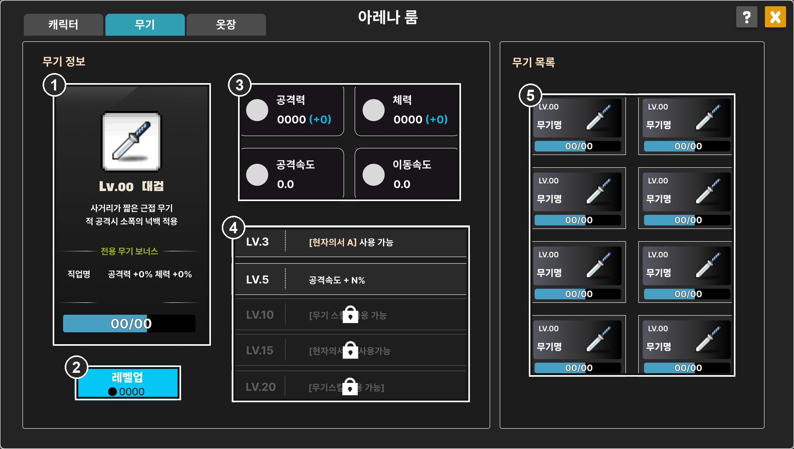
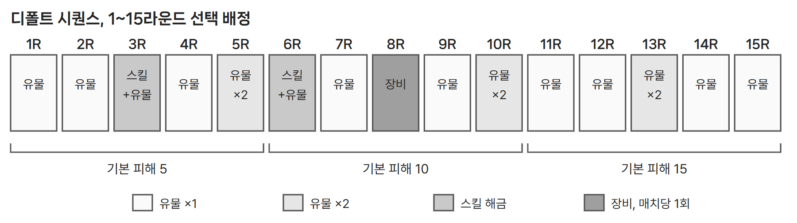

# 4.1 무기 강화와 아레나룸 무기 화면

*원본 기획서 수록 UI 시안에 번호를 표시. 00, 0000, N은 시안의 자리표시 값이다.*

| IDX | 표시 내용과 동작 |
| --- | --- |
| 1 | 무기 정보: 아이콘, 레벨, 설명, 전용 무기 보너스, 카드 게이지 |
| 2 | 레벨업: 카드와 메소를 모두 충족할 때만 활성 |
| 3 | 능력치: 공격력, 체력의 현재값과 증가량, 공격속도, 이동속도 |
| 4 | 마일스톤: 3, 5, 10, 15, 20레벨 해금, 미해금은 잠금 |
| 5 | 무기 목록: 8종의 레벨과 카드 보유량 |

- 캐릭터는 경험치로 자동 레벨업하고, 별도 승급으로 비율 또는 고정 보너스를 계정 전체에 준다. 무기는 카드와 메소로 수동 레벨업하고(최대 20), 정수 스탯을 해당 무기 장착 시에만 준다.
- 매 레벨 공격력과 체력이 오르며, 만렙에서 기본값 대비 +17% 내외로 설정했다(유물의 1.5배 정도). 공격속도와 이동속도는 매 레벨 증가 대상이 아니다.

## ● 마일스톤

*원문 규칙을 바탕으로 다시 그린 도식*

현자의서와 마법의서는 무기당 2종, 총 16종의 고유 유물이다. 해금은 후보 풀 진입을 뜻하며, 강화하지 않은 플레이어는 공용 유물과 공용 스킬만 본다.

## ● 레벨업 처리

<figure><figcaption>원본 기획서 수록, 카드 70/100 비활성(왼쪽), 150/100 활성(오른쪽)</figcaption></figure>

1. 무기 카드를 얻으면 해당 무기에 쌓인다.
2. 카드와 메소를 모두 충족하면 버튼이 활성화된다.
3. 버튼을 눌러야 반영하고, 요구량만 차감한다.
4. 여러 레벨분이 쌓여도 한 번에 1레벨씩 오른다.
5. 3, 5, 10, 15, 20레벨에 도달하면 해금을 처리한다.

| 재화 | 범위 | 획득처 | 규칙 |
| --- | --- | --- | --- |
| 무기 카드 | 무기별 개별 | 상점 구매, BM 요소 | 다른 무기로 이전 불가. 최대 보유량은 만렙까지 필요한 수량이며 초안 기준 885장 |
| 메소 | 공용 | 게임 보상 | 캐릭터 승급에도 쓰여 두 성장 축이 같은 재화를 두고 경쟁 |

---

# 4.2 선택 라운드와 시퀀스

*원본 기획서 수록 UI 시안에 번호를 표시. 카드 이름과 효과 문구는 시안의 임시 문구다.*

| IDX | 구분 | 표시 내용과 동작 |
| --- | --- | --- |
| 1 | 선택 창 헤더 | 종류별 색 구분. 유물 파랑, 스킬 갈색, 장비 보라 |
| 2 | 후보 카드 3장 | 하나를 고른다. 스킬은 1차에 4번, 2차에 5번 슬롯에 장착 |
| 3 | 새로고침 | 선택 라운드마다 1회, 3장을 모두 교체. 쓰지 않으면 사라지며 이월 없음 |

선택 라운드는 1회 20초이며, 시간이 지나거나 모든 유저가 고르면 즉시 끝난다. 배정이 여러 개면 그만큼 반복하고 각각 20초와 새로고침 1회를 따로 적용한다.

## ● 디폴트 시퀀스

*원문 규칙을 바탕으로 다시 그린 도식*

매치 시작 시 미리 만든 시퀀스(Arena01, Arena02 …) 중 하나를 추첨해, 같은 조합이라도 판마다 성장 흐름이 달라진다. 장비는 어느 시드에서도 매치당 1회이며, 시퀀스는 데이터로 분리해 계속 추가할 수 있다.

## ● 후보 등장 규칙

| 종류 | 후보 풀 |
| --- | --- |
| 유물 | 공용 유물과 현재 무기의 고유 유물 중 해금된 것. 이미 얻은 1회 한정 유물은 제외 |
| 스킬 | 공용 4종, 무기 10레벨 이상이면 무기 스킬 A, 20레벨이면 B까지 최대 6종. 2차 선택에서는 이미 장착한 스킬 제외 |
| 장비 | 장비 8종. 망토에 장착되어 상대에게 보이며 대부분 자동 발동 |

| 무기 | 무기 스킬 A, 10레벨 | 무기 스킬 B, 20레벨 |
| --- | --- | --- |
| 망치, 대검 | 디바인 스윙, 인사이징 | 디바인 차지, 광폭화 |
| 단검, 권총 | 레디 투 다이, 시즈 봄버 | 페이크, 럭키 다이스 |
| 활, 표창 | 폭풍의 시, 쉐도우 파트너 | 리트리트 샷, 스타 더스트 |
| 건틀릿, 스태프 | 폭류권, 에메랄드 플라워 | 섬멸, 매직 가드 |

*무기 고유 스킬 기획서 기준. 무기 성장 문서의 스킬명은 망치, 권총 외 6종에서 다르다. 시즈 봄버는 facing 방향 벽 앞에 5초간 포탑을 세워 1초마다 적 최대 체력 3% 피해를 준다.*
