---

## 1. 마을 맵 구성

이동과 상호작용

튜토리얼을 마치면 마을로 이동한다.

걷기 속도는 2m/s , 마을 전체 이동 시간은 20~25초 다.

건물과 플레이어는 충돌하지 않는다.

건물에 가까이 가면 건물 중앙에 이름과 “입장”을 표시한다. 스페이스바를 눌러 입장한다.

NPC·건물·상점·퀘스트 알림판은 스페이스바로 상호작용한다.

시설별 기능

No. | 시설 | 기능

1 | 상점 | 재화 및 소모품 구매

2 | 흥신소 | 입장 후 타이쿤 진행

3 | 저승 재판소 | 스토리 관련 기능

4 | 퀘스트 알림판 | 메인·서브 퀘스트 수락

5 | 저승 관문 | 던전 입장(메인 퀘스트)

레이어 순서: 배경 → 건물 → 바닥 타일·플레이어

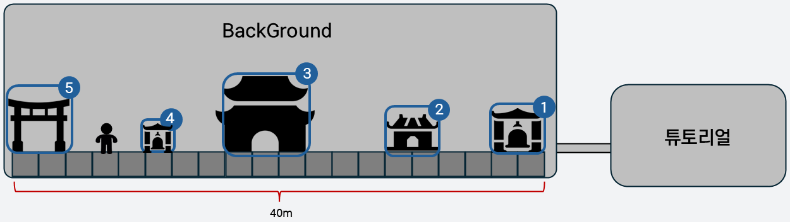

---

## 2. 마을 맵 구성_리소스 규격

리소스 | 리소스명 | 러프 크기(px) | 가로 배율 | 세로 배율

배경 | Adv_Town_Background_ | 1920×1080 등 | 40 | 15

상점 | Adv_Town_Shop | 480×360 ~ 512×512 | 4 | 2

흥신소 | Adv_Town_TaycoonEntry | 480×360 ~ 512×512 | 4 | 2

저승 재판소 | Adv_Town_Tribunal | 720×720 ~ 1024×1024 | 6 | 4

퀘스트 알림판 | Adv_Town_Questboard | 300×270 ~ 512×512 | 2 | 1

저승 관문 | Adv_Town_Gateway | 480×360 ~ 512×512 | 4 | 2

배율은 캐릭터 크기 기준이다. 러프 크기는 원본의 참고 범위이며, 최종 규격은 제작 시 조정한다.

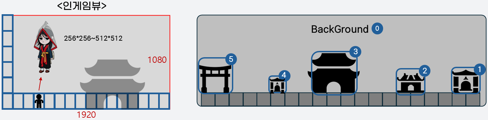

---

## 3. 아트 컨셉_마을 배경

전반적으로 어두운 붉은색 또는 푸른색 계열을 사용한다.

주변에는 안개를 두고, 높은 산과 바위 등의 자연경관을 배치한다.

배경은 선명하기보다 흐릿한 느낌으로 표현한다.

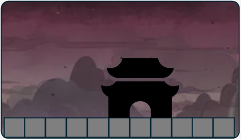

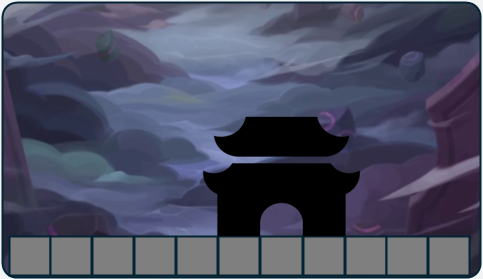

---

## 4. 아트 컨셉_흥신소와 저승 재판소

흥신소

무너지기 직전의 기와집 형태로 디자인한다.

성불 기원 현수막을 걸고, 곳곳에 거미줄이 쳐진 모습을 표현한다.

저승 재판소

웅장한 대문 또는 조선시대 성문 같은 느낌으로 디자인한다.

나무 재질을 바탕으로 빨간색과 노란색 계열을 사용한다.

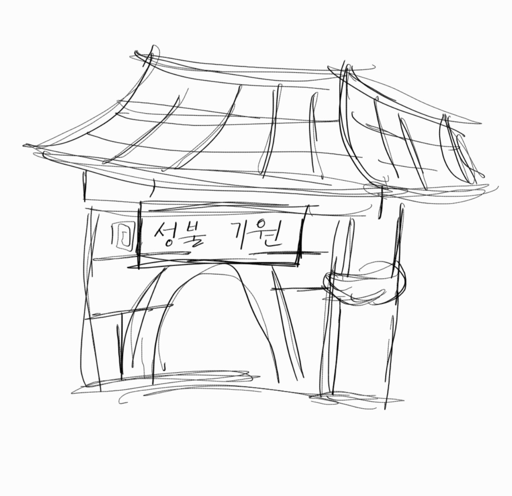

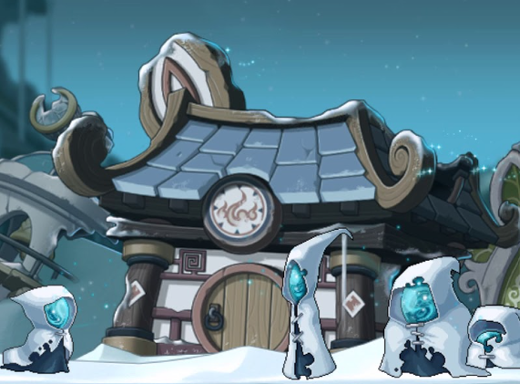

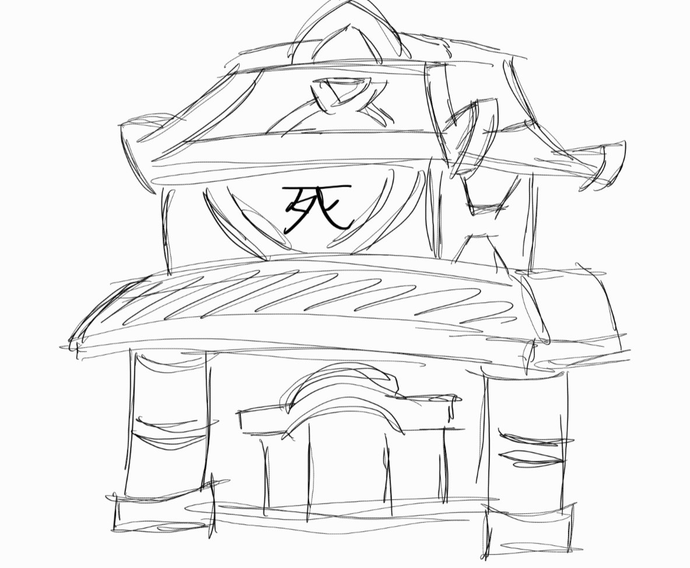

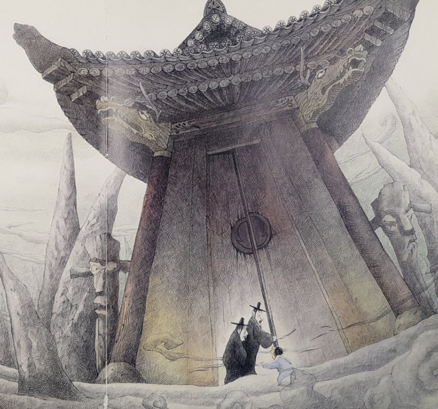

---

## 5. 아트 컨셉_상점과 퀘스트 알림판

상점

트럭 만물상이나 황금 마차 같은 형태로 디자인한다.

좌판 위에는 염주·호리병·부적 등의 물건을 늘어놓는다.

강시 옷을 참고해 남색과 노란색 계열을 사용한다.

퀘스트 알림판

지붕은 기와, 몸체는 나무 재질로 표현한다.

가운데에는 한자가 적힌 찢어진 종이를 붙인다.

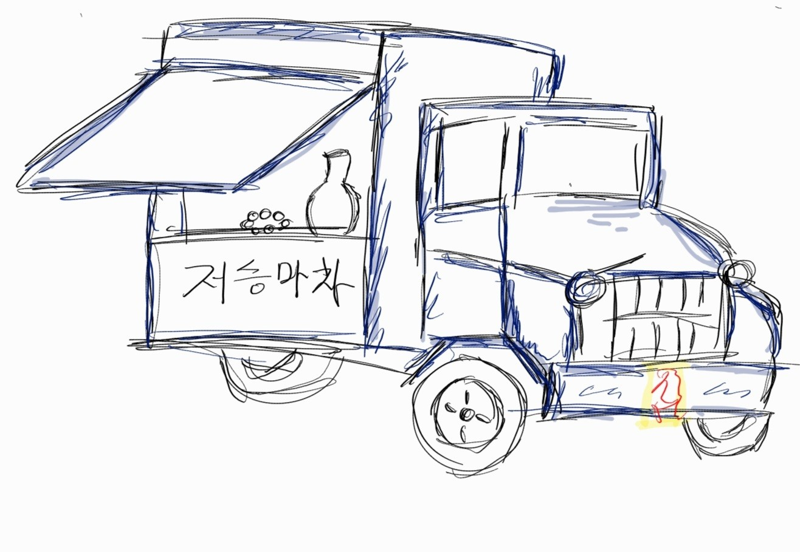

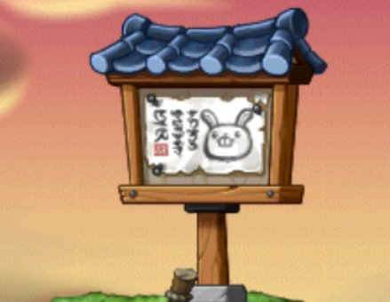

---

## 6. 아트 컨셉_저승 관문

장승 또는 두 개의 기둥 형태로 디자인한다.

나무 재질을 바탕으로 붉은색과 검정색을 주로 사용한다.

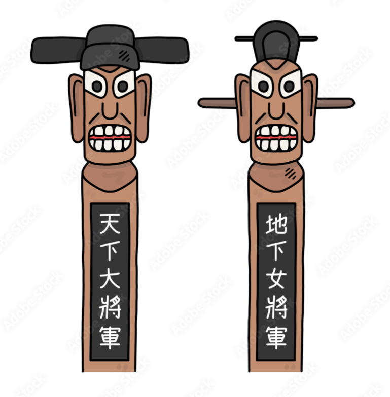

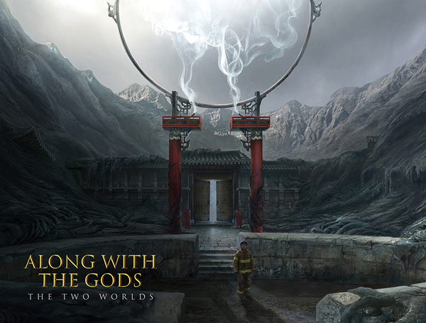

---

## 7. 아트 컨셉_마을 기본 타일

기본 형태와 문양 스케치

정사각형으로 제작한다.

타일 크기는 논의 후 결정한다.

대리석 재질에 전통 문양을 넣고, 회색 또는 검정색 계열을 사용한다.

윗면은 배경과 비슷한 색으로 빛나는 느낌을 준다.

오래되어 부서지고 갈라진 듯한 질감을 표현한다.

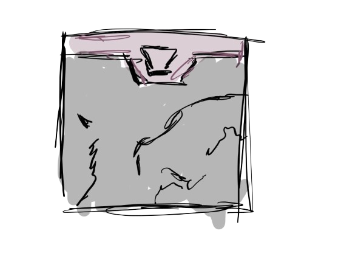

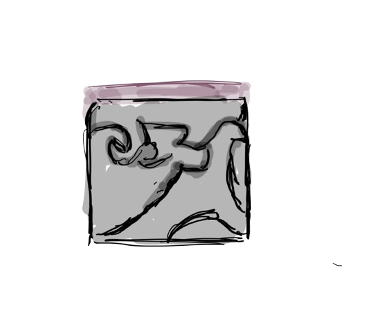

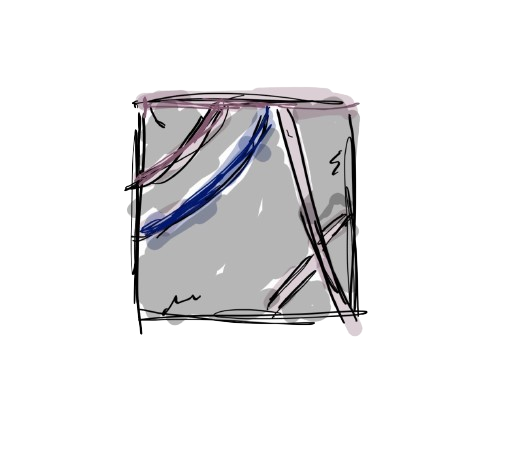

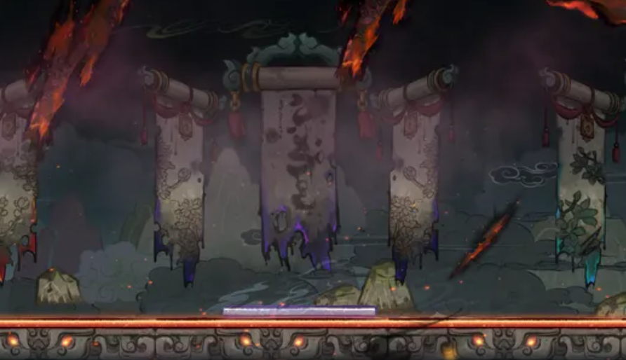

---

## 8. 아웃라인

표시 | 설명

연결부 | 구역 사이 연결

초록 | 일꾼 망령 A 배치

빨강 타원 | 일꾼 망령 B 배치

파랑 | 일꾼 망령 C 배치

빨강 원 | 일꾼 망령 D 배치

보라 | 작업 반장 A 배치

A1~A6 구역은 도면의 연결부로 이어진다.

A6의 레버를 누르면 A1을 막고 있던 벽이 올라간다.

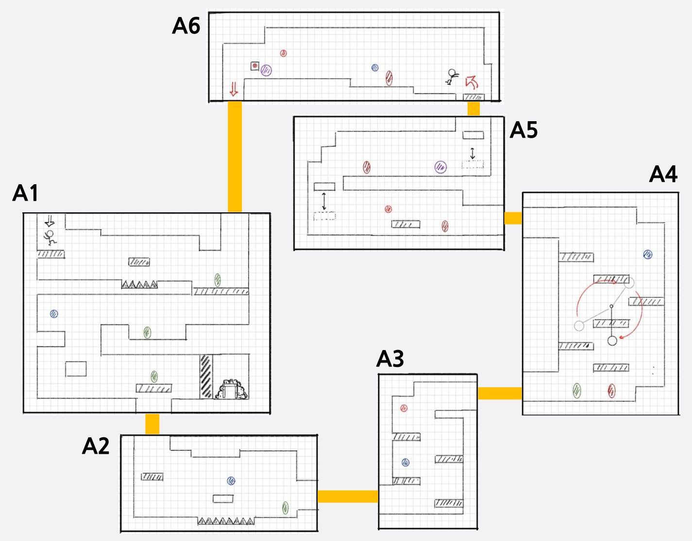

---

## 9. A1_통과 발판과 막힌 벽

통과 가능한 발판

발판 위에서 점프 + 아래 방향키 를 입력하면 아래로 통과할 수 있다.

A6 레버로 여는 벽

통로가 벽으로 막혀 있다.

A6에서 레버를 누르면 A1의 벽이 올라간다.

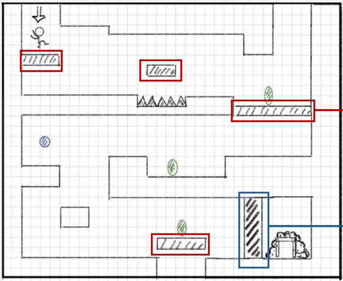

---

## 10. A4_철퇴 함정

회전하는 철퇴 함정

철퇴 부분 에 피격 판정을 둔다.

쇠사슬(줄) 부분 에는 콜라이더를 두지 않는다.

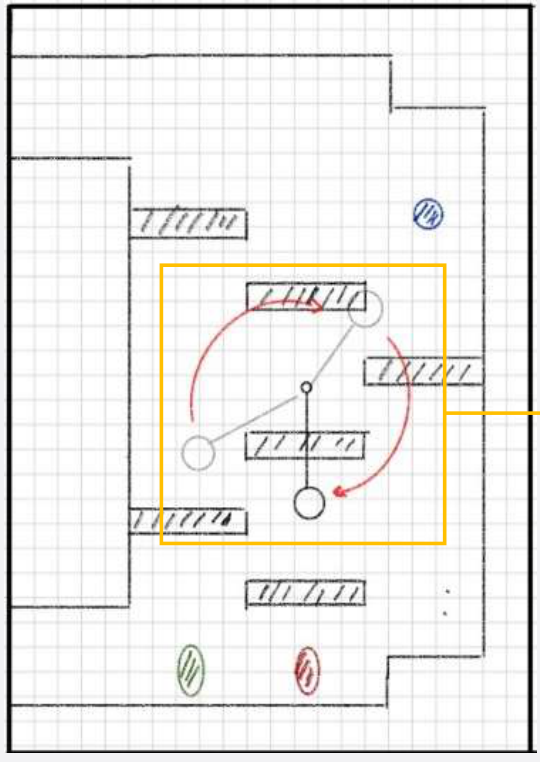

---

## 11. A5_몬스터 처치와 이동 발판

2번 발판

처음에는 위쪽에 고정되어 있다.

A5의 모든 몬스터를 처치하면 위아래로 움직이기 시작한다.

1번 발판

계속해서 위아래로 움직인다.

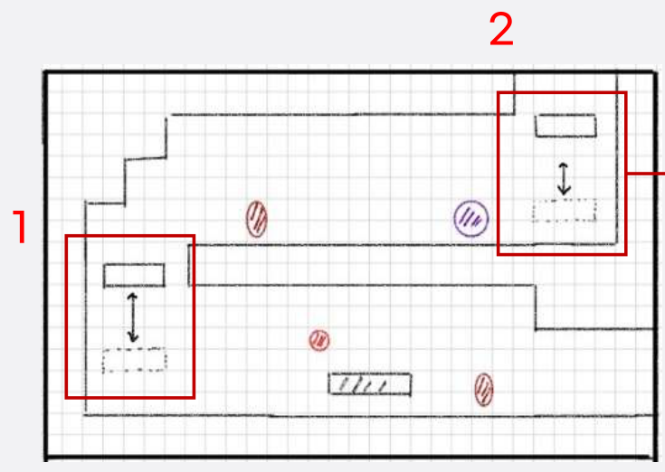

---

## 12. 아트 요청_기본 블록과 얇은 블록

기본 블록_중간 부분

윗부분은 나무, 나머지는 돌이 섞인 느낌으로 표현한다.

모서리는 각지기보다 둥글거나 거칠게 마감한다.

가로 길이를 달리해 정사각형 1개, 직사각형 2개 를 제작한다.

기본 블록_끝부분

중간 부분과 비슷한 재질을 사용한다.

윗부분이 튀어나오도록 마감한다.

얇은 블록

어두운 회색 계열의 철 재질로 표현한다.

두께는 기본 블록의 절반 으로 한다.

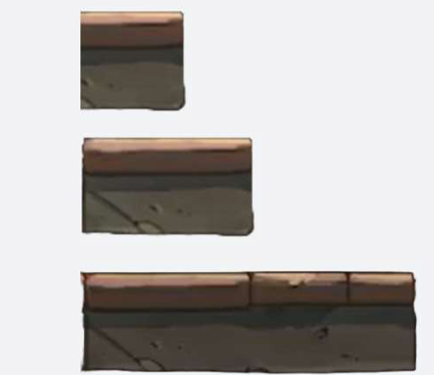

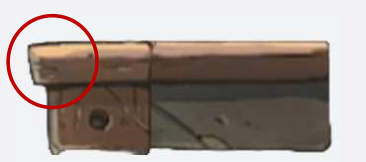

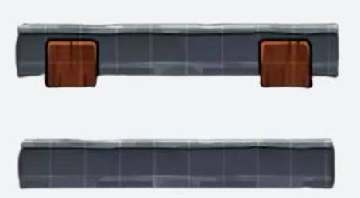

---

## 13. 아트 요청_돌 블록과 나무 기둥

돌 블록_중간 부분

어두운 검정색 또는 회색 계열로, 여러 돌을 쌓은 느낌을 낸다.

두꺼운 벽으로 사용할 예정이다. 크기는 기본 블록의 가로·세로 각각 2~3배다.

블록 안의 돌 모양을 달리해 2개 제작한다.

나무 기둥 1

끈으로 묶은 일자 통나무 형태이며, 어두운 갈색 계열을 사용한다.

기본 블록처럼 끝부분 1개, 중간 부분 1개 로 나누어 제작한다.

나무 기둥 2

각목처럼 통짜 형태의 나무 기둥으로 만든다.

나무 기둥 1보다 조금 밝은 계열로, 1개 제작한다.

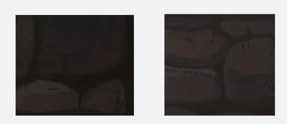

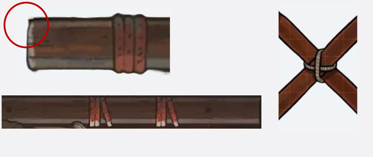

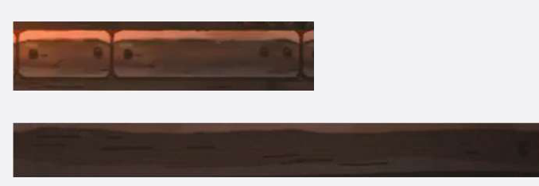
