---

## 1. 전투 시작_캐릭터 인식 & 공격 타입

변수명 | 변수명(영) | 자료형 | 설명

시야 거리 | ViewDistance | int | 몬스터의 시야 거리 범위 안에 들어오면 추적 프로세스 시작

시야는 원형 범위이며, ViewDistance 값은 원의 반지름 이다.

캐릭터가 시야 범위에 들어오면 몬스터의 공격 타입에 따라 전투 진입 여부를 판단한다.

변수명 | 변수명(영) | 자료형 | 설명

공격 타입 | MonsterAttackType | bool | 몬스터의 선공 여부 True: 시야, 공격 사거리 안에서 먼저 공격 False: 피격 전에는 먼저 공격하지 않음

True 이면 캐릭터가 시야에 들어올 때 전투 프로세스를 시작한다.

False 이면 캐릭터가 시야에 들어와도 피격 전까지 기본 상태를 유지한다.

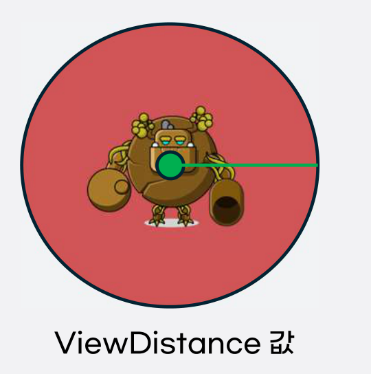

---

## 2. 전투_추적 & 공격

변수명 | 변수명(영) | 자료형 | 설명

공격 사거리 | AttackDistance | int | 몬스터의 공격 사거리 범위 안에 들어오면 공격 프로세스 시작

전투 상태인 몬스터의 공격 사거리 안 에 캐릭터가 있으면 즉시 공격 프로세스를 시작한다.

시야에는 있지만 공격 사거리에는 없으면 캐릭터를 따라 이동하는 추적 프로세스를 시작한다.

캐릭터가 있는 방향으로 이동하며, 추적 속도는 MonsterTable의 이동속도 값을 사용한다.

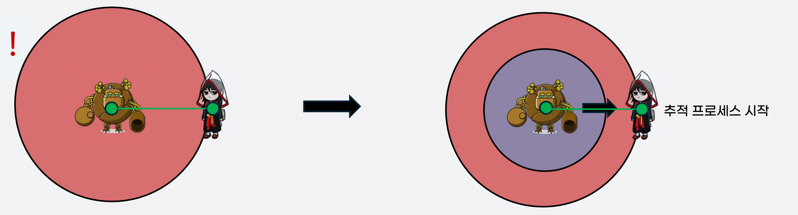

---

## 3. 전투_추적 & 공격

변수명 | 변수명(영) | 자료형 | 설명

몬스터 공격력 | MonsterAD | int | 몬스터의 공격력

몬스터 공격속도 | MonsterAS | int | 공격 애니메이션 종료 후 다음 공격 스킬 발동까지 대기하는 시간(ms)

■ 공격 프로세스

MonsterAS가 500이면 공격 애니메이션 종료 후 500ms 대기

공격 사거리 안에 캐릭터가 있으면 몬스터의 공격 스킬이 발동한다.

공격 애니메이션이 재생되며, 몬스터의 공격력에 따라 캐릭터의 HP가 감소한다.

공격이 끝난 뒤 MonsterAS만큼 대기하고 다음 공격을 시작한다.

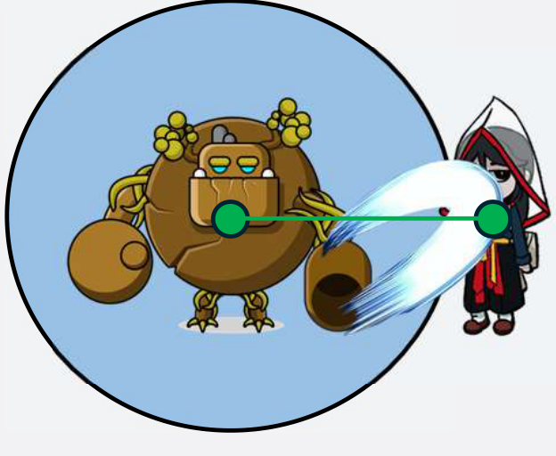

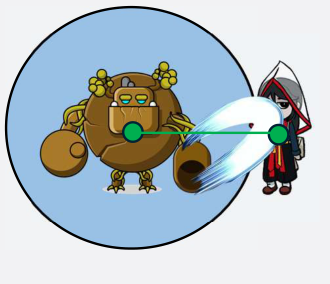

---

## 4. 전투_추적 & 공격

■ 공격 프로세스

변수명 | 변수명(영) | 자료형 | 설명

몬스터 투사체 속도 | MonsterSS | int | 투사체를 날리는 몬스터의 경우 투사체가 날아가는 속도

몬스터가 투사체를 날리는 공격 스킬을 사용하는 경우에 적용한다.

스킬 발동 시점의 캐릭터 위치 를 향해 몬스터 위치에서 직선으로 발사한다. 발사 후 캐릭터를 따라가는 유도탄은 아니다.

투사체 이동속도는 MonsterTable의 MonsterSS 값을 참조한다.

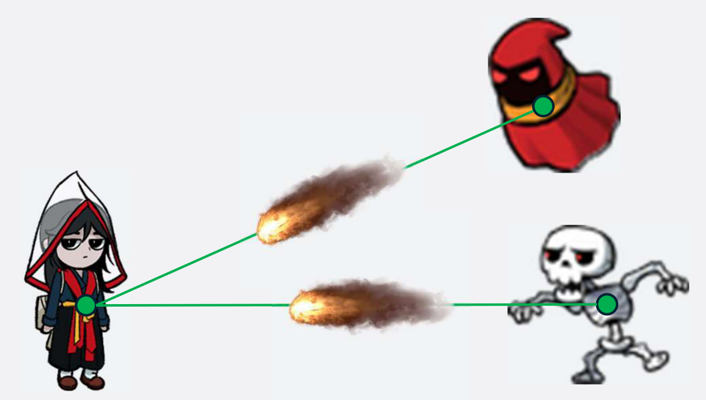

---

## 5. 디자인 컨셉

이름 일꾼 망령 A, B (임시)

삐뚤어진 안전모, 몸 곳곳의 생채기, 상의를 벗고 바지를 입은 모습. 발목에는 족쇄가 있고, 오른손에는 돌멩이를 쥐고 있다.

안전모는 노란색. 일꾼 망령 A: 어두운 녹색 계열의 피부. 일꾼 망령 B: 어두운 붉은색 계열(팥색)의 피부.

<REF>

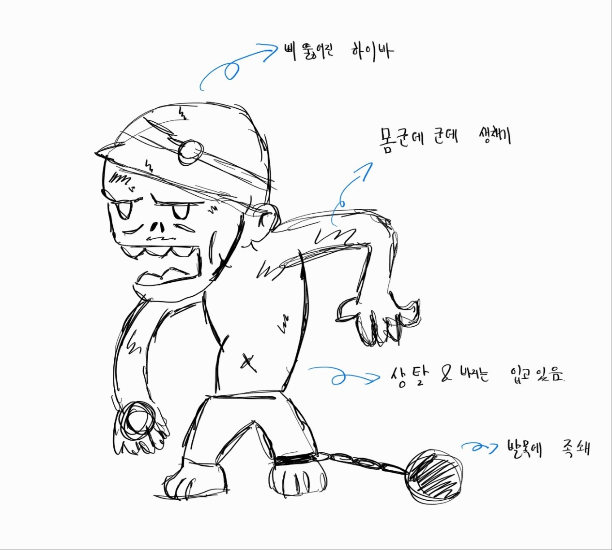

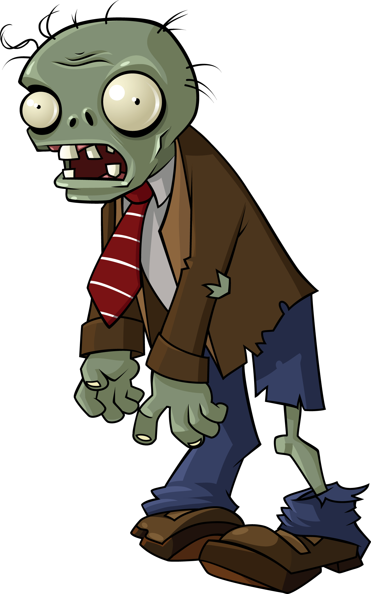

---

## 6. 디자인 컨셉

이름 일꾼 망령 C, D (임시)

누더기 두건을 쓰고, 양손에 족쇄가 있다.

일꾼 망령 C: 어두운 푸른색 계열. 일꾼 망령 D: 어두운 붉은색 계열(팥색).

<REF>

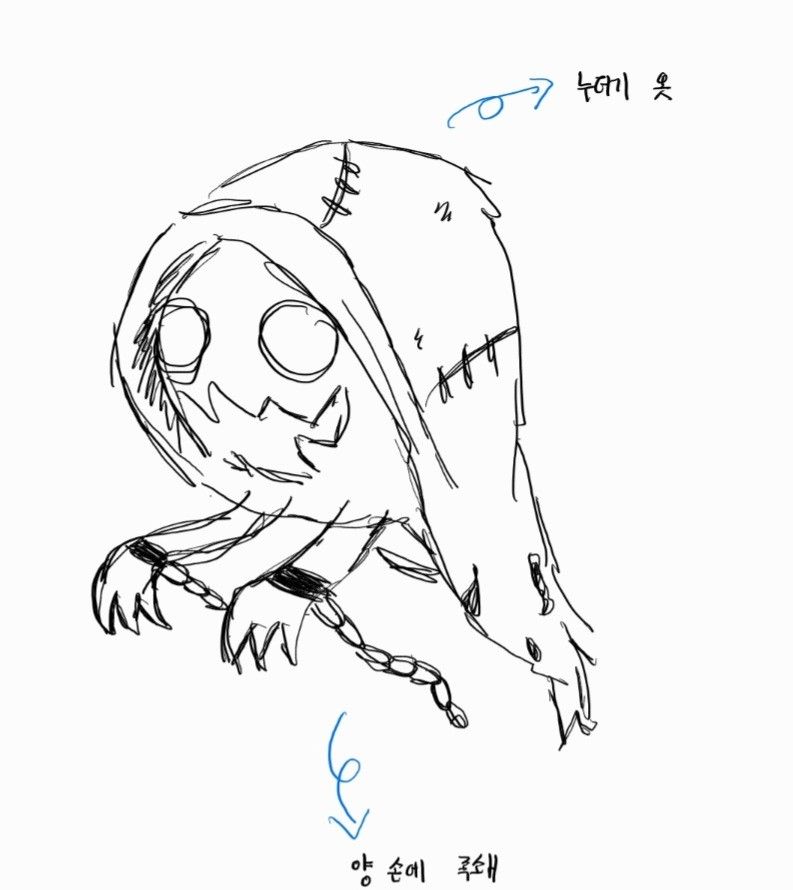

---

## 7. 디자인 컨셉

이름 작업 반장 A

안전모를 쓰고, 점프 슈트 같은 한 벌 옷을 입는다. 손에는 각목을 들고, 오른쪽 팔뚝에는 완장을 찬다. 전체적으로 각진 인상이다.

안전모, 조끼, 완장은 노란색, 옷은 남색 계열. 피부는 어두운 살구색 느낌이다.

<REF>

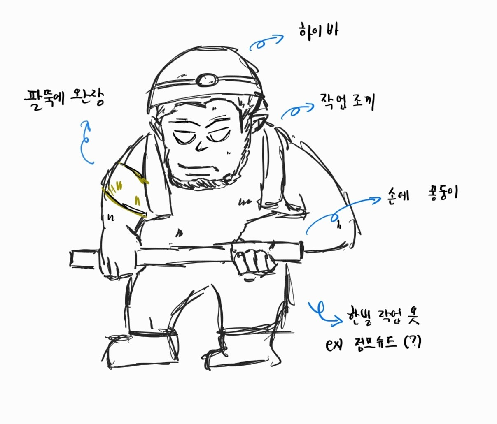

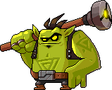

---

## 8. 디자인 컨셉

이름 작업 반장 B

손에 족쇄를 들고, 팔뚝에는 완장을 찬다. 조금 얄쌍한 체형과 뾰족한 귀가 특징이다.

옷은 남색 계열, 피부는 밝은 살구색이다.

<REF>

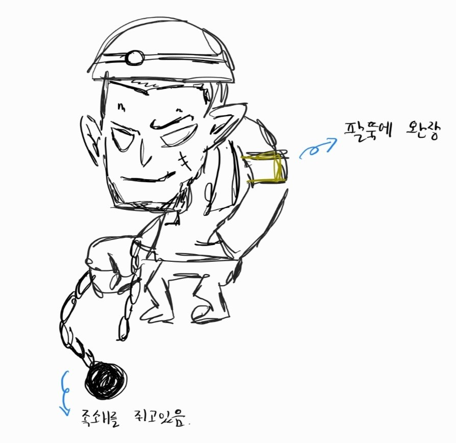

---

## 9. 애니메이션

일꾼 망령 A, B

WorkSpecterA_Ideal

제자리에서 어깨를 살짝 들썩거린다.

WorkSpecterA_Work

양팔과 다리를 좌우로 움직이며 걷는다. 뚝딱거리는 느낌을 준다.

WorkSpecterA_Attack

몸을 뒤로 살짝 젖힌 뒤 손바닥으로 내리친다.

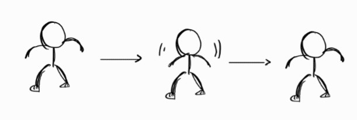

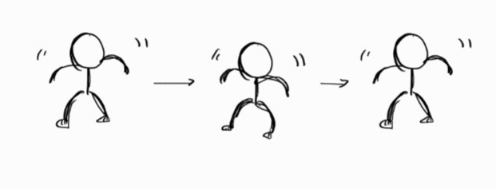

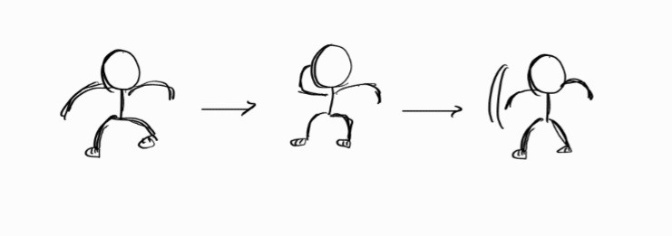

---

## 10. 애니메이션

일꾼 망령 C, D

WorkSpectorB_Ideal

두건이 펄럭거리며, 손을 살짝 위아래로 움직인다.

WorkSpectorB_Walk

Ideal과 같은 애니메이션을 사용하며 몬스터의 위치만 이동한다.

WorkSpectorB_Attack

손바닥을 들어 올려 기를 모은 뒤 불덩이 형태의 투사체를 날린다.

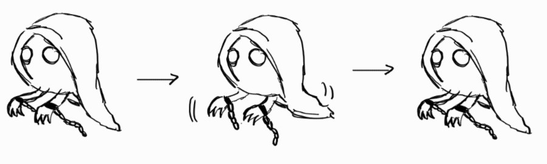

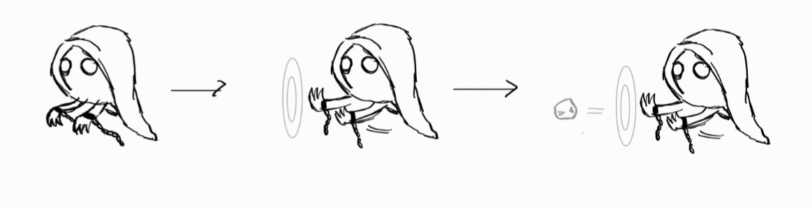

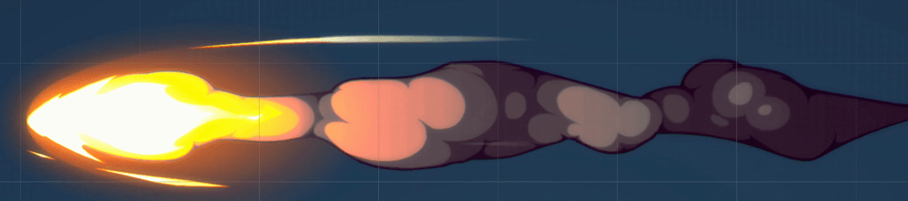

---

## 11. 애니메이션

작업 반장 A

WorkLeaderA_Ideal

각목을 한쪽 어깨에 대고 있는 듯한 자세를 취한다.

WorkLeaderA_Walk

한 손에 각목을 들고 터벅터벅 걷는 느낌을 준다.

WorkLeaderA_Attack

몽둥이를 들어 올려 위에서 아래로 크게 휘두른다.

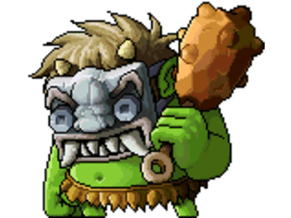

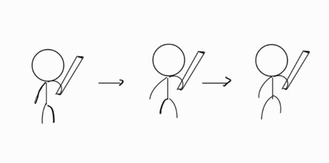

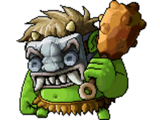

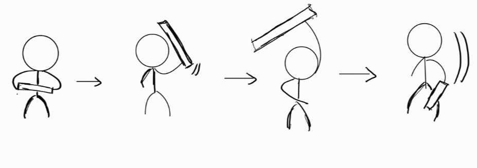

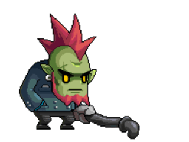

---

## 12. 애니메이션

작업 반장 B

WorkLeaderB_Ideal

들고 있는 족쇄를 짤랑짤랑 흔든다.

WorkLeaderB_Walk

Ideal 애니메이션에서 다리만 움직이는 느낌으로 걷는다.

WorkLeaderB_Attack

족쇄를 들어 올려 아래로 크게 휘두른다. 채찍 같은 느낌을 준다.

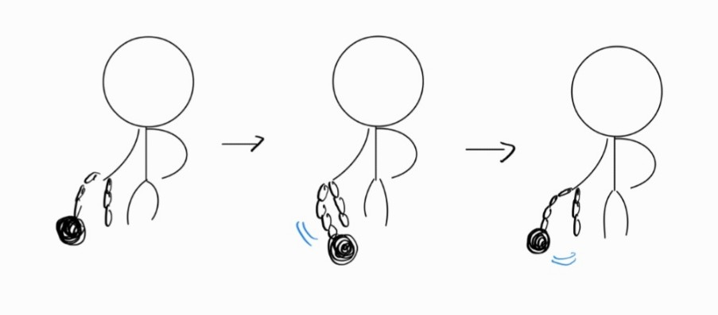

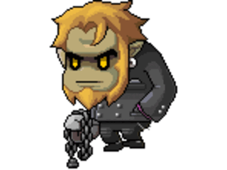

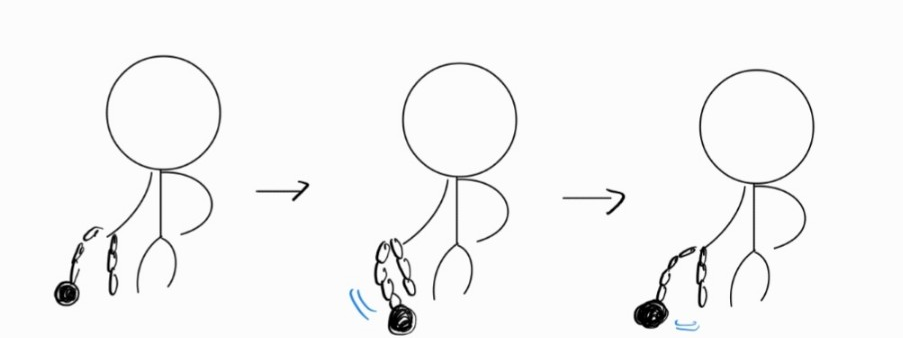

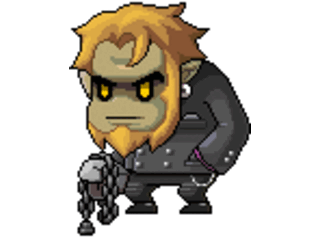

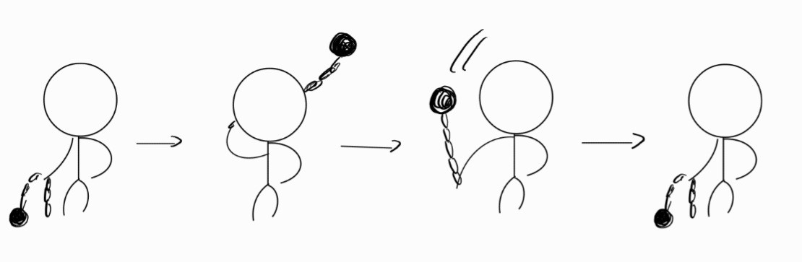

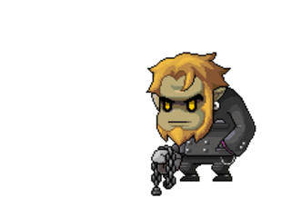
