---

## 1. 기본 이동 로직_걷기, 달리기, 앉기

좌우 이동, 걷기

좌우 방향키를 누르고 있는 동안 이동한다. (GetKey) 방향키를 떼면 관성 없이 즉시 정지 한다. 이동 속도: 맵 디자인 이후 결정

좌우 이동, 달리기

걷는 도중 Shift + 좌우 방향키 로 해당 방향으로 달린다. Shift만 떼면 걷기로, 방향키를 떼면 정지 상태로 전환한다. 이동 속도: 맵 디자인 이후 결정

앉기, 앉아서 걷기

정지 상태에서 아래 방향키를 누르고 있으면 앉는다. (GetKey) 걷는 도중 아래 방향키를 누르면 앉아서 걷고, 이동 속도가 감소한다. 아래 방향키를 떼면 원래 상태로 복귀한다.

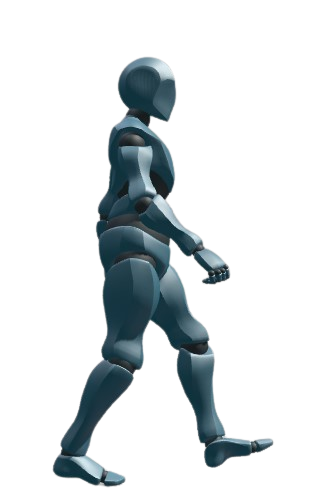

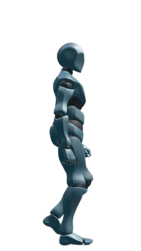

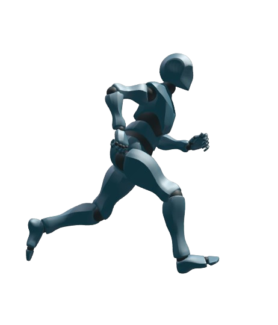

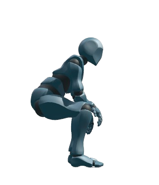

---

## 2. 기본 이동 로직_슬라이딩, 점프

슬라이딩

달리는 도중 아래 방향키 를 누르면 진행 방향으로 슬라이딩한다. (GetKeyDown) 애니메이션이 끝나기 전에는 방향 전환, 점프, 정지 등 다른 행동을 할 수 없다. 애니메이션 종료 후 현재 상태로 복귀한다.

점프, 2단 점프

Alt 를 누르면 점프한다. (GetKeyDown) 정지, 걷기, 달리기 상태에서 사용할 수 있으며, 앉기, 슬라이딩 중에는 사용할 수 없다. 점프 중 다시 Alt를 누르면 2단 점프 한다. 입력한 높이에서 다시 점프 높이만큼 뜬다. 점프 높이: 맵 디자인 이후 결정

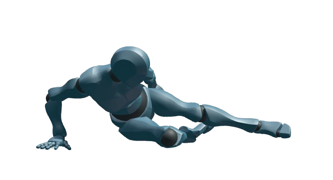

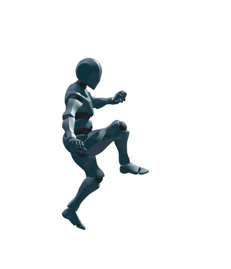

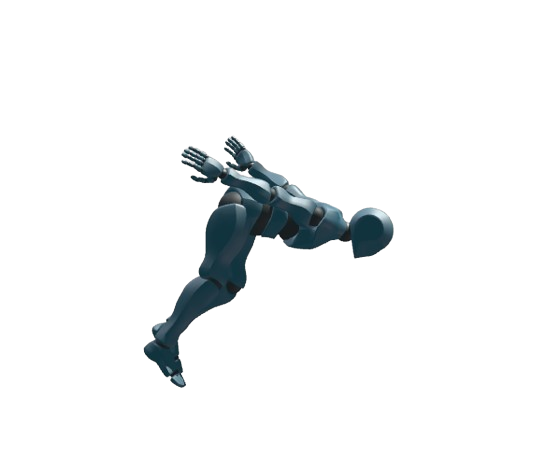

---

## 3. 캐릭터 연출 기획_점프

애니메이션 | 리소스명 | Player_Jump_Anim

분류 | 준비 동작 | 액션 | 마무리

설명 | 양쪽 무릎을 살짝 굽히며 하늘로 도약한다. | 옷을 펄럭이고 팔을 벌리며 점프한다. 떨어질 때는 옷이 위를 향한다. | 착지 시 무릎을 살짝 굽히며 대기 상태로 전환한다.

루프 타입 | Once | Once | Once

재생시간 (ms) | 100 | 500 | 100

이펙트 | 리소스명 | —

분류 | 준비 동작 | 액션 | 마무리

설명 | — | — | —

루프 타입 | — | — | —

재생시간 (ms) | — | — | —

사운드 | 리소스명 | Player_Jump_Sound | — | Player_Landing_Sound

분류 | 준비 동작 | 액션 | 마무리

설명 | “탓” 소리와 같은 짧은 점프 사운드 | — | “착” 소리와 같은 짧은 착지 사운드

루프 타입 | once | — | Once

재생시간 (ms) | 100 | — | 100

점프, 착지 사운드 레퍼런스

준비 → 도약 → 착지 순서로 동작을 구성한다.

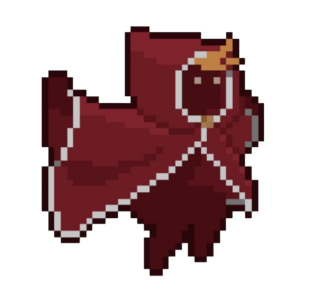

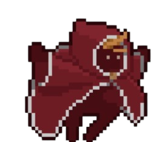

---

## 4. 캐릭터 연출 기획_더블 점프

애니메이션 | 리소스명 | Player_DoubleJump_Anim

분류 | 준비 동작 | 액션 | 마무리

설명 | 기본 점프 동작에서 이어진다. | 공중에서 한 바퀴 더 회전한다. | 기본 점프의 착지 동작과 동일하다.

루프 타입 | — | Once | —

재생시간 (ms) | — | 400 | —

이펙트 | 리소스명 | Player_DoubleJump_Effect

분류 | 준비 동작 | 액션 | 마무리

설명 | — | 공중에서 더블 점프할 때 먼지, 구름 형태의 잔상을 남긴다. | —

루프 타입 | — | Once | —

재생시간 (ms) | — | 200 | —

사운드 | 리소스명 | Player_Jump_sound 와 동일

분류 | 준비 동작 | 액션 | 마무리

설명 | — | Player_Jump_sound 와 동일 | —

루프 타입 | — | Once | —

재생시간 (ms) | — | 200 | —

점프 사운드 레퍼런스

기본 점프 도중 한 번 더 회전하고, 착지는 기본 점프와 동일하게 구성한다.

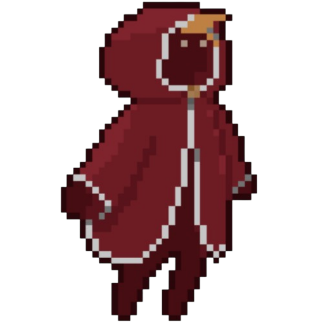

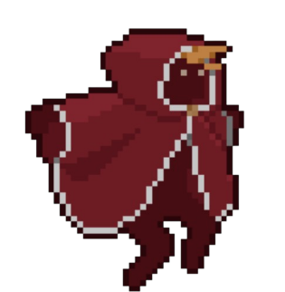

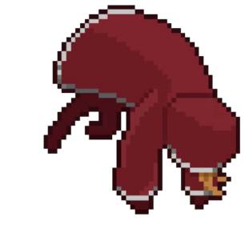

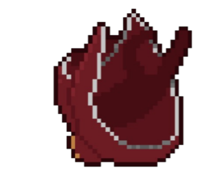

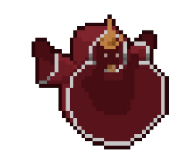

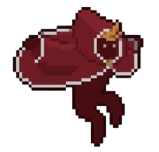

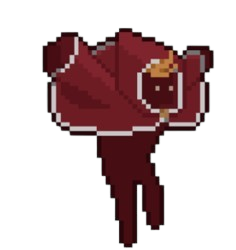

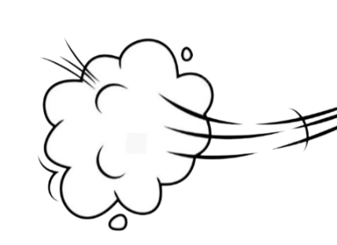

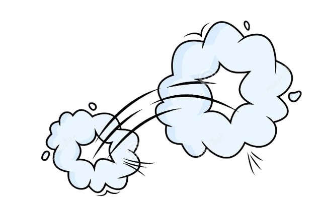

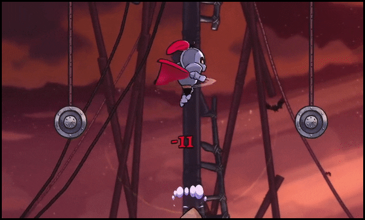

---

## 5. 캐릭터 연출 기획_슬라이딩

애니메이션 | 리소스명 | Player__Sliding_Anim

분류 | 준비 동작 | 액션 | 마무리

설명 | 몸을 숙이며 한쪽 팔로 바닥을 짚는다. | 다리를 쭉 펴고 옷이 펄럭인다. | 다시 IDLE 상태로 복귀한다.

루프 타입 | once | once | —

재생시간 (ms) | 50 | 700 | —

이펙트 | 리소스명 | Player_Sliding_Effect

분류 | 준비 동작 | 액션 | 마무리

설명 | — | 바닥이 긁히면서 먼지구름이 일어난다. | 자연스럽게 옅어지며 사라진다.

루프 타입 | — | — | —

재생시간 (ms) | — | — | —

사운드 | 리소스명 | Player_Slidng_Sound

분류 | 준비 동작 | 액션 | 마무리

설명 | — | 바닥이 “촤아악” 긁히는 사운드 | —

루프 타입 | — | once | —

재생시간 (ms) | — | 700 | —

슬라이딩 사운드 레퍼런스

달리는 방향으로 몸을 낮춰 미끄러지는 동작을 구성한다.

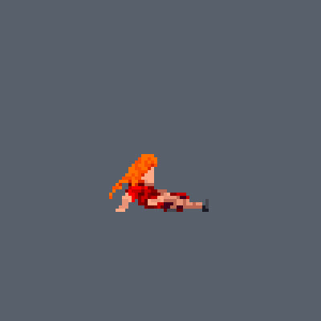

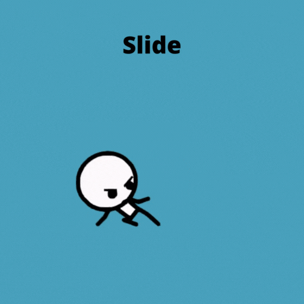

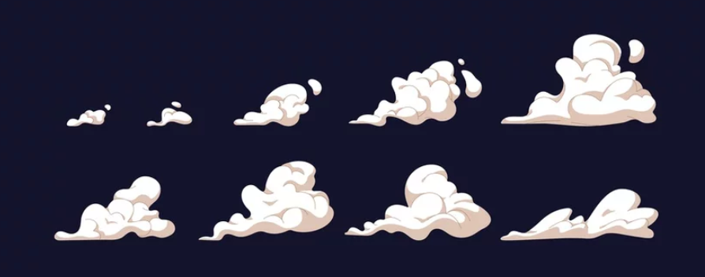

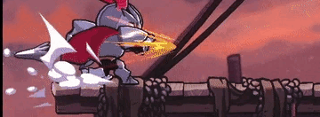
