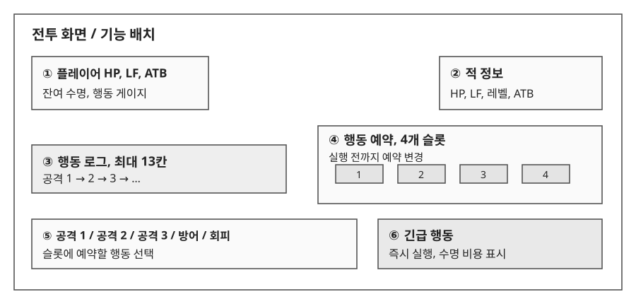
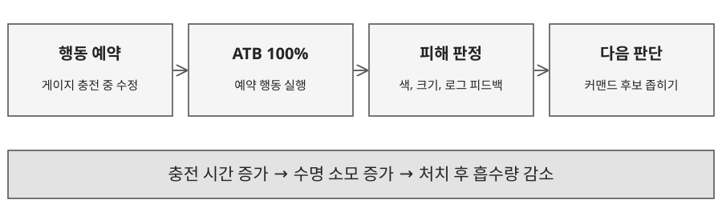
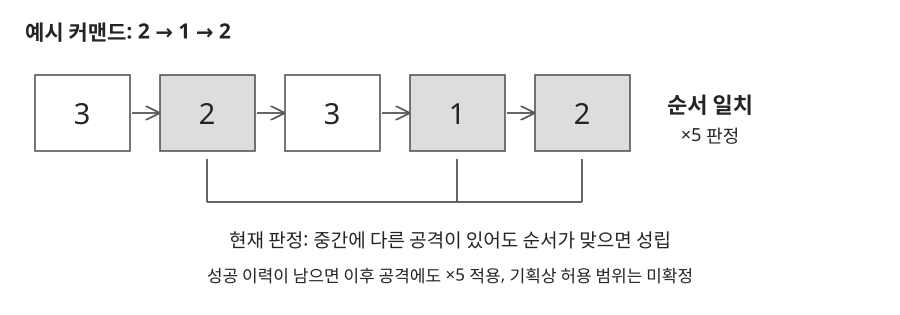

# 1.1 전투 흐름과 정보 배치

## 전투 목표

적을 빠르게 처치해 남아 있는 수명을 흡수한다. 플레이어는 공격 순서를 추리하는 동안에도 수명을 소모하므로, 충분히 관찰할지 비용을 내고 힌트를 받을지 판단해야 한다.

| 번호 | 기능 | 표시와 입력 규칙 |
|---|---|---|
| ①, ② | 전투 상태 | HP와 수명을 구분하고, 양측의 행동 게이지를 표시한다. |
| ③ | 행동 로그 | 공격 행동만 최대 13칸에 기록한다. 오래된 기록부터 밀어낸다. |
| ④ | 행동 예약 | 4개 슬롯에 행동을 예약한다. 실행 전에는 변경할 수 있다. |
| ⑤ | 기본 행동 | 공격 1, 2, 3, 방어, 회피를 제공한다. |
| ⑥ | 긴급 행동 | 소모 수명을 표시한다. 비용을 지불하고 게이지와 무관하게 실행한다. |

## 진행 규칙

- 탐험 중 적이 있는 타일에 1칸 이내로 인접하면 전투에 진입한다.
- 양측 ATB 게이지가 자동으로 충전되며, 충전 중 수명이 감소한다.
- 게이지가 100%가 되면 예약 행동을 실행한다. 행동은 한쪽이 끝난 뒤 다음 행동을 처리한다.
- 플레이어와 적이 한 번씩 행동한 뒤 긴급 행동을 사용할 수 있다.
- 적 HP가 0이 되면 남은 수명을 흡수한다. 플레이어의 수명이 0이 되면 런이 종료된다.
- 플레이어 HP가 0이 되면 전투에서 패배한다. 패배 시 손실 규칙은 미확정이다.

---

# 1.2 ATB와 피해 공식

## 속도와 비용

| 항목 | 계산식 | 설계 의도 |
|---|---|---|
| 충전 시간 T | 1000 ÷ (100 + ATBSpeed ÷ 5) | 속도가 높을수록 대기와 수명 소모 감소 |
| 충전 중 수명 소모 | T × LIFE_DECAY | 시간 비용을 독립 변수로 조정 |
| 기본 피해 B | max(1, floor(공격력 × 100 ÷ (100 + DEF))) | 방어력에 따른 경감, 피해 0 방지 |
| 약점 후보 공격 | floor(B × 1.1) | 정답을 직접 공개하지 않는 소폭 보상 |
| 커맨드 성공 공격 | floor(B × 5) | 공격 순서를 알아낸 보상, ×1.1과 중첩하지 않음 |

| ATBSpeed | 충전 시간 | 1회 충전의 수명 소모, LIFE_DECAY = 1 |
|---|---|---|
| 0 | 10.00초 | 10.00 |
| 100 | 8.33초 | 8.33 |
| 300 | 6.25초 | 6.25 |
| 500 | 5.00초 | 5.00 |

표의 소수는 계산 예시이며 UI의 정수 표시 규칙과 구분한다. ATBSpeed 500에서 충전 시간은 5초다.

## 방어와 회피

- 방어 시 피해 계산에 사용하는 DEF를 2배로 적용한다.
- 회피 확률은 50%를 기준으로 둔다.
- PowerAtk는 방어 행동의 효과를 무시한다.
- 같은 방어 또는 회피 행동은 중복 예약하지 않는다. 적 공격 1회에 먼저 사용한 방어 행동을 처리한다.

공격 1, 2, 3의 기본 피해는 동일하게 둔다. 높은 기본 피해의 버튼만 반복하는 대신, 공격 종류와 순서에 집중하도록 한다.

---

# 1.3 약점 커맨드와 추리 피드백

## 커맨드 구성

- 공격 1, 2, 3을 중복 허용해 2~4자리로 조합한다.
- 조합 수는 3² + 3³ + 3⁴ = 117개다. 몬스터별 커맨드는 기획자가 지정한다.
- 공격이 커맨드에 포함되면 후보 피드백, 순서 조건까지 만족하면 성공 피드백을 표시한다.
- 방어, 회피, 긴급 행동은 공격 로그에 넣지 않는다.

## 피드백 구분

| 상태 | 피해 처리 | 시각 정보 |
|---|---|---|
| 일반 공격 | 기본 피해 | 노란색 숫자, #FFD900 |
| 약점 후보 | 기본 피해 × 1.1 | 붉은 계열 숫자, #FF6161 |
| 커맨드 성공 | 기본 피해 × 5 | 빨간색 #FF0000, 글자 크기 65, 성공 로그 강조 |

## 긴급 행동, 약점 파악

| 사용 단계 | 기획 규칙 | 의도 |
|---|---|---|
| 1회 | 커맨드 길이 공개 | 탐색 범위를 줄인다. |
| 2회 | 첫 슬롯에 정답 공격 자동 예약 | 전체 정답 대신 다음 행동의 실마리를 준다. |
| 비용 | 수명 소모, 비용 변수로 관리 | 추리에 쓸 시간과 힌트 비용을 비교한다. |

현재 시뮬레이터의 2회 보상은 첫 공격 표시까지다. 성공 이력이 남아 있는 동안 이후 공격에도 ×5가 반복 적용된다. 등급별 커맨드 전환과 상태이상은 미구현이다. 반복 보상의 허용 범위를 먼저 정한 뒤 판정 로직에 반영한다.
