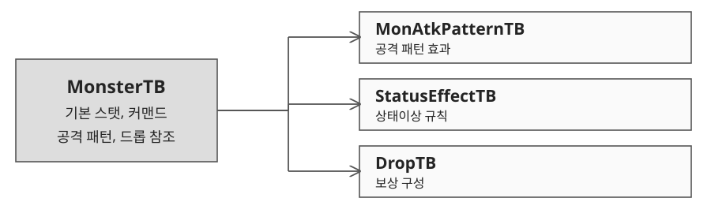

# 2.1 몬스터 데이터와 등급 규칙

## 데이터 구조

| 테이블 | 주요 역할 |
|---|---|
| MonsterTB | 레벨 1 기본 스탯, 수명, 약점 커맨드 3개, 패턴과 드롭 참조 |
| MonAtkPatternTB | 기본 공격과 특수 공격의 효과 정의 |
| StatusEffectTB | 지속 턴, 갱신, 중첩 등 상태이상 규칙 |
| DropTB | 장비, 죄악 조각, 기타 아이템 보상 구성 |

## 등급별 커맨드 운용

| 등급 | 활성 커맨드 | 전환 조건 |
|---|---|---|
| Normal | 3개 중 무작위 1개 | 전투 중 고정 |
| Elite | 3개 중 무작위 2개, 순차 | 첫 커맨드 공략 후 두 번째로 전환 |
| Boss | 3개 모두 사용 | 1 → 2 → 3 순차 전환 |

## 개체 생성과 공격

- 몬스터 ID는 등장 지역 1자리, 등급 1자리, 고유 번호 3자리로 구분한다. 예: 10001.
- 기본 스탯과 배치 레벨을 분리한다. 실제 스탯 = 기본값 × (1 + (레벨 − 1) × 0.1).
- ATB 100% 도달 시 지정된 공격 패턴 3개 중 1개를 무작위 실행한다.
- 기본 공격 외에 강공, 중독, 출혈, 약화, 둔화, 흡수, 혼란, 수면, 축소 효과를 구성한다.
- 같은 상태이상은 더 긴 지속 턴으로 갱신하고, 다른 상태이상은 동시에 적용한다. 중첩 여부는 상태별 정의를 따른다.

## 수명 보상

획득 수명 = 몬스터 초기 수명 − 전투 중 몬스터가 소모한 수명. 처치가 늦어질수록 보상이 줄어야 한다. 몬스터 수치는 검증용 데이터이며 등급별 목표 전투 시간과 함께 조정해야 한다.
