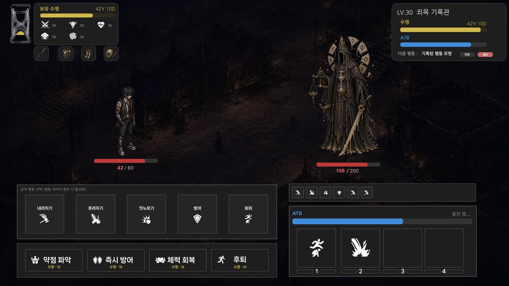

# 전투_시간을 쓰며 약점을 찾는 ATB

<ul class="intro">
<li>HP는 공격을 버티는 체력, 수명은 생존에 남은 시간이자 처치 후 얻을 보상이다.</li>
<li>전투가 늦어지면 자신의 수명을 더 쓰고 적에게서 얻을 잔여 수명도 줄어든다.</li>
<li>약점을 추리해 빠르게 처치하는 것이 다음 탐험의 여유로 이어지도록 기획했다.</li>
</ul>

## ● ATB는 무엇인가

<strong>ATB(Active Time Battle)는 시간이 흐르면 행동 게이지가 차고, 가득 찬 쪽이 행동하는 전투 방식이다.</strong>

<ul>
<li>SOS에서는 각자의 게이지가 100%에 도달하면 예약한 행동을 실행한다.</li>
<li>행동은 한쪽이 끝난 뒤 다음 행동을 처리한다.</li>
</ul>

## ● 왜 이 방식인가

<ul>
<li>수명은 생존 시간인 동시에 탐험과 거래에 쓰는 자원이다. 전투에 실시간 소모를 두면 <strong>고민하는 시간도 비용</strong>이 된다.</li>
<li>전투 밖에서는 행동 단위로 소모하도록 구분해, 모든 상황에서 실시간으로 수명이 줄어드는 부담을 피하는 방향으로 정했다.</li>
</ul>

## ● 전투 반복 흐름

<figure aria-label="전투 반복 흐름">

<b>충전, 예약</b>양측 ATB 증가 양측 수명 감소
<i>→</i>
<b>100% 도달</b>예약 행동 실행 피해와 생존 판정
<i>→</i>
<b>단서 확인</b>공격 로그, 피해 표시 다음 행동 선택

전투가 끝나지 않았다면 충전, 예약, 단서 확인을 반복
</figure>

입력 대기 조건은 다음 쪽의 행동 예약 규칙으로 구분한다.

## ● 플레이어가 판단할 것

<table>
<colgroup><col style="width:24%"/><col style="width:38%"/><col style="width:38%"/></colgroup>
<thead><tr><th>선택</th><th>얻는 것</th><th>지불하거나 감수하는 것</th></tr></thead>
<tbody>
<tr><td>직접 공격하며 추리</td><td>공격 종류와 순서의 단서</td><td>추리에 걸리는 시간과 피격 위험</td></tr>
<tr><td>약점 파악 사용</td><td>커맨드 길이 또는 첫 공격의 실마리</td><td>긴급 행동의 수명 비용</td></tr>
<tr><td>방어, 회피 예약</td><td>적 공격에 대응할 기회</td><td>해당 행동 기회에 공격하지 않음</td></tr>
</tbody>
</table>

## ● 진입과 종료

탐험 중 적 타일에 1칸 이내로 인접하면 전투에 진입한다. 종료 조건은 다음 세 가지로 구분한다.

적 HP 0<i>→</i><em>남은 적 수명 흡수</em>플레이어 HP 0<i>→</i><em>전투 패배</em>플레이어 수명 0<i>→</i><em>런 종료</em>

패배 시 손실 규칙은 확정이 필요하다.

# 전투_화면 정보와 행동 예약

## ● 서로 다른 세 정보

<figure class="ui">

<b>HP</b>전투에서 버틸 수 있는 체력

<b>수명</b>소모하고 흡수하는 생존 자원

<b>ATB</b>다음 행동까지 남은 충전량

<figcaption class="credit">전투 UI, 아트: 팀 제작</figcaption></figure>

## ● 입력과 기록의 역할

<table>
<colgroup><col style="width:17%"/><col style="width:41%"/><col style="width:42%"/></colgroup>
<thead><tr><th>영역</th><th>기획 규칙</th><th>플레이 중 읽는 방법</th></tr></thead>
<tbody>
<tr><td>기본 행동</td><td>공격 1, 2, 3, 방어, 회피</td><td>공격 종류를 바꾸며 약점 순서를 추리</td></tr>
<tr><td>행동 예약</td><td>슬롯 4개, 실행 전 변경 가능</td><td>앞으로 실행할 행동을 미리 구성</td></tr>
<tr><td>공격 로그</td><td>공격만 최대 13개, 오래된 것부터 제거</td><td>이미 실행한 공격에서 순서를 찾음</td></tr>
<tr><td>긴급 행동</td><td>수명 비용 표시, ATB와 무관하게 실행</td><td>시간을 기다리는 대신 수명을 지불</td></tr>
</tbody>
</table>

<b>예약 예시</b>
공격 2공격 1공격 3방어<em class="no">실행 전의 선택</em>

<ul>
<li>충전이 끝난 슬롯은 활성 상태로 남는다. 행동을 고르면 가장 오래된 활성 슬롯에서 즉시 실행하고, 활성 슬롯이 없으면 충전 중인 슬롯에 예약한다.</li>
<li><strong>4개 모두 활성화된 채 입력을 기다리면 플레이어 수명 소모를 멈추는 기획</strong>이다.</li>
</ul>

## ● 긴급 행동의 사용 조건

<ul>
<li><strong>플레이어와 적이 한 번씩 행동한 뒤 활성화</strong>한다. 약점 파악, 즉시 방어, 체력 회복, 후퇴를 구성한다.</li>
<li>즉시 방어는 슬롯과 무관하게 적의 다음 공격을 방어하며, 후퇴는 전투 종료와 패배로 처리한다.</li>
<li>회복은 이번 전투에서 잃은 HP의 일정 비율을 되돌리고 회복량에 비례해 수명을 소모하는 기획이다.</li>
</ul>

## ● 무기와 공격 번호

<ul>
<li>무기는 타격류, 날붙이류, 관통류, 투척류로 나누어 마스터리, 장비 묶음, 연출, 스탯과 특수 효과를 관리한다.</li>
<li>무기별 명칭과 연출이 달라도 약점 판정은 공격 번호 1, 2, 3을 기준으로 한다.</li>
</ul>

## ● UI에 전달할 표시 기준

<table>
<colgroup><col style="width:17%"/><col style="width:83%"/></colgroup>
<thead><tr><th>항목</th><th>표시 기준</th></tr></thead>
<tbody>
<tr><td>연결, 순서</td><td>공격 아이콘과 이름은 장비 데이터로 연결하고 설명은 툴팁으로 표시한다. 기본 행동은 공격 1, 2, 3, 방어, 회피 순서, 긴급 행동은 약점 파악, 즉시 방어, 체력 회복, 후퇴 순서다.</td></tr>
<tr><td>색상, 기록</td><td>행동 게이지는 #C49665, 활성 슬롯의 테두리는 #F3C695로 표시한다. 예약 슬롯에는 선택한 행동 아이콘을 넣고, 공격 로그는 행동 모션이 시작될 때 기록한다.</td></tr>
<tr><td>배치</td><td>양측 체력바는 스프라이트 발끝에서 50px 아래에 배치한다. 플레이어의 방어, 회피 준비 아이콘은 체력바 왼쪽 10px, 적의 다음 공격 아이콘과 피해 표시는 각각 왼쪽 50px, 20px에 둔다.</td></tr>
</tbody>
</table>

# 전투_ATB 속도와 피해 계산

## ● 충전 속도가 시간 비용에 주는 영향

T = 1000 ÷ (100 + ATBSpeed ÷ 5)<small>T: 충전 시간(초), 충전 중 수명 소모 = T × LIFE_DECAY</small>

<ul>
<li>속도가 높아지면 한 번 행동하기까지의 대기와 그동안의 수명 소모가 줄어든다.</li>
<li><strong>ATBSpeed 500에서 정확히 5초</strong>이며, 5초를 공식의 최솟값으로 뜻하지 않는다.</li>
</ul>

<table>
<colgroup><col style="width:28%"/><col style="width:18%"/><col style="width:18%"/><col style="width:18%"/><col style="width:18%"/></colgroup>
<thead><tr><th>ATBSpeed</th><th class="num">0</th><th class="num">100</th><th class="num">300</th><th class="num">500</th></tr></thead>
<tbody>
<tr><td>충전 시간(초)</td><td class="num">10.00</td><td class="num">8.33</td><td class="num">6.25</td><td class="num">5.00</td></tr>
<tr><td>수명 소모(LIFE_DECAY = 1)</td><td class="num">10.00</td><td class="num">8.33</td><td class="num">6.25</td><td class="num">5.00</td></tr>
</tbody>
</table>

표는 기본 충전 시간 10초, 초당 소모율 1을 대입한 연속 시간 계산 예시다. 원문의 사이클 소모 표는 정수로 표시한다. 표기 단위와 실제 갱신 간격은 검증 문서에서 구분한다.

## ● 전투 기획서의 피해 규칙

<table>
<colgroup><col style="width:24%"/><col style="width:46%"/><col style="width:30%"/></colgroup>
<thead><tr><th>판정</th><th>기획식</th><th>ATK 30, DEF 20 예시</th></tr></thead>
<tbody>
<tr><td>기본 피해 B</td><td>ATK − DEF</td><td>10</td></tr>
<tr><td>약점 후보 공격</td><td>B × 1.1</td><td>11</td></tr>
<tr><td>커맨드 성공 공격</td><td>B × 2, 후보 ×1.1과 중첩하지 않음</td><td>20</td></tr>
<tr><td>플레이어가 받는 피해</td><td>적 ATK − 플레이어 DEF</td><td>양측에 같은 차감 방식 적용</td></tr>
</tbody>
</table>

<figure aria-label="ATK 30, DEF 20 예시의 판정별 피해">

기본 B

10
후보 B × 1.1

11
성공 B × 2

20

<figcaption>ATK 30, DEF 20 예시. 후보와 성공 배율은 중첩하지 않는다.</figcaption></figure>

공격 1, 2, 3의 기본 피해를 같게 두어 가장 강한 버튼 대신 약점에 포함되는 공격과 순서를 찾게 한다. 후보에는 작은 단서를 주고, 순서를 완성한 공격에는 더 큰 보상을 준다.

## ● 방어와 회피

<table>
<colgroup><col style="width:24%"/><col style="width:76%"/></colgroup>
<thead><tr><th>행동</th><th>기획 규칙</th></tr></thead>
<tbody>
<tr><td>방어</td><td>플레이어의 방어력을 기준으로 적 공격의 피해를 줄인다. 피해 하한과 반올림 기준은 적용할 피해식과 함께 정리해야 한다.</td></tr>
<tr><td>회피</td><td>회피 확률은 50%를 기준으로 두며, 성공하면 피해 0, 실패하면 정상 피해를 받는다.</td></tr>
<tr><td>PowerAtk</td><td>플레이어의 방어 행동 효과를 무시한다.</td></tr>
<tr><td>중복 예약</td><td>같은 방어, 회피는 중복 예약하지 않고, 적 공격 1회에 먼저 사용한 대응 행동을 처리하도록 기획했다.</td></tr>
</tbody>
</table>

# 전투_약점 커맨드와 추리 피드백

<ul class="intro">
<li>공격 1, 2, 3을 중복 허용하여 <strong>2~4자리</strong>로 조합한다. 가능한 조합은 3² + 3³ + 3⁴ = <strong>117개</strong>이며, 몬스터별 커맨드는 기획자가 지정한다.</li>
<li>방어, 회피, 긴급 행동은 공격 로그에 넣지 않는다.</li>
</ul>

<table class="combo">
<colgroup><col style="width:25%"/><col style="width:25%"/><col style="width:25%"/><col style="width:25%"/></colgroup>
<thead><tr><th>커맨드 길이</th><th class="num">2자리</th><th class="num">3자리</th><th class="num">4자리</th></tr></thead>
<tbody><tr><td>조합 수</td><td class="num">3² = 9</td><td class="num">3³ = 27</td><td class="num">3⁴ = 81</td></tr></tbody>
</table>

## ● 순서는 유지하되, 연속할 필요는 없다

<figure aria-label="커맨드 판정 예시">

<b>목표 커맨드</b>
213

<b>공격 로그 예시</b>
22113<em>성공</em>

<b>실패 예시</b>
312<em class="no">실패</em>

<figcaption>강조한 2 → 1 → 3을 순서대로 고를 수 있다. 사이의 다른 공격은 건너뛴다.</figcaption></figure>

<ul>
<li>상세 전투 기획의 판정은 최대 13개 로그 안에서 순서를 지키는 부분 수열을 찾는다.</li>
<li>예를 들어 3 → 1 → 2만 있으면 2 → 1 → 3의 순서를 만들 수 없으므로 실패한다.</li>
</ul>

## ● 정답 대신 주는 단서

<table>
<colgroup><col style="width:30%"/><col style="width:16%"/><col style="width:54%"/></colgroup>
<thead><tr><th>상태</th><th>기획 피해</th><th>기획상 시각 피드백</th></tr></thead>
<tbody>
<tr><td>일반</td><td>B</td><td>노란색 #FFD900, 글자 크기 50</td></tr>
<tr><td>해당 공격이 커맨드에 포함</td><td>B × 1.1</td><td>붉은 계열 #FF6161, 글자 크기 50</td></tr>
<tr><td>순서 조건 성공</td><td>B × 2</td><td>빨간색 #FF0000, 글자 크기 65, 성공 로그 테두리가 빛난 뒤 사라짐</td></tr>
</tbody>
</table>

피해식과 색, 글자 크기는 전투 기획서의 기준이다. 약점 후보 표시는 해당 공격이 몇 번째 자리인지까지 공개하지 않는다.

## ● 수명으로 추리 범위를 좁히는 약점 파악

약점 파악은 최대 2회다. 정답 전체를 드러내지 않고 추리 범위를 좁힌다.

<figure aria-label="약점 파악 사용 횟수별 단서">

<b>1회</b>커맨드 길이 공개

???<em class="no">3자리</em>

<i>→</i>
<b>2회</b>첫 슬롯에 정답 공격 자동 예약

2??<em class="no">첫 슬롯에 공격 2</em>

<figcaption>목표 커맨드 2 → 1 → 3을 예로 든 표시다.</figcaption></figure>

사용 횟수마다 수명 비용에 가중치를 두는 기획이다.

