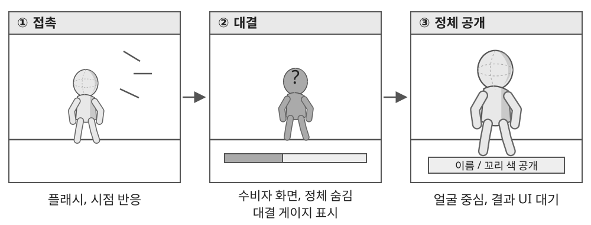
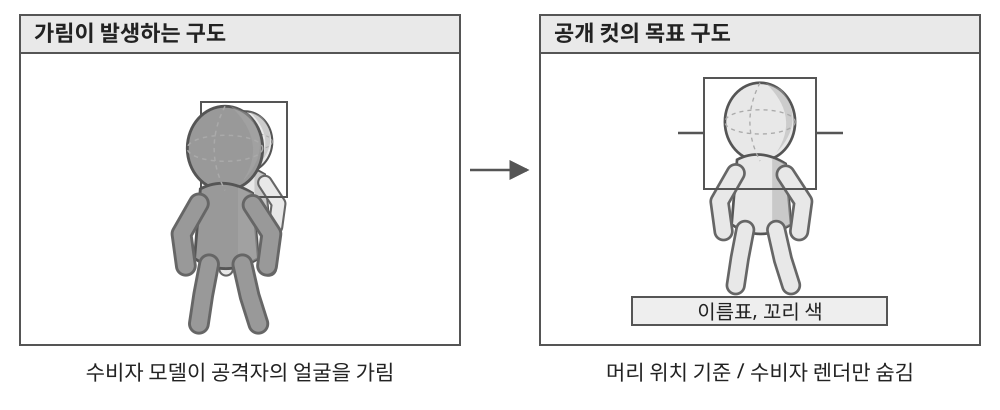

# 2.1 꼬리 잡기 카메라 연출

## ● 연출 목적

- 꼬리가 잡힌 사실을 즉시 전달하고, 일반 이동에서 대결로 시선을 전환.
- 대결 중에는 공격자의 정체를 숨기고, 결과 후 공개 컷에서 얼굴과 이름을 확인하도록 구성.
- 승패 판정은 게임 규칙을 따르며, 카메라는 판정 결과를 전달하는 역할로 한정.

| 단계 | 화면 연출 | 정보 표시 |
| --- | --- | --- |
| 접촉 | 짧은 플래시와 시점 반응 | 꼬리를 잡힌 상황 전달 |
| 대결 진입 | 공격, 수비 역할에 맞는 구도로 전환 | 대결 UI 준비 |
| 대결 | 게이지, 비네팅, 심장박동 사용 | 수비자 화면에서 공격자 얼굴, 이름, 색 정보 숨김 |
| 결과 | 탈취 또는 탈출 판정에 따라 분기 | 결과 화면과 연출의 표시 순서 제어 |
| 정체 공개 | 탈취 성공 시 공격자의 얼굴을 중심으로 구도 전환 | 이름, 꼬리 색 공개 |
| 복귀 | 일반 카메라 또는 결과 화면으로 전환 | 연출 중 적용한 입력 잠금, 숨김 해제 |

## ● 적용 원칙

1. 정체를 가리는 처리는 수비자가 보는 정보에 적용.
2. 공개 컷이 끝나기 전에 결과 패널이 얼굴을 덮지 않도록 표시 시점을 분리.
3. 탈출, 취소 시 정체 공개 없이 일반 화면으로 복귀.
4. 이동, 대결 카메라에는 벽과 장애물의 관통을 막는 충돌 보정 적용.

---

# 2.2 정체 공개 구도 및 예외 처리

## ● 구도 설정

| 항목 | 처리 규칙 |
| --- | --- |
| 시선 기준 | 고정된 월드 높이 대신 실제 모델의 머리, 몸 위치를 기준으로 설정 |
| 화면 범위 | 캐릭터별 크기를 고려해 얼굴이 잘리지 않도록 거리, 구도 보정 |
| 전경 가림 | 수비자 모델이 얼굴을 가리면 공개 컷의 해당 카메라에서만 숨김 |
| 이름, 색 정보 | 정체 공개 시점에 맞춰 표시 |

## ● 종료, 취소 시 복원

| 발생 조건 | 복원 항목 |
| --- | --- |
| 공개 연출 정상 종료 | 일반 시점 또는 결과 화면으로 전환, 입력 잠금 해제 |
| 대결 취소, 중단 | 카메라 제어권과 숨긴 모델 복원 |
| 관련 오브젝트 비활성화 | 연출 상태가 다음 플레이에 남지 않도록 정리 |

## ● 검수 항목

- 대결 도중 얼굴 외의 이름표, 색 정보로 정체가 먼저 드러나지 않는지 확인.
- 서로 다른 키, 외형의 모델에서 얼굴이 화면 안에 들어오는지 확인.
- 이동, 대결 카메라: 벽 근처와 좁은 공간에서 관통 확인.
- 공개 컷: 공격자 얼굴이 전경 모델이나 주변 지형에 가려지는지 확인.
- 정상 종료뿐 아니라 취소, 중단 후에도 입력과 시점이 복원되는지 확인.

## ● 일반 이동 카메라 조정

대결 연출과 별도로, 플레이 화면을 확인한 뒤 달리기 확대 폭을 기존 대비 10% 축소하고 스피드라인 제거. 확대 진입 0.4초, 해제 0.65초로 설정.
