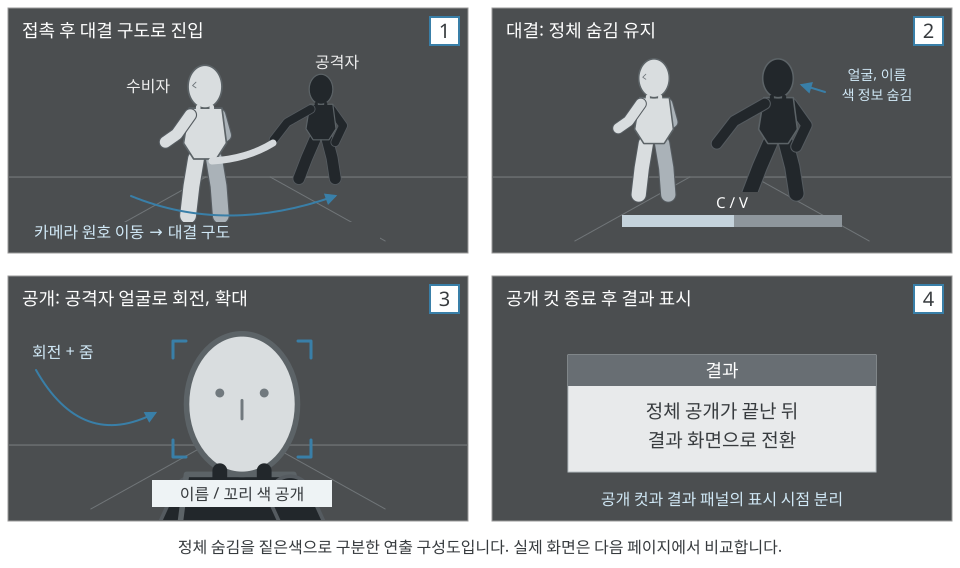
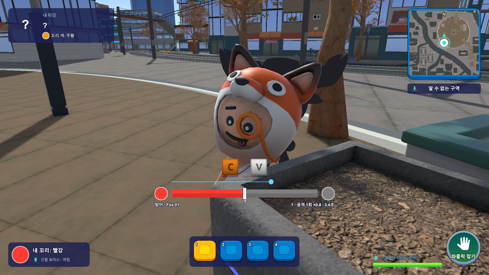
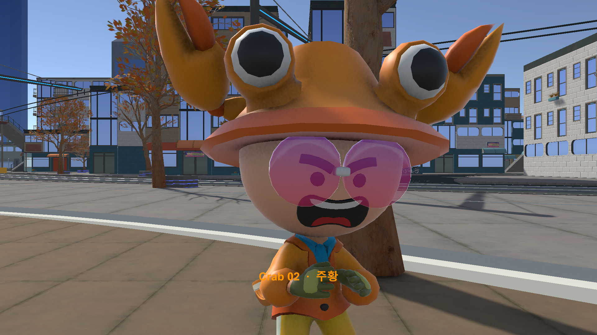

# 2.1 꼬리 잡기 카메라 연출 기획

## ● 연출 목적

- 이 게임에서 수비자가 끝까지 모르는 정보는 **"누가 나를 쫓았는가"**. 카메라 연출은 이 질문의 답을 대결이 끝나는 순간에 돌려주는 장치로 설계.
- 대결 중에는 공격자의 정체를 가려 긴장을 유지하고, 탈취가 확정된 뒤에만 공개.
- 승패 판정은 서버 규칙이 담당. 카메라는 결과를 전달할 뿐 판정, 입력 허용 시간을 바꾸지 않음.

## ● 회전과 확대를 선택한 이유

- **원호 이동:** 두 캐릭터와 꼬리를 한 화면에 담아 대결의 위치 관계를 유지.
- **공격자 화면 확대:** 꼬리를 쥔 손과 허리 쪽으로 접근해 탈취 동작을 강조.
- **수비자 공개 컷:** 공격자 얼굴로 회전, 확대해 얼굴과 이름, 꼬리 색을 함께 확인.

## ● 단계별 시점과 시간

| 단계 | 시간 | 화면 연출 | 정보 표시 |
| --- | --- | --- | --- |
| 접촉 | 0.12초 | 역할별 짧은 전후 반응과 흔들림 | 잡힌 사실만 전달 |
| 대결 진입 | 0.35초 | 원호 이동으로 대결 구도, FOV 전환 | 공격자 정체 숨김 유지 |
| 대결 | 서버 남은 시간 | 게이지에 따라 FOV 변화, 비네팅, 심장박동 | 수비자 화면에서 공격자 정체 숨김, 이름과 색 정보 비공개 |
| 탈취 | 0.6초 | 공격자 화면: 꼬리, 허리 쪽 0.6m 접근, FOV 40° | 결과 패널은 대기 |
| 탈출 | 0.5초 | 공격자 후방 반동, 수비자 FOV 70° | 정체 공개 없음 |
| 정체 공개 | 0.8초 | 수비자 화면: 0.25초 동안 공격자 얼굴로 회전, 확대, FOV 45° | 이름, 꼬리 색 공개. 이후 결과 화면 |
| 복귀 | 탈취 후 공격자 0.4초, 탈출 후 수비자 0.3초 | 일반 추적 시점으로 보간. 정체 공개를 본 수비자는 복귀 없이 결과 화면으로 전환 | 입력 잠금, 숨김 해제 |

---

# 2.2 조정 파라미터 및 실제 보정

## ● 조정 가능 파라미터

| 항목 | 현재 값 | 조정 의도 |
| --- | --- | --- |
| 기본 시점 | 오프셋 (0, 2.5, -2.5), 초기 pitch -15°, FOV 60° | 추격 중 경로와 상대 꼬리를 함께 읽음 |
| 달리기 시점 | 거리 × 1.108, FOV 69°, 진입 0.4초, 해제 0.65초 | 속도감은 주되 조작을 방해하지 않는 폭 |
| 벽 충돌 | 반경 0.2m, 여유 0.04m, 선호 최소 0.8m, 복귀 0.3초 | 좁은 골목에서 벽 너머 정보 노출 방지 |
| 대결 FOV | 공격 48~55°, 수비 55~62° | 게이지 우세, 열세를 화면 폭으로 전달 |
| 공개 구도 | 실제 머리 범위 기준 거리 (최소 0.7m), 화면 높이 약 60% | 캐릭터 크기, 모자와 무관하게 얼굴을 담음 |

## ● 실제 화면에서 발견하고 수정한 문제

<figure><figcaption>대결: 수비자 화면의 C/V 교대 입력과 게이지</figcaption></figure><figure><figcaption>공개: 얼굴, 이름, 꼬리 색 표시</figcaption></figure>

*Unity 에디터 실행 캡처 (2026.10.13).*

| IDX | 발견한 문제 | 수정 내용 |
| --- | --- | --- |
| 1 | 고정 얼굴 높이가 실제 모델보다 높아 얼굴이 화면 아래로 잘림 | 실제 머리, 골반 위치와 머리 범위를 읽어 구도 계산 |
| 2 | 공개 컷에서 잡힌 본인 모델이 공격자 얼굴을 가림 | 해당 카메라의 공개 렌더 중에만 본인 모델을 숨기고 종료, 취소 시 복원 |
| 3 | 결과 패널이 공개 컷을 덮음 | 결과 패널을 공개 컷 종료 뒤에 표시 |
| 4 | 달리기 확대가 과함 | 확대 증가분 10% 축소, 스피드라인 제거 |
| 5 | 달리기 중 급선회 시 화면이 기울어짐 | 일반 이동 시점의 기울기 적용 제거, 수평 유지 |

## ● 확인 범위

- **Unity 실제 실행:** 대결 → 탈취 → 정체 공개 → 결과 화면을 실행하여 정체 숨김, 공개, 결과 패널 지연, 입력과 숨김 복원 확인.
- **상태 검사:** 보행 14, 벽 충돌 11, 연출 단계 33항목 통과. 연출 단계는 시간을 주입한 검사로 실제 재생 시간 검증과 구분.
- **미검증:** 배포 빌드, 두 PC 통신, 모든 캐릭터, 벽 배치에서의 구도, 멀미 등 체감 조정.
