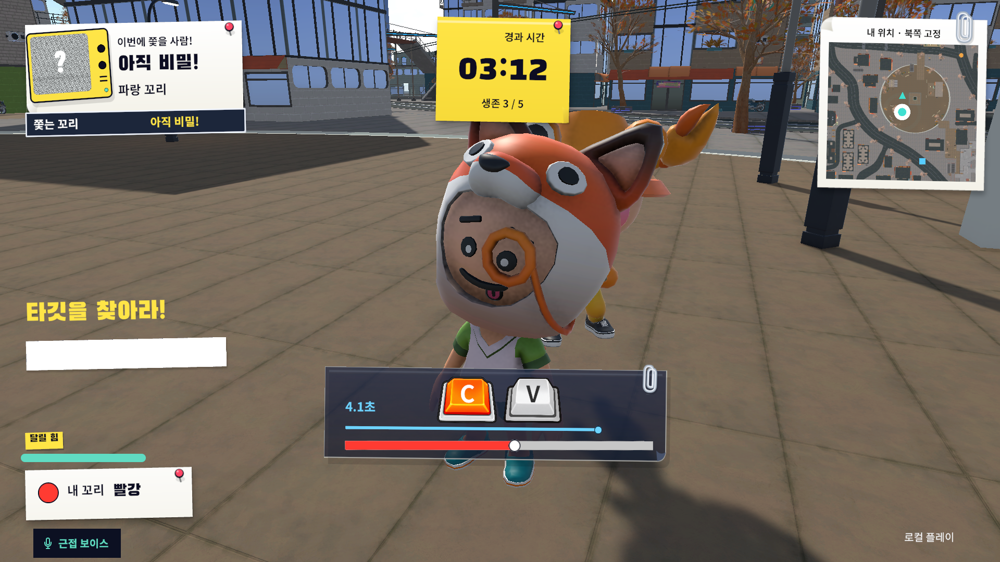
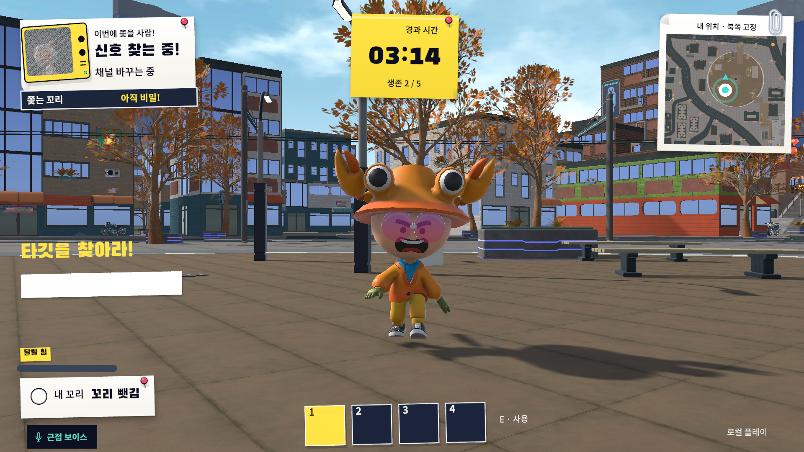

# 카메라 연출_기획 의도와 연출 흐름

## ● 연출 목적

- 대결 중에는 수비자가 자신을 잡은 상대를 쉽게 알아보지 못하도록 공격자의 정체를 가린다. 꼬리를 빼앗긴 뒤 공격자의 얼굴을 보여주며, **누가 자신을 노렸는지 확인하는 순간**을 강조한다.
- 공격자에게는 꼬리를 빼앗는 동작을, 수비자에게는 상대의 정체가 드러나는 장면을 보여준다. 같은 결과라도 각자의 역할에 맞는 화면으로 전달한다.
- 연출은 승패를 보여주는 역할이다. 카메라가 움직이는 동안에도 판정과 입력 규칙은 바뀌지 않는다.

## ● 장면별 구도와 의도

- **대결 구도:** 카메라가 두 캐릭터 주위를 돌며 꼬리를 잡은 모습을 담는다. 누가 잡고 누가 잡혔는지 보여주되, 수비자에게는 공격자의 정체가 드러나지 않도록 한다.
- **공격자 화면:** 꼬리를 쥔 손에 가까이 다가가 꼬리를 빼앗는 동작을 강조한다.
- **수비자 화면:** 포획이 확정되면 공격자의 얼굴 쪽으로 카메라를 돌려 확대한다. 얼굴과 이름, 꼬리 색을 확인한 뒤 결과 화면으로 넘어간다.

## ● 연출 순서

| 단계 | 화면에서 보여줄 내용 | 전환과 표시 기준 |
| --- | --- | --- |
| 접촉 | 짧은 반동으로 꼬리가 잡힌 순간을 알린다. | 약 0.1초 동안 반응을 보여준다. |
| 대결 진입 | 두 캐릭터 주위를 돌며 대결 구도로 전환한다. | 구도가 바뀌는 동안에도 공격자의 정체는 계속 가린다. |
| 대결 | 화면의 폭과 주변 어두워짐, 심장박동으로 대결 상황을 전달한다. | 미니게임이 끝날 때까지 유지한다. |
| 꼬리 탈취 | 공격자 화면에서 손과 꼬리를 가까이 보여준다. | 손과 꼬리를 보여준 뒤 공격자는 추격 화면으로 돌아간다. |
| 정체 공개 | 수비자 화면에서 공격자의 얼굴을 확대하고 이름과 꼬리 색을 공개한다. | 약 0.8초 동안 보여준 뒤 결과 화면으로 전환한다. |
| 탈출 | 공격자가 밀려나는 반응을 보여주고 추격 화면으로 돌아간다. | 다시 도망치거나 쫓을 수 있도록 연결한다. 별도 정체 공개 장면은 없다. |
| 추격 복귀 | 생존한 플레이어는 평소의 추격 시점으로 돌아간다. | 꼬리를 빼앗은 공격자와 탈출한 수비자에게 적용한다. |

---

# 카메라 연출_구현 결과와 개선

## ● 연출 조정 기준

- 기획한 구도를 Unity에 적용한 뒤, 실제 캐릭터와 배경에서 보이는 화면을 기준으로 조정했다.
- **이동 중에는 길과 타깃이 잘 보이는지**, 대결과 정체 공개 장면에서는 **필요한 동작과 얼굴이 가려지지 않는지**를 살폈다.

| 항목 | 조정 방향 | 판단 기준 |
| --- | --- | --- |
| 기본 시점 | 캐릭터 뒤에서 이동 경로와 상대의 꼬리를 함께 담는다. | 추격하면서 길과 타깃을 확인할 수 있는가. |
| 달리기 시점 | 화면 변화의 강도를 줄여 속도감과 조작 편의의 균형을 맞춘다. | 이동과 방향 전환을 방해하지 않는가. |
| 벽 주변 시점 | 벽에 가려지지 않도록 카메라 위치를 조정한다. | 좁은 골목에서 벽 너머가 보이지 않는가. |
| 대결 구도 | 대결의 우세와 열세에 따라 화면의 폭을 바꾼다. | 정체를 가리면서 대결 상황을 전달하는가. |
| 정체 공개 구도 | 캐릭터의 실제 머리 위치와 크기에 맞춰 얼굴을 담는다. | 키나 모자가 달라도 얼굴이 잘 보이는가. |

## ● 발견한 문제와 개선 내용

<figure><figcaption>대결 중 — 수비자에게 공격자의 정체를 숨기는 화면</figcaption></figure><figure><figcaption>포획 후 — 공격자의 얼굴을 공개하는 화면</figcaption></figure>

| 발견한 문제 | 개선 내용 |
| --- | --- |
| 고정된 높이에 맞춘 카메라 때문에 얼굴이 화면 아래로 잘렸다. | 캐릭터의 실제 머리 위치와 크기에 맞춰 얼굴을 담도록 수정했다. |
| 수비자 캐릭터가 공격자의 얼굴을 가렸다. | 정체 공개 장면의 카메라에서만 수비자 캐릭터를 숨기고, 장면이 끝나거나 취소되면 다시 표시했다. |
| 결과 패널이 정체 공개 장면을 덮었다. | 얼굴을 보여주는 장면이 끝난 뒤 결과 패널이 나오도록 순서를 조정했다. |
| 달리기 화면의 확대와 효과가 과했다. | 화면 변화의 강도를 낮추고 속도감을 표현하던 선 효과를 제거했다. |
| 달리며 급하게 방향을 바꾸면 화면이 기울었다. | 일반 이동 카메라의 기울기 효과를 제거해 수평을 유지하도록 했다. |
