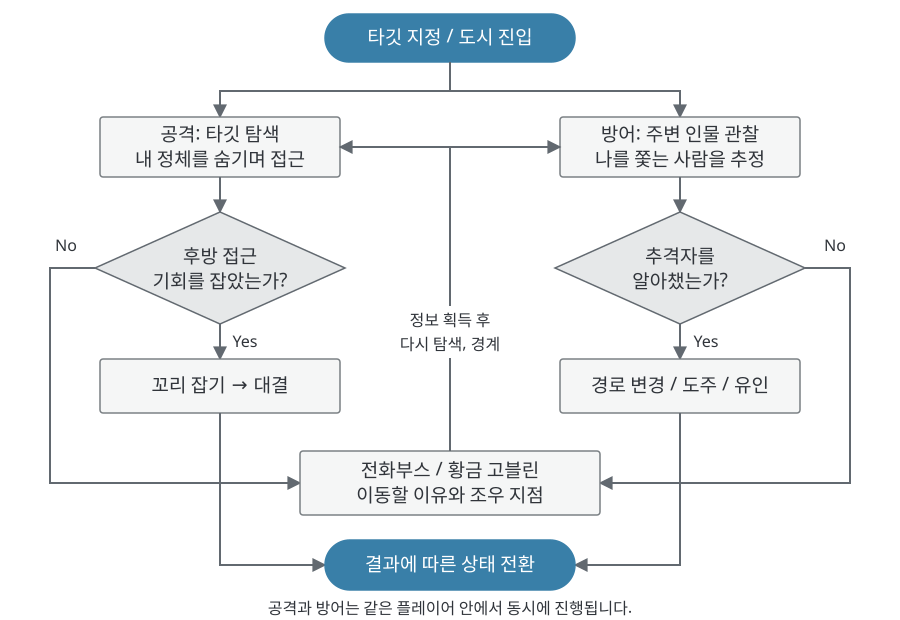
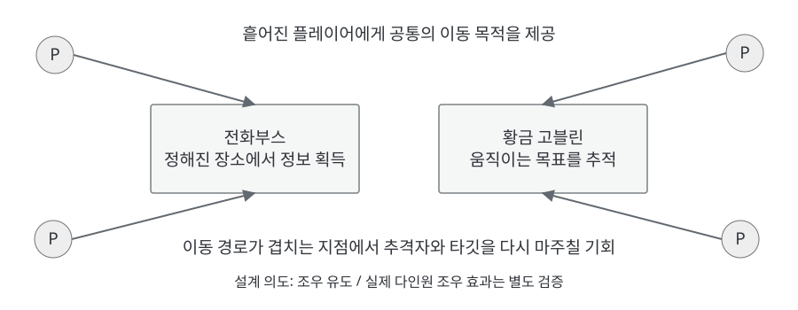

# 1.1 게임 개요

## ● 핵심 한 줄

- **타깃에게는 내 정체를 숨기고, 나를 쫓는 추격자의 단서는 찾아내는** 3D 멀티플레이 소셜 추격 게임.
- 타깃은 시작 시 지정됨. 접근하는 동안 타깃이 나를 추격자로 알아채지 못하게 하는 것이 공격의 과제.
- 나를 쫓는 사람은 모름. 관찰과 이벤트로 추격자의 단서를 모아 먼저 알아채는 것이 방어의 과제.

| 구분 | 내용 |
| --- | --- |
| 플랫폼, 인원 | PC, 6~8인 목표 (빈자리는 봇으로 채우는 구조) |
| 공간 | 광장, 상업 거리, 골목, 실내, 수직 공간을 추격에 맞게 압축한 도시 |
| 관계 | 시작 시 타깃 1명 지정. 모든 플레이어가 누군가의 타깃이 되는 사슬 구조. 탈락 시 앞뒤 재연결 |
| 포획 | 후방 일정 범위에서만 잡기 가능. 잡은 뒤 짧은 대결(C/V 게이지)을 거쳐 탈취 |
| 담당 | 기초 컨셉, 플레이 루프, 시스템 및 카메라 연출 기획 / PM / Unity CLI 기반 AI 구현. 맵, 레벨 디자인 제작은 팀원 담당 |

## ● 핵심 재미

1. **숨기기:** 타깃 근처에서 평범한 행인처럼 움직여 접근 의도를 감추고, 추격을 눈치채기 전에 후방을 확보.
2. **찾아내기:** 주변 인물 중 누가 나를 쫓는지 의심하고, 단서를 모아 먼저 피하거나 역으로 유인.
3. **조작으로 결정:** 심리전의 결과는 후방 접근, 잡기, 대결 입력으로 판가름. 말만으로 승패가 끝나지 않음.

---

# 1.2 플레이 루프 및 화면 정보

## ● 쫓는 루프와 쫓기는 루프

| 루프 | 순서 | 플레이어 판단 |
| --- | --- | --- |
| 공격 | 탐색 → 위장 접근 → 후방 잡기 → 대결 → 탈취 → 다음 타깃 재연결 | 타깃의 위치를 찾되, 접근 경로와 행동으로 정체가 드러나지 않게 함 |
| 방어 | 경계 → 단서 수집 → 추격자 추정 → 도주, 뿌리치기 | 마주친 사람이 추격자인지 판단. 잡힌 뒤에도 대결로 저항 |
| 이벤트 | 알림 → 이동 → 경쟁 → 정보, 포획 | 정보나 고블린을 얻기 위해 한곳에 모이며 노출 위험을 감수 |

두 루프가 한 플레이어 안에서 동시에 돌아가도록 설계. 타깃만 쫓으면 등 뒤가 비고, 추격자만 경계하면 타깃을 놓침.

| IDX | 화면 요소 | 표시 내용 및 기획 의도 |
| --- | --- | --- |
| 1 | 내 타깃 | 타깃의 꼬리 색. 위치는 표시하지 않아 직접 탐색하게 함 |
| 2 | 내 꼬리 상태 | 자신의 꼬리 색. 추격자의 정체는 표시하지 않음 |
| 3 | 미니맵 | 지형 파악, 이벤트 위치와 황금 고블린 아이콘 표시 |
| 4 | 이벤트, 정보 알림 | 전화부스 활성화와 획득한 정보를 짧게 표시 |
| 5 | 아이템 슬롯 | 1~4 선택, E 사용. 능력치 강화가 아닌 추격, 도주 보조 수단 |
| 6 | 대결 입력 | 잡기 성공 후 C/V 교대 입력과 게이지. 수비자 화면에서는 공격자 정체를 숨김 |

## ● 정보 공개 기준

| 정보 | 획득 방법 | 기획 의도 |
| --- | --- | --- |
| 내 타깃의 꼬리 색 | 시작부터 표시 | 공격 측의 과제를 '찾기'와 '들키지 않기'로 집중 |
| 추격자의 정체 | 관찰, 전화부스 정보, 포획 후 공개 컷 | 방어 측의 과제를 단서 추리로 만듦 |
| 실시간 위치 추적 | 제공하지 않음. 이벤트 정보도 '확인 당시 위치'를 5초간 표시 | 좌표 추적 대신 직접 찾아가는 과정을 유지 |

---

# 1.3 사람을 모으는 이벤트

## ● 설계 목적

- 서로를 경계하는 구조는 모두가 숨기만 하는 소극적인 판으로 흐를 위험이 있음.
- 정해진 시점에 가치 있는 목표를 한곳에 두어 **이동할 이유**를 만들고, 그 장소에서 타깃, 추격자와 마주칠 가능성을 만듦.

| 이벤트 | 규칙 (현재 구현 기준) | 모이는 이유와 위험 |
| --- | --- | --- |
| 전화부스 | 라운드 중 주기적으로 활성화, 전원에게 알림과 벨소리. 먼저 통화한 플레이어가 정보 1개 선택 | 추격자 이름, 추격자 위치, 타깃 위치 중 선택 가능. 통화 중에는 이동과 시점이 잠겨 무방비 |
| 황금 고블린 | 라운드 시작 10초 후 무작위 위치에 1마리 등장. 플레이어 달리기의 1.5배 속도로 5~10초마다 목적지 변경 | 미니맵에 전원에게 표시되어 추적 경로가 겹침. 손전등 기절 후 포획 가능 |

| 조정 가능 값 | 현재 값 | 비고 |
| --- | --- | --- |
| 전화부스 첫 활성, 주기, 지속 | 10초, 45초, 25초 | UI 프로토타입에서 가져온 초기값. 확정 수치 아님 |
| 정보 표시 시간 | 5초 | 위치는 확인 당시 지점만 표시 |
| 고블린 등장, 속도 | 10초, 달리기 × 1.5 (약 9m/s) | 카운트다운 제외 |
| 고블린 잡기 여유 반경 | 0.25m | Inspector에서 조정 |

## ● 확인 범위

- **Unity 로컬 실행에서 확인:** 고블린 등장 시점, 이동, 미니맵 아이콘 추적과 포획 후 숨김, 손전등 기절과 기절 중 포획.
- **미구현:** 고블린 포획 보상과 라운드 승패 연결. 현재는 포획 이펙트 후 제거만 연결.
- **미검증:** 실제 6~8인 플레이에서 이벤트가 조우와 추격을 늘리는지. 두 PC 접속, 배포 빌드 검증도 남아 있음.
