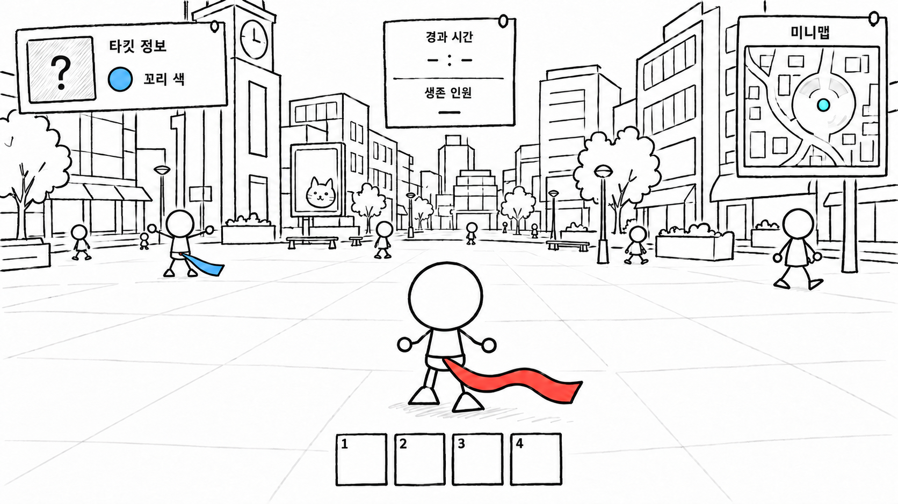
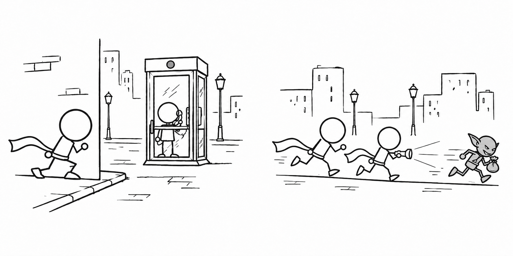

# 컨셉 기획_게임 개요와 핵심 재미

## ● 게임 소개

| 항목 | 내용 |
| --- | --- |
| 장르 | 도시를 배경으로 타깃에게 접근해 꼬리를 빼앗는 3D 소셜 추격 게임. |
| 플레이 구조 | 각 플레이어가 지정된 타깃을 쫓는 동시에, 자신을 쫓는 상대를 경계한다. |
| 기본 규칙 | 타깃의 꼬리를 빼앗으면 타깃이 탈락하고, 내 꼬리를 빼앗기면 내가 탈락한다. 꼬리를 잡는 순간 저항 미니게임이 시작되며, 대결에서 이겨야 꼬리를 빼앗을 수 있다. |
| 플랫폼과 인원 | PC, 6~12인 멀티플레이 목표. |
| 공간 | 광장, 거리, 골목과 실내가 연결된 도시에서 상대를 찾고 접근한다. |

캐릭터 뒤에서 도시를 바라보는 3인칭 시점. 타깃의 꼬리 색을 단서로 상대를 찾으며 주변을 경계한다.

## ● 핵심 재미

- **쫓으면서 쫓기는 긴장감:** 타깃만 쫓으면 자신에게 접근하는 상대를 놓칠 수 있고, 경계만 하면 타깃을 잡을 기회를 놓칠 수 있다. 두 상황을 함께 판단하도록 한다.
- **접근과 추리의 심리전:** 타깃에게는 접근 의도를 들키지 않아야 한다. 동시에 주변 인물의 움직임과 이벤트에서 얻은 정보로 누가 나를 쫓는지 판단한다.
- **잡힌 뒤의 저항:** 꼬리를 잡힌 상황에서도 미니게임으로 뿌리칠 기회를 준다. 한 번 잡혔다고 바로 탈락하지 않도록 한다.
- **위험을 감수하는 선택:** 정보를 얻거나 공통 목표를 쫓기 위해 움직일 때도 꼬리를 지켜야 한다. 얻을 기회와 주변의 위험을 함께 판단하도록 한다.

## ● 추격 관계

- 플레이어마다 타깃이 한 명씩 정해지며, 자신도 다른 누군가의 타깃이 된다. 모든 플레이어가 같은 관계로 연결된다.
- 아래 그림은 한 명을 기준으로 본 관계다. 왼쪽과 오른쪽 인물도 각각 자신의 타깃을 쫓으면서 다른 플레이어에게 쫓긴다.

플레이어 한 명을 기준으로 본 관계

<strong>나를 쫓는 사람</strong><small>처음에는 누구인지 모름</small>

나를 쫓음

<strong>나</strong><small>쫓으면서 쫓김</small>

내가 쫓음

<strong>내 타깃</strong><small>꼬리 색을 알고 찾음</small>

| 정보 구분 | 제공 내용과 의도 |
| --- | --- |
| 시작 정보 | 타깃의 꼬리 색을 알려준다. 타깃의 위치와 자신을 쫓는 사람의 정체는 처음부터 알려주지 않아, 직접 찾고 경계하게 한다. |
| 추가 정보 | 전화부스에서 추격자 이름, 추격자 위치, 타깃 위치 중 하나를 확인한다. 지금 필요한 정보를 선택해 추격과 경계에 활용한다. |

---

# 컨셉 기획_플레이 루프

## ● 플레이 루프

- **탐색과 경계는 동시에 진행한다.** 타깃을 찾고 접근하는 동안에도 자신을 쫓는 사람의 움직임을 살핀다.
- 타깃의 꼬리를 잡거나 자신의 꼬리를 잡히면 저항 미니게임에 들어간다. 같은 플레이어라도 상황에 따라 잡는 쪽과 잡히는 쪽이 바뀐다.
- **타깃 승계:** QTE에서 승리해 포획과 상대의 탈락이 확정되면, 탈락한 상대가 쫓던 대상을 다음 타깃으로 이어받는다.
- **배틀로얄 규칙:** 생존자가 줄어 마지막 두 명이 남으면 서로를 타깃으로 겨룬다. 상대를 포획해 최후의 1인이 된 플레이어가 승리한다.

| 단계 | 플레이어 행동 |
| --- | --- |
| 탐색 | 제공된 꼬리 색을 바탕으로 도시에서 타깃을 찾는다. |
| 접근 | 접근 의도를 들키지 않도록 움직이며 타깃의 뒤로 돌아갈 기회를 찾는다. |
| 꼬리 잡기 | 타깃의 후방에서 꼬리를 잡는다. 잡기가 성립하면 두 플레이어의 미니게임이 시작된다. |

## ● 저항 미니게임과 대결 결과

- 꼬리를 잡으면 두 플레이어가 **C와 V를 번갈아 누르는 QTE 입력 대결**을 시작한다. 최대 5초 동안 입력하며, 각자의 입력으로 우세 게이지를 자기 쪽으로 밀어낸다.
- **포획:** 잡은 쪽이 이기면 상대의 꼬리를 빼앗아 탈락시킨다. **탈출:** 잡힌 쪽이 이기면 잡기를 뿌리치고 다시 도망친다.
- 아래의 **추격자**는 이번 대결에서 꼬리를 잡은 플레이어다. 같은 플레이어도 상황에 따라 잡히는 쪽이 될 수 있다.

<svg viewBox="0 0 800 370" xmlns="http://www.w3.org/2000/svg" aria-hidden="true">
<defs><marker id="retry-arrow" viewBox="0 0 10 10" refX="9" refY="5" markerWidth="6" markerHeight="6" orient="auto"><path d="M0 0L10 5L0 10Z" fill="#555"/></marker></defs>
<g fill="none" stroke="#555" stroke-width="1.8" marker-end="url(#retry-arrow)"><path d="M360 52V84"/><path d="M360 126V154"/><path d="M260 194H160V270"/><path d="M460 194H600V270"/><path d="M725 312H776V31H470"/></g>
<g fill="#f4f4f4" stroke="#929292" stroke-width="1"><rect x="250" y="10" width="220" height="42" rx="21" fill="#3d7ea6" stroke="#3d7ea6"/><rect x="250" y="84" width="220" height="42" fill="#e1e1e1"/><path d="M360 154L460 194L360 234L260 194Z" fill="#e4e4e4"/><rect x="35" y="270" width="250" height="85" rx="42.5" fill="#3d7ea6" stroke="#3d7ea6"/><rect x="475" y="270" width="250" height="85" rx="42.5" fill="#3d7ea6" stroke="#3d7ea6"/></g>
<g fill="#262626" text-anchor="middle" font-family="P,sans-serif" font-size="14">
<text x="360" y="37" fill="#fff" font-weight="700" font-size="17">꼬리 잡기</text><text x="360" y="111" font-weight="700" font-size="17">저항 미니게임</text>
<text x="360" y="200" font-weight="700" font-size="16">추격자 승리?</text><text x="210" y="182">Yes</text><text x="525" y="182">No</text>
<text x="160" y="295" fill="#fff" font-weight="700" font-size="17">포획</text><text x="160" y="319" fill="#fff">꼬리 탈취, 잡힌 플레이어 탈락</text><text x="160" y="341" fill="#fff">탈락자가 쫓던 대상을 다음 타깃으로</text>
<text x="600" y="295" fill="#fff" font-weight="700" font-size="17">탈출</text><text x="600" y="319" fill="#fff">잡힌 꼬리를 뿌리치고 도주</text><text x="600" y="341" fill="#fff">기존 추격 관계 유지</text>
<text x="620" y="66" font-weight="700">재추격 → 다시 꼬리 잡기</text>
</g></svg>

## ● 반복 대결 규칙과 기획 의도

- **탈출 후 재추격:** 잡힌 쪽이 뿌리치면 기존 추격 관계를 유지한다. 다시 쫓아가 꼬리를 잡으면 미니게임에 재진입한다.
- **시도 누적:** 한 판 안에서 같은 타깃에 대한 대결 횟수에 따라 공격 입력에 이점을 준다. 미니게임 1회를 한 라운드로 정의하며, 진입할 때마다 시도를 1회로 센다. 세 번째 진입부터는 같은 배율을 유지한다. 상대가 탈출해도 누적하며, 포획에 성공해 타깃이 바뀌면 초기화한다.
- **기획 의도:** 잡힌 쪽에는 만회할 기회를 주면서도, 반복 대결에서는 포획 가능성을 높여 추격이 끝없이 이어지지 않도록 한다.
- **정체 공개:** 대결 중에는 잡힌 쪽의 화면에서 공격자의 정체를 감춘다. 포획이 확정되면 공격자의 얼굴을 보여 준다.

---

# 컨셉 기획_도시 이벤트

## ● 이벤트 기획 의도

- 넓은 도시에서 모두가 서로를 경계하며 숨어 있으면 추격이 멈출 수 있다.
- 정보를 얻는 이벤트, 특수 아이템을 지급하는 이벤트 등으로 이동을 유도한다. 같은 장소나 경로에서 타깃 또는 자신을 쫓는 상대와 마주칠 기회를 만든다.
- 공통 목표에 관심을 갖는 동안에도 자신의 꼬리를 지켜야 한다. 이벤트 참여와 주변 경계를 함께 판단하게 한다.

## ● 전화부스

- **이벤트 개요:** 도시의 전화부스에 들어가 통화하면, 자신을 쫓는 사람이나 타깃에 관한 정보를 얻는 이벤트다. 정보를 얻는 동안에는 움직일 수 없어 주변의 공격에 노출된다.
- **진행:** 활성화 시 알림과 벨소리로 모두에게 알려준다. 먼저 통화한 플레이어가 필요한 정보 하나를 선택한다.

| 선택 정보 | 활용 목적 |
| --- | --- |
| 추격자 이름 | 주변에서 보았던 인물과 비교해 누가 자신을 쫓는지 확인한다. |
| 추격자 위치 | 자신에게 접근하는 상대의 위치를 확인해 피할 방향을 판단한다. |
| 타깃 위치 | 타깃을 찾지 못했을 때 접근할 방향을 정한다. |

- **위험:** 알림은 자신을 쫓는 상대에게도 전달된다. 통화 중에는 이동과 시점이 잠겨 주변을 살피거나 피할 수 없다.
- **의도:** 정보가 필요한 플레이어와 그 틈을 노리는 플레이어가 한곳에서 마주칠 기회를 만든다.

## ● 황금 고블린

- **이벤트 개요:** 도시를 돌아다니는 황금 고블린을 붙잡아 특수 아이템 보상을 얻는 이벤트다. 여러 플레이어가 같은 고블린을 쫓으며, 서로 마주치고 기습할 기회가 생기도록 한다.
- **진행:** 목적지를 바꾸며 도시를 이동한다. 모든 플레이어의 미니맵에 아이콘으로 표시되며, 손전등으로 기절시킨 뒤 붙잡을 수 있다.
- **의도:** 특수 아이템 보상을 얻기 위해 위험을 감수하는 선택을 의도한다. 서로 다른 타깃을 쫓던 플레이어가 고블린을 따라 움직이며 마주칠 기회를 만들고자 한다.
- **위험:** 고블린에 집중하는 동안 다른 플레이어에게 꼬리를 잡힐 수 있다. 목표를 따라갈지, 주변을 경계할지 함께 판단한다.
