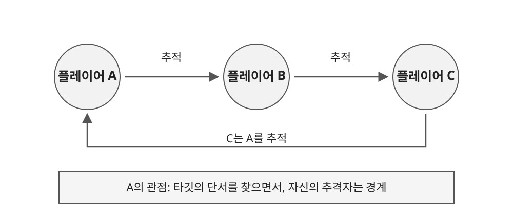
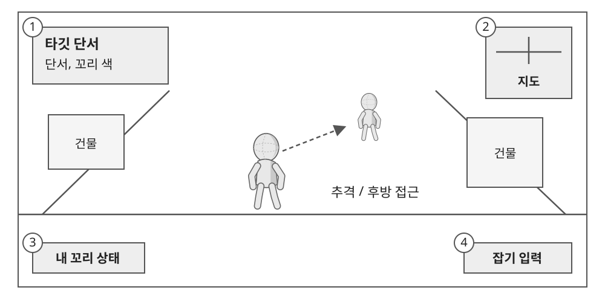

# 1.1 게임 개요

## ● 도시형 꼬리잡기

- 지정된 타깃을 찾아 후방으로 접근하고, 꼬리 탈취를 시도하는 3D 소셜 추격 게임.
- 모든 플레이어는 누군가를 추적하는 동시에 다른 플레이어의 타깃이 됨.
- 타깃의 단서를 찾는 행동과 자신의 정체를 숨기는 행동이 함께 발생하도록 설계.

| 구분 | 내용 |
| --- | --- |
| 플랫폼 | PC |
| 플레이 인원 | 6~8인 목표 |
| 주요 공간 | 골목, 계단, 건물 등 시야와 이동 경로가 교차하는 도시 |
| 목표 행동 | 타깃 탐색 → 후방 접근 → 꼬리 잡기 → 대결 → 탈취 |
| 방어 행동 | 주변 경계 → 추격자 발견 → 도주 → 잡힌 뒤 저항 |

## ● 핵심 재미와 범위

1. 타깃을 찾는 동안 자신의 추격자도 경계하도록 하여, 이동 중에도 주변 인물을 관찰하게 함.
2. 꼬리가 잡힌 뒤 대결 단계를 두어 접촉만으로 승패가 끝나지 않도록 함.
3. 체력, 무기, 자기장 중심의 난전보다 탐색, 속임수, 추격에 집중.

---

# 1.2 플레이 화면 및 정보 구조

| IDX | 구분 | 표시 내용 및 동작 |
| --- | --- | --- |
| 1 | 타깃 정보 | 현재 확보한 타깃 단서를 표시. 확인되지 않은 정체는 숨김 |
| 2 | 지도 | 주변 공간과 이동 경로 파악에 사용 |
| 3 | 내 꼬리 상태 | 자신의 꼬리 색 등 현재 상태를 표시 |
| 4 | 잡기 입력 | 후방 접근 후 꼬리 잡기를 시도하는 입력 영역 |

## ● 정보 획득과 위험

| 요소 | 플레이어 선택 | 기획 의도 |
| --- | --- | --- |
| 제한된 타깃 정보 | 관찰, 이벤트로 단서 확보 | 좌표를 따라가는 이동보다 탐색과 판단을 유도 |
| 전화부스 | 정보 보상을 위해 정해진 장소로 이동 | 정보 획득과 위치 노출의 위험을 함께 제공 |
| 대결 | 꼬리가 잡힌 뒤에도 저항 | 추격의 마지막 순간에 긴장과 대응 기회 제공 |

## ● 플레이테스트 확인 항목

- 정보 보상이 이동의 이유가 되는가?
- 전화부스 주변에서 추격, 협상, 기습이 발생하는가?
- 새로운 기능이 타깃 탐색과 꼬리 탈취를 돕는가?
