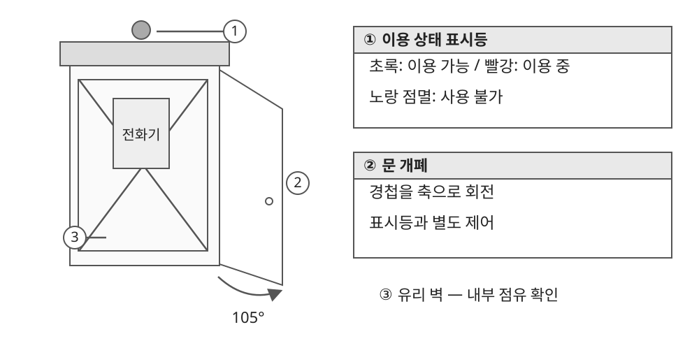
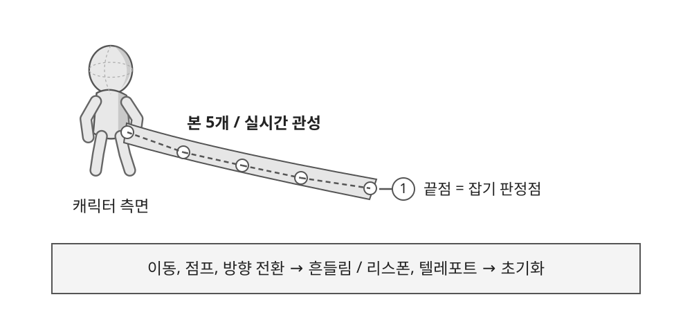

# 4.1 전화부스 오브젝트 기획

## ● 기능 개요

- 정보 획득을 위해 접근하는 장소로, 이용 상태를 멀리서 구분할 수 있도록 표시등 사용.
- 내부 점유 여부를 확인할 수 있는 유리 벽과 출입문으로 구성.
- 문 개폐와 표시등은 별도로 제어하여 게임의 상태 변경에 대응.

| 구분 | 표현, 동작 | 처리 기준 |
| --- | --- | --- |
| 이용 가능 | 초록 표시등 | 진입 가능한 상태를 전달 |
| 이용 중 | 빨강 표시등 | 내부 점유 상태와 연동 |
| 사용 불가 | 노랑 점멸 | 이용 가능, 이용 중과 구분 |
| 문 열기 | 경첩을 기준으로 105° 회전 | 문과 본체의 기준축 일치 |
| 도중 반전 | 열기, 닫기 입력 전환 | 진행 중인 각도에서 자연스럽게 전환 |
| 여러 부스 | 상태를 개별 관리 | 한 부스의 조작이 다른 부스에 영향을 주지 않음 |

## ● 적용 범위 및 검수

- 시험 씬: 문 개폐, 내부 점유, 초록/빨강 표시 연동 확인.
- 본게임 정보 조회 이벤트 연결은 별도 작업으로 구분.
- 문 회전축, 재질, 반복 조작, 여러 인스턴스의 독립 동작 확인.

---

# 4.2 꼬리 오브젝트 기획

## ● 기능 개요

- 캐릭터 뒤에서 위치가 읽히는 한 가닥 머플러 형태.
- 플레이어 색상으로 구분하며, 머플러 끝과 실제 잡기 판정 위치를 연결.
- 고정 키프레임 재생 대신 이동 변화에 반응하는 실시간 관성 사용.

| 항목 | 처리 규칙 |
| --- | --- |
| 구조 | 본 5개로 구성하여 연속적인 흔들림 표현 |
| 색상 | 흰 공통 바탕에 플레이어별 색상 적용 |
| 이동, 점프, 방향 전환 | 캐릭터의 움직임 변화에 따라 관성 반응 |
| 구르기 시작, 종료 | 해당 상태를 꼬리 제어에 전달 |
| 리스폰, 텔레포트, 재사용 | 이전 위치의 흔들림을 초기화 |
| 잡기 판정 | 머플러 끝의 위치와 판정점 일치 |

## ● 조정 기준

1. 과도한 흔들림은 강성과 감쇠를 조정하여 줄임.
2. 정지 후 안정되는 시간과 급전환 시 꺾임을 함께 확인.
3. 플레이어와 봇 모두 같은 색상, 상태 전달 규칙 적용.
4. 원거리 카메라에서도 꼬리의 위치와 색을 식별할 수 있는지 확인.
