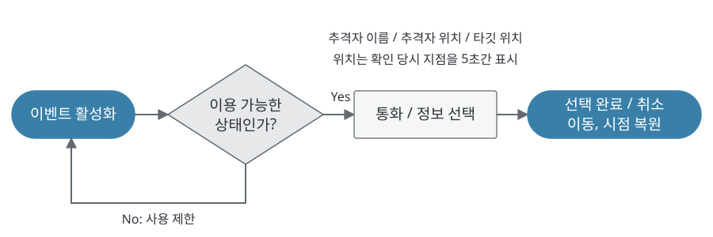
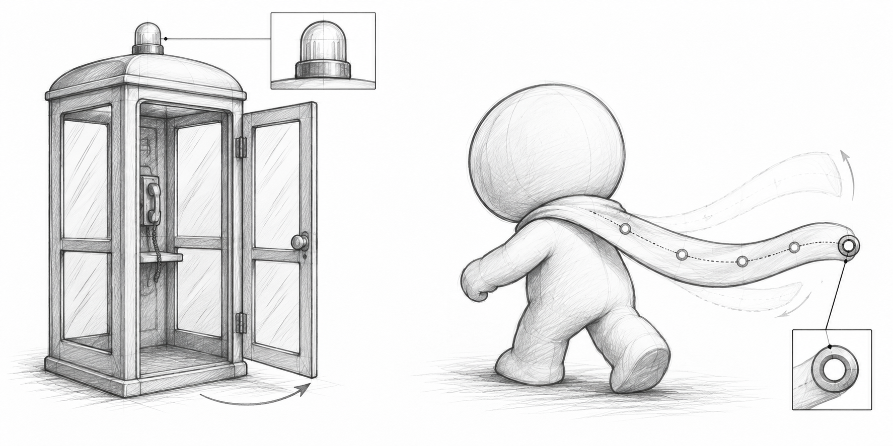
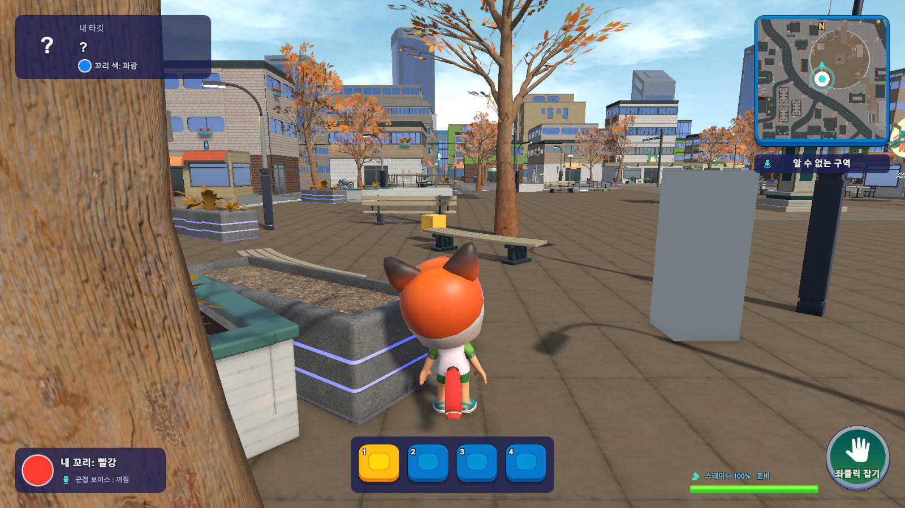

# 4.1 전화부스 기획

## ● 기획 의도

- 추격자 정보를 얻을 수 있는 장소. 정보가 가치 있는 만큼, 사용 중에는 움직일 수 없게 하여 위험을 함께 줌.
- 활성화를 전원에게 알려 여러 플레이어가 한곳으로 모이게 하고, 그 주변에서 추격, 기습, 눈치 싸움이 생기도록 의도.

| 단계 | 처리 규칙 | 조정 값 |
| --- | --- | --- |
| 활성화 | 라운드 중 자동 활성화, 화면 알림과 벨소리 | 첫 10초, 주기 45초, 지속 25초 (초기값) |
| 사용 조건 | 탈락, 유령, 대결 중, 넉백, 기절, 탑승 중에는 사용 불가 | |
| 통화 | 이동과 시점 잠금. 취소 시 원래 상태로 복원 | |
| 정보 선택 | 추격자 이름, 추격자 위치, 타깃 위치 중 1개 | 위치는 확인 당시 지점을 5초간 표시 |

## ● 오브젝트 설계

*설명용 스케치. 꼬리 끝의 원은 판정 기준 위치를 나타내며, 현재 판정은 4.2의 본 사슬 전체를 사용.*

| 구분 | 표현, 동작 | 기획 의도 |
| --- | --- | --- |
| 표시등 | 초록 이용 가능, 빨강 이용 중. Blender 시안에는 고장 표시용 노랑 점멸도 포함 | 멀리서도 부스 상태와 점유 여부를 구분 |
| 문 | 경첩 기준 105° 회전, 열고 닫는 도중 반전 가능 | 들어가는 행동 자체가 노출로 보이게 함 |
| 유리 벽 | 내부 점유자가 밖에서 보임 | 통화 중인 사람이 기습 대상이 됨 |
| 독립 제어 | 문과 표시등, 부스별 상태를 따로 관리 | 여러 부스 배치에 대응 |

*확인 범위: Blender로 제작한 부스는 Unity 시험 씬에서 문 개폐, 내부 점유에 따른 초록, 빨강 표시를 확인. 본게임 정보 이벤트는 별도 부스 모델로 동작하며, 새 부스의 본게임 적용은 미완료. 텍스처 일부는 AnimeCity 에셋을 가공해 사용.*

---

# 4.2 꼬리 (머플러) 설계

## ● 형태와 관성

- 잡아야 하는 대상이므로 뒤에서 위치와 움직임이 바로 읽혀야 함. 허리 머플러, 풍선 등 형태 비교 후 한 가닥 머플러로 결정.
- 키프레임 재생은 입력이 바뀔 때마다 어색해져, 본 5개에 실시간 관성을 계산하는 방식으로 전환.

| 항목 | 처리 규칙, 값 |
| --- | --- |
| 색상 | 흰 공통 바탕에 플레이어별 색 적용 |
| 관성 | 이동, 점프, 방향 전환에 반응. 구르기 시작, 종료 전달. 리스폰, 텔레포트 시 흔들림 초기화 |
| 조정 | 과한 팔랑거림 확인 후 강성 85→140, 감쇠 7→20. 최대 각도 85° 유지 |
| 잡기 판정 | 관성으로 움직이는 본 사슬을 따라 판정 캡슐을 연결. 허리 쪽 35% 제외, 여유 반경 0.15m |

*확인: 관성은 30, 60, 120fps에서 달리기, 회전, 점프, 구르기, 텔레포트 검사 통과. 캡슐 판정은 사슬 중간 접촉, 굽힌 뒤 새 위치, 벽 차단을 Unity에서 별도 확인. 실제 플레이어가 직접 조작한 전체 플레이 검증은 별도.*

## ● 확인한 문제와 수정

| 확인한 문제 | 조정한 내용 |
| --- | --- |
| 이동과 회전에서 머플러가 과하게 팔랑거림 | 강성과 감쇠를 높여 반응을 정리하고, 순간 이동 후에는 관성을 초기화 |
| 끝점만으로는 움직이는 꼬리의 중간 접촉을 표현하기 어려움 | 본 사슬을 따른 연속 캡슐 판정으로 변경. 중간 접촉, 굽힌 뒤 위치, 벽 차단 확인 |

*초기 형태 후보 영상과 최종 한 가닥 머플러의 적용 화면은 서로 다른 제작 단계.*
