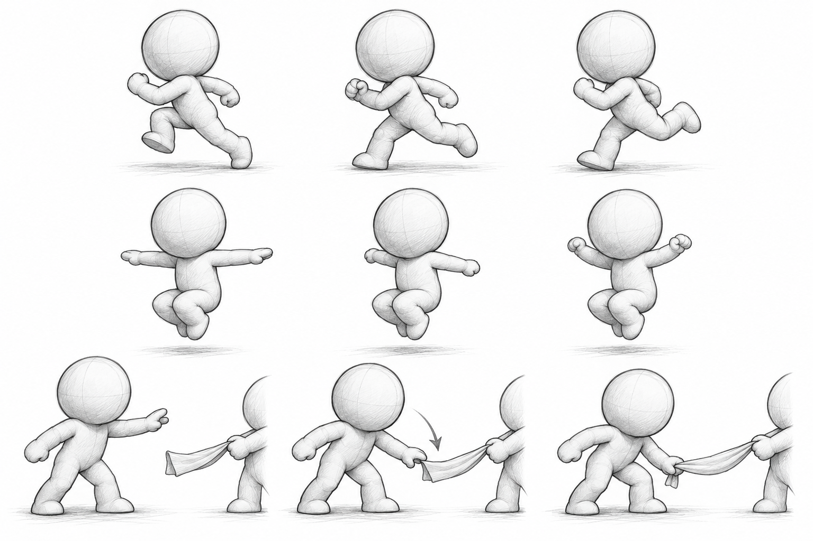

# 3.1 캐릭터 모션 기획

## ● 기획 의도

- 캐릭터를 뒤에서 보며 쫓는 게임. 작은 캐릭터라도 팔, 다리의 움직임으로 달리기, 점프, 잡기가 즉시 구분되어야 함.
- 구매 에셋(Cute Characters Modular Animated Pack)의 모델, 리그, 기본 모션을 기반으로, 플레이에 필요한 부위만 AI 에이전트에 지시하여 수정.
- 실제 이동은 게임 코드가 담당. 애니메이션은 제자리 재생으로 제작하여 이동 거리와 중복되지 않게 함.

*위부터 달리기 주기, 점프 팔 후보, 위에서 아래로 낚아채는 잡기. 기획 설명용 스케치.*

## ● 유지한 부분과 바꾼 부분

| 동작 | 유지 | 변경 |
| --- | --- | --- |
| 걷기 | 에셋 원본 걷기 | 전진 이동 제거, 바닥 높이, 루프 끝 정렬만 수정. 새로 만든 걷기보다 원본이 낫다고 판단 |
| 달리기 | 리그, 메시 | 어깨와 골반의 반대 회전, 넓은 보폭, 몸에서 떨어진 팔 흔들기, 높은 무릎과 뒤꿈치 회수. 주기 0.4초 |
| 점프 | 에셋 점프의 시작, 공중, 착지 자세와 궤적 | 상승 중 팔의 작은 흔들림, 하강 중 다리 흔들림, 한쪽 팔을 뒤로 15° |
| 꼬리 잡기 | 에셋 펀치의 타이밍(30fps, 24프레임)과 손 쥐기 | 오른팔, 오른 전완 곡선만 수정해 수평 휘두르기를 위→아래 낚아채기로 변경 |

## ● 상태 흐름과 게임 파라미터

| 상태 | 전환 조건 | 값 |
| --- | --- | --- |
| 대기, 걷기, 달리기 | 실제 수평 속도로 블렌드 | 0 / 3.5 / 6.0m/s |
| 점프 | 수직 속도와 접지 여부로 시작, 상승, 하강, 착지 선택 | 4단계 |
| 꼬리 잡기 | 입력 시 재생, 접촉 시점에 거리, 각도, 장애물을 다시 판정 | 약 0.767초 클립, 판정 15프레임(0.5초) |
| 취소 | 탈락, 탑승, 대결, 라운드 종료 시 예약된 판정 취소 | 판정과 모션 시점 불일치 방지 |

---

# 3.2 레퍼런스 선택 및 검수

## ● 레퍼런스 선택

*참고 화면: [마리오 달리기 영상 14~19초](https://youtu.be/TW4las8Pl94?t=14). 오른쪽은 캐릭터 부분 확대.*

| 단계 | 레퍼런스 | 판단 |
| --- | --- | --- |
| 자세 실험 | 마리오 영상 14~19초 | 약 15.7초를 기준으로 가속 전후 팔 모양이 다름. 첫 시안은 가속 후의 접은 팔로 해석되어, 가속 전의 펼친 팔로 정정 요청. 하체와 0.467초 주기는 유지. Blender 실험으로 종료 |
| 최종 달리기 | [다른 영상 314~326초](https://youtu.be/SBw43XmHzg0?t=314) | 4후보(A 0.533초, B 0.667초, C 0.4초, D 0.533초) 제작. 어깨 움직임, 보폭 부족으로 재요청 후 C 선택 |
| 점프 | 에셋 원본 점프 | 직접 만든 달리기 점프는 기각. 속도, 궤적, 다리를 고정하고 팔 4안 비교 후 C 선택 |
| 잡기 | 에셋 원본 펀치 | 신규 손 휘두르기, 투수형 전신 동작을 거쳐 원본 펀치의 팔 궤적 수정안 채택 |

## ● 비교 조건과 수정 기록

1. 원본 액션은 보존하고 버전마다 별도 작업 파일에서 수정.
2. 후보 비교 시 수정하지 않는 부위(하체, 속도, 궤적)를 고정하고 정면, 측면, 후면을 함께 확인.
3. 매 시안에서 발 최저 높이(바닥 관통)와 루프 시작, 끝 자세 차이를 수치로 확인.
4. 달리기 C안이 끊겨 보인 문제는 속도 문제가 아님. 미리보기 범위가 12프레임 주기를 중간에 자르고 있어 재생 범위만 수정.

## ● Unity 적용 검수

| 확인한 문제 | 조치와 확인 결과 |
| --- | --- |
| Unity에서 승인 자세와 다르게 보임 | Humanoid 리타게팅이 메시를 최대 7.5~12.5cm 변형한 것을 확인. Generic 리그로 다시 반출. 표본 16자세 정점 비교 최대 0.328mm |
| 기존 Animator와의 연결 | 기존 Humanoid Animator를 유지하고 Generic 보조 리그의 자세만 전달. 캐릭터 5종 표본 자세에서 본 일치 확인 |
| 실제 플레이 | Unity 실행에서 걷기 3.5m/s, 달리기 6.0m/s, 점프 4단계, 잡기 재생 확인 |
| 잡기 부분 수정 | 오른팔 사슬 외 모든 본의 변환 차이 0 확인 |

*표본 자세 비교이며 모든 프레임의 일치를 보장하지 않음. 영상 관찰을 자세 설계에 활용한 것으로 모션 캡처가 아님.*
